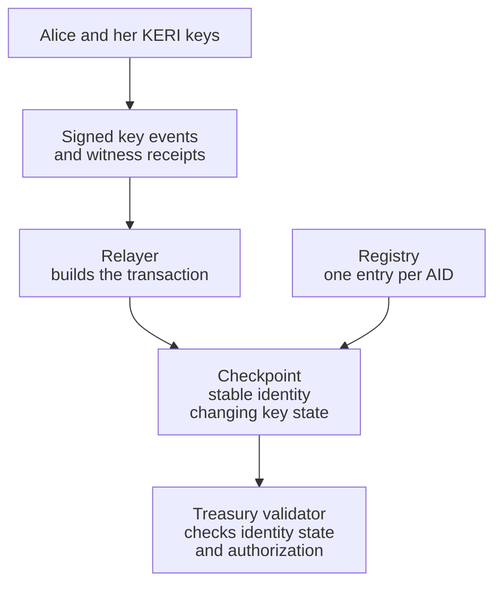

# Follow one identity

Alice wants a treasury to recognize her identity after she replaces her keys.
Her KERI **AID** (Autonomic Identifier) stays the same; her signed **key event
log** records which keys may act for it. Cardano holds a **checkpoint** of that
key state. The treasury reads the checkpoint when deciding whether to accept
Alice's authorization.

This chapter follows that one identity through four runnable examples. Each
starts with a guarantee, states its conditions, then shows the successful and
refused outcomes. The implementation responsibilities and evidence limits sit
beside the claim they qualify.

!!! info "What you are playing"
    These are simulations of the **accepted current design**, not commands against
    the deployed V1 contracts. The checkpoint model represents evidence as facts;
    it does not check real signatures, CESR encodings or witness receipts. The
    registry model executes the pinned generic economic booking, fold and recovery
    judgments on complete model transactions. It does not submit Cardano transactions. See the
    [architecture overview](overview.md) for the explicit V1/current-design distinction and
    the [deployment guide](../user/m1-preprod-deployment.md) for deployed behavior.

## The parts Alice depends on



KERI supplies the evidence; a relayer carries it to Cardano. The checkpoint
validator and reference observers enforce the transaction rules. An off-chain
follower helps locate the current output. The treasury's validator checks that
output and its own authorization rule; finding an output through an indexer does
not make it authoritative.

The two simulators give separate views of this architecture. The checkpoint
simulator focuses on one identity's lifecycle and money. The registry simulator
focuses on the shared registration boundary. Loading one does not transfer state
to the other.

## What registration guarantees

**In the registry model, a successful first registration creates one registry
entry and its matching checkpoint together. A second registration of the same
AID is refused.** This guarantee depends on valid inception evidence, shown when the
request is booked, an absent registry key and a successful fold. A booked
request has shown its evidence and establishes neither of the other two.

| Moment | What is established | What is still absent |
|---|---|---|
| Alice fixes her KERI inception | The inception determines the AID. Witness receipts concern this event. | A registry entry and checkpoint NFT need not exist. |
| Alice books a registration request | The booking shows her inception evidence and publishes the initial checkpoint datum; only then is the approval minted. The inbox holds the pending request and its funding. | A booked request alone creates no checkpoint NFT or active leaf. |
| Anyone folds that request | The fold needs no evidence from Alice: it requires no existing leaf, inserts `AID → active token`, creates the matching checkpoint and locks the bond. | There is no separately successful insertion if the coupled registration fails. |

The [duplicate-registration example](#4-the-registry-refuses-a-duplicate-follow-the-money)
exposes both sides: Alice's fold creates the checkpoint; Mallory can submit a
request but cannot process a second registration. The checkpoint example below
abstracts that entire registration boundary into one `register` step.

### What must enforce the guarantee on Cardano?

The intended implementation must couple the **MPFS Add/Insert and checkpoint
NFT mint in the same fold transaction**. Validators check that transaction;
the plugin does not mint an NFT through a later side effect. Singular's fold does
exactly this coupling: it checks absence and mints the representative into the
output the certified request names, in the folding transaction
([requests, folding and NFT custody](https://github.com/lambdasistemi/singular/blob/main/docs/lifecycle.md)).

| Responsibility | Required check |
|---|---|
| MPFS insertion | The AID key is absent and the insertion produces the correct registry root. Generic MPFS does not interpret KERI inception evidence. |
| KERI admission, at the booking | Required of the validator: before the approval is minted, the inception evidence must cover the AID and the key state the initial datum declares. The model states the evidence as one fact of the key and does not state that binding. The booking requires the attestation minted in the same transaction, which verifies the inception, and checks the initial state (`Application.only_booking_reads_inception`); the evidence is local: no deployed registry runs it yet. The fold then delivers the checkpoint output the approval commits (`Application.fold_delivers_committed`), with its required value, and the inserted leaf identifies it. |
| Mint authorization | The quantity-one checkpoint mint is bound to that same admitted registration and inserted leaf; minting cannot bypass that registration boundary. |

These are **required implementation obligations**. The Registry's
`bookRegistration` reads the `Env.inception` predicate, which assumes the cryptographic answer; `fold` invokes the
imported economic judgment, installs the resulting carriers and reads no evidence. The model does not specify how the booking's evidence is
divided between the application's mint, the checkpoint minting policy and the registration
observers. The concrete script interfaces and asset-name encoding must be
verified separately before this becomes an implementation guarantee.

The existing V1 registration path has an earlier **BLAKE3 proof token** that
certifies an inception-to-AID hash relationship. That token is distinct from the
checkpoint NFT and grants no identity authority. KERI witnesses receipt the
inception event, not the Cardano NFT. See
[Identity Operations](identity-ops.md#register) for the V1 transaction path.

### The booking shows the inception; the fold shows nothing

**The controller, who holds the inception event, proves it once, when booking.
A folder then needs nothing from the controller.** Booking the same identifier
twice is allowed. The registry supplies uniqueness when a fold admits the
first request and creates the checkpoint.

This is the model's rule, and the merged code follows it: the application mint
verifies the inception at the booking, through an attestation minted in the
same transaction, which is what the constitution requires of the controller's
booking mint; the fold consumes the admitted request and reads no inception
evidence. The evidence is local: no deployed registry runs it yet. The model's
statement that Singular's client can fold a KERI request is for one request
per fold.

The [architecture diagram](overview.md#m1-registration-flow) shows the booking,
the booked request, the fold and the consumer boundaries together.

| Stage | Guarantee | What it does not establish |
|---|---|---|
| Booking, by the controller | The key has its inception evidence, and the request publishes the initial checkpoint datum its approval commits: exactly the initial state of that key, born at the booking, with the refund address the request names and a deposit that covers the bonds and one premium. No approval is minted otherwise. | Registry absence, a checkpoint, or a reservation of the AID. |
| Booked request | Carries the approval, the published initial datum and the funding. Everything a fold needs is in it or in the registry. | Successful admission. A request for an already registered AID stays unfolded; from its deadline anyone may return it to its refund address, less the tip. Nothing returns it by itself. |
| Registration fold, by anyone | Proves registry absence, inserts the leaf and delivers what the approval commits: the address, the datum, exactly the deposit and the new token. | Any KERI validation. The fold reads no inception evidence and validates no datum; the booking did both. |

The evidence must cover the **AID and the initial key state together**, under
a pinned validation policy. Otherwise a booking could pair a valid inception
with unrelated checkpoint keys. The model states the evidence as one fact of
the key and leaves its content (signatures, witness receipts, the keys written
in the datum) to the validator that realizes it; that limit is recorded in the
[Lean correspondence register](https://github.com/lambdasistemi/cardano-keri/issues/435).
Registration-time fields such as the refund address, the birth slot and the
bonds are checked at the booking, with the rest of the initial datum.

**A booking is not the source of checkpoint uniqueness.** Even with two booked
requests of one AID, only the first successful fold can satisfy the registry
absence check.

The [duplicate scenario](#4-the-registry-refuses-a-duplicate-follow-the-money)
demonstrates that registration boundary using an assumed inception fact.

### What does `active token` promise?

The registry records an AID as absent, active or permanently retired. An active
key identifies an existing incarnation; it does not certify that its checkpoint
is consumable. Live, poisoned, frozen and pending termination are
application conditions.

There is no owner exit: no parking and no revival. A live checkpoint keeps
its representative token and active registry key until it is convicted.
Conviction first leaves a pending carrier. Booking
transfers its custody into a complete pending termination entry; only the
accepted fold consuming that exact request burns the token and retires the key.

The Registry simulator's token and key counters are abstract integers. Its
permanent AID/token bindings are distinct from concrete Cardano asset names.
Exact registry identity, token bytes and consumer transaction authentication
remain separate obligations. The Checkpoint page's associated-system panel
plays actual registration origins, pending requests and completion receipts;
its local stories alone do not prove those system premises. See the
[registry model reference](../design/registry-as-mpfs.md#the-machine-registrylean).

## How to play an example

1. Expand **Show … .dsl — copy and play**, then copy the **whole code block**
   using its copy button. You can also open its `.dsl` link.
2. Open the simulator linked immediately above that block.
3. Paste into the text area next to **Load DSL**, then select **Load DSL**.
4. Use **›** to step forward, or **▶** to play. Playback pauses at the main
   result; press it again for the remaining steps. Select a **⋔** branch chip
   to try an alternative; compare the results with
   **What to observe** below the block.

Every block includes its own setup. Loading it starts a fresh story: no previous
example, manual evidence or edited parameter is needed. The download and displayed
block come from the same file. `expect` fields describe results checked by the
documentation build; they do not grant permission to an action.

The checkpoint examples use model units: `D = 1000` is the conviction bond
(stake against duplicity), `B = 5` the freeze bond (what a freeze pays to the payee it names, once rotation evidence exists and the pool holds less than the premium), `P = 2` the premium (what a rotation pays from the pool to the payee the submitter names, when the pool holds at least that much) and `W = 10` the juvenility window (the age a
checkpoint must reach before a consumer trusts it) in slots. Addresses `1` and `2` stand for Alice and Hal. These
small integers are simulator values, not real addresses or deployment settings.

## 1. Alice registers: existence comes before trust

The treasury cannot use an absent identity. Registration creates its checkpoint
with both bonds and a pool for relayer payments. A new checkpoint then waits out
the juvenility window before a consumer can accept it.

**Guarantee and conditions:** in this model, the consumer refuses a fresh
registration until its age reaches `W`, even when both bonds are full and the
checkpoint is neither frozen nor poisoned. Registration itself remains allowed.

[Open the checkpoint simulator](../simulator/index.html) ·
[Open register.dsl](scenarios/register.dsl)

??? example "Show register.dsl — copy and play"

    ```text
    --8<-- "docs/architecture/scenarios/register.dsl"
    ```

**What to observe:** before registration the verdict is `not-present`.
Registration at slot 0 locks the two bonds and pool 10, with Alice at refund
address 1. The verdict remains `juvenile` at slot 9 and becomes `consumable` at
slot 10. The alternative **Registering the same AID again** refuses the action
with `already-present` and preserves the existing checkpoint.

Existence and consumability answer different questions. A juvenile checkpoint
exists and can participate in lifecycle operations; the waiting window gates
consumer use. For the transaction structure behind registration, continue to
[Identity Operations](identity-ops.md).

## 2. Alice rotates: evidence must reach Cardano

Alice replaces her keys without changing her AID. Witnessed rotation evidence
alone does not advance the Cardano checkpoint: Hal must submit the corresponding
transaction. His payment comes from the separate pool.

**Guarantee and conditions:** with matching witnessed rotation evidence and
enough pool to pay `P`, an accepted `keep` rotation advances the checkpoint and
pays the named relayer. Replaying the old evidence against the new epoch is
refused. Real witness and signature verification is assumed by this simulation.

[Open the checkpoint simulator](../simulator/index.html) ·
[Open rotate.dsl](scenarios/rotate.dsl)

??? example "Show rotate.dsl — copy and play"

    ```text
    --8<-- "docs/architecture/scenarios/rotate.dsl"
    ```

**What to observe:** the evidence step at slot 12 leaves the checkpoint at
sequence 0. Hal's `rotate` advances sequence and epoch to 1, keeps Alice's refund
address, reduces the pool from 10 to 8 and pays 2 to Hal at address 2. The
checkpoint remains `consumable`: this rotation does not restart juvenility.
The alternative **Hal tries to land the same rotation again** refuses with
`no-witnessed-rotation`. The old evidence names epoch 0 and sequence 0; it cannot
be reused against epoch 1.

`rotationTo: [0, 0, 1]` is an assumed verified fact in this model. In the
implementation, parsing, signatures, next-key commitments and witness thresholds
need their real checks. This is the boundary explained by
[reference observers](observer-architecture.md). The simulation demonstrates the
state transition and payment, not cryptographic verification.

## 3. The treasury reads: current keys can become unusable

The treasury must check the checkpoint at each use. A key that was acceptable
yesterday may belong to a poisoned epoch today. Alice can use the current key
quorum to declare that epoch untrustworthy; once that declaration lands, waiting
does not repair it.

**Guarantee and conditions:** once a current-quorum poison declaration lands,
the model's consumer predicate refuses that epoch. Advancing time does not clear
poison. This guarantee covers checkpoint eligibility, not the treasury's own
signature verification or payment authorization.

[Open the checkpoint simulator](../simulator/index.html) ·
[Open consume.dsl](scenarios/consume.dsl)

??? example "Show consume.dsl — copy and play"

    ```text
    --8<-- "docs/architecture/scenarios/consume.dsl"
    ```

**What to observe:** this example registers and rotates Alice from scratch. At
slot 13 the treasury sees `consumable`. At slot 14 a current-epoch quorum fact
allows poison to land; the verdict becomes `poisoned`. At slot 24 it is still
`poisoned`, even though the original waiting window has long elapsed. The pool
stays at 8. Neither time nor the consumer's previous decision clears poison.

`consumable` means eligible under the model's checkpoint rules. It does **not**
mean the treasury has verified a spending signature or authorized a payment.
The application must also validate the checkpoint's identity, token, script and
datum, then apply its own authorization rule. The
[consumer checklist](../user/consumer-checklist.md) explains those responsibilities;
[Value Authorization](value-auth.md) expands the model's refusal conditions.

## 4. The registry refuses a duplicate: follow the money

Now look at Alice through the registry simulator. Here AID `11` is Alice's
abstract identifier. A contributed request is pending work; only a successful
fold updates the registry. Mallory can pay to submit a duplicate request, but
cannot turn it into a second registered identity.

**Guarantee and conditions:** processing a registration requires an absent AID
leaf. With Alice already registered, a duplicate request cannot create another
checkpoint. A return whose validity interval starts before the request's deadline is refused, so until then a fold is the only way to spend the request, and the fold of this duplicate is refused because the key is already active (`key-exists`); a fold's whole validity interval must end at or before the deadline and a return's whole validity interval must start at or after it, so from the deadline anyone may return the request to its refund address.

[Open the registry simulator](../simulator/registry/index.html) ·
[Open duplicate.dsl](scenarios/duplicate.dsl)

??? example "Show duplicate.dsl — copy and play"

    ```text
    --8<-- "docs/architecture/scenarios/duplicate.dsl"
    ```

**What to observe:** a registration booking holds 17 model units: carrier value
14 (bond 10 plus minimum ADA 4), registration cost 2 and tip 1. Its fold creates
the active carrier and records the permanent binding. A second booking for AID
11 remains pending. The **Try processing another registration of this AID**
branch refuses with `key-exists`. After the deadline the trunk returns the
duplicate, citing the active key: refund address 42 receives 16 (everything but
the tip 1, which the returner keeps as its fee), with no signature. The
final state retains the original carrier/token, treasury 2 and no pending
registration. The full transaction, rather than the application flow summary,
contains that refund.

Try **Try returning the duplicate before its deadline**. A return whose
validity interval starts before the deadline refuses with
`keri-return-before-deadline`: a duplicate is not cancelled early. These
parameters and addresses belong to this complete Registry fixture; they do not
inherit the Checkpoint examples' settings.

The uniqueness boundary belongs to the registry. The checkpoint can then evolve
without storing all identities in its datum. See
[The Registry as an MPFS Instance](../design/registry-as-mpfs.md) for the
request/fold architecture and proof boundary.

## From the model to a running system

The examples establish modeled lifecycle outcomes. They do not test transaction
submission, rollback recovery, witness availability or deployment configuration.
Use these references when crossing those boundaries:

| Question | Next page |
|---|---|
| Which behavior is deployed V1, and which belongs to the current model? | [Architecture overview](overview.md) |
| Which validator or observer owns each transaction check? | [Identity Operations](identity-ops.md) and [Observer Architecture](observer-architecture.md) |
| How does a service find and follow checkpoint outputs? | [The follower](../user/follower.md) |
| What must the consuming application verify? | [Consumer checklist](../user/consumer-checklist.md) |
| How do requests become unique registry entries? | [The Registry as an MPFS Instance](../design/registry-as-mpfs.md) |

To check the examples locally, run `node scripts/check-architecture-scenarios.mjs
--selftest`, build the docs, then run `node scripts/check-architecture-scenarios.mjs
--site site`. CI replays every source and checks the actual rendered code blocks
and published downloads against it.
