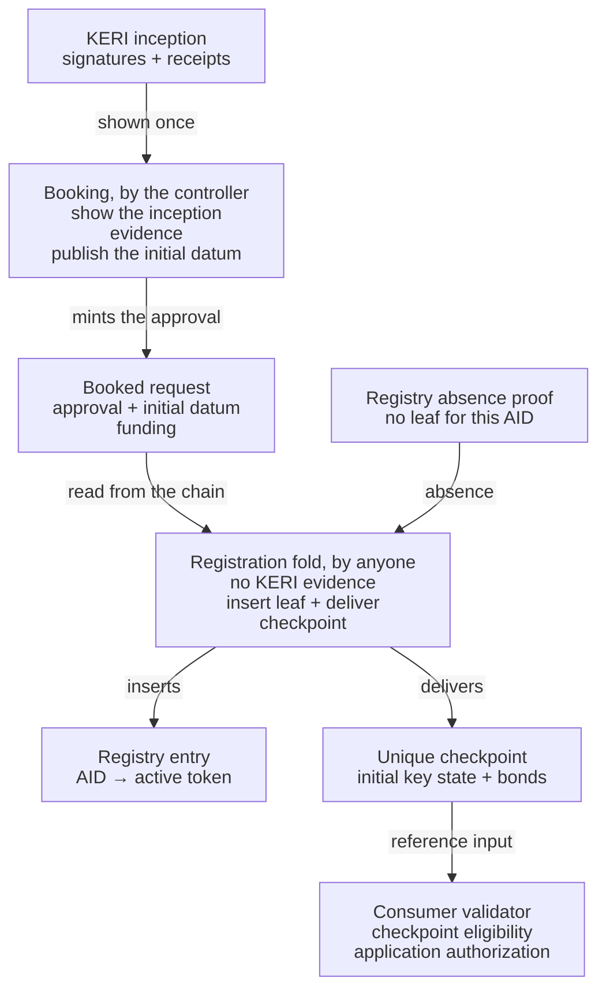
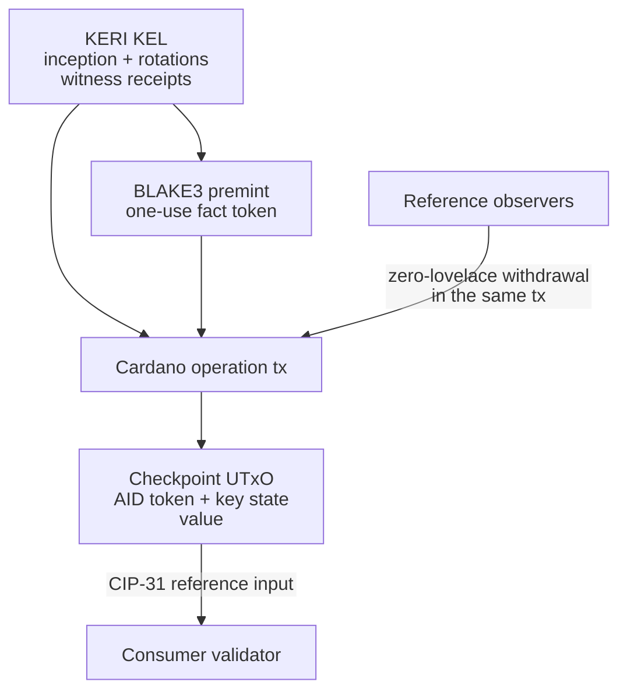
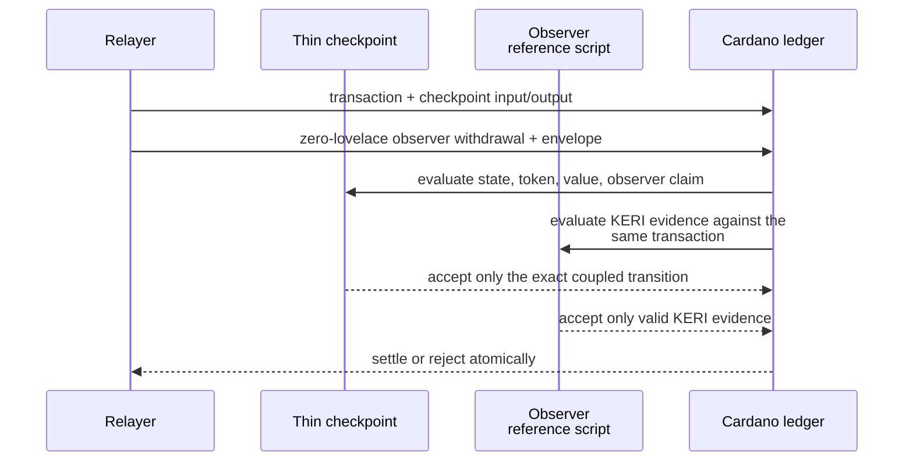

# Architecture overview

cardano-keri gives one KERI identity a stable Cardano checkpoint while its keys
rotate. KERI is Key Event Receipt Infrastructure; its **AID** (Autonomic
Identifier) names an identity, and its **KEL** (Key Event Log) is the signed
history of that identity's key events.

Start with [Follow one identity](follow-one-identity.md) to play registration,
rotation, consumer refusal and registry uniqueness before reading the mechanisms
below.

!!! abstract "Where this page stands"
    The transaction architecture — thin checkpoint, reference observers,
    zero-lovelace withdrawal, BLAKE3 premint — is **shipped on `main` today**.
    The M1 registration flow below is the **model's rule, not yet the code's**:
    the controller shows the inception when booking the registration, and the
    fold checks no KERI evidence. On `main` the validators and the commands
    still prove the inception at the fold, until the code follows the model.
    How lifecycle state is *represented* also changes: today it is role addresses, in the
    [accepted design](../index.md#the-accepted-design) it is one
    bit plus the checkpoint's own value. Both are described below, marked.

## The identity plane

Every registered AID owns a sovereign **checkpoint UTxO** (unspent transaction
output) carrying one AID-derived token and an inline datum with its current key
state. Registration must establish both valid initial state and uniqueness;
these are separate guarantees.

### M1 registration flow



| Boundary | Guarantee | Enforcement responsibility |
|---|---|---|
| Booking | The key has its inception evidence, and the request publishes the initial checkpoint datum its approval commits, which is exactly the initial state of that key. Booking one identifier twice is allowed. | KERI's application, when it mints the approval: no approval exists without the evidence. |
| First registration | If the AID has never been registered, create its registry entry and checkpoint together. A second booked request of the same AID cannot be folded; from its deadline anyone may return it to its refund address, less the tip. Nothing returns it by itself. | The registry verifies absence and insertion and delivers what the approval commits: the address, the datum, the deposit and the new token. The fold validates nothing of KERI's and needs nothing from the controller. |
| Consumer use | Only an eligible checkpoint may supply keys to the application. | The consumer validates the checkpoint and applies its own authorization rules. A booked request and an active registry leaf alone do not authorize use. |

A folder reads everything it needs from the chain: the holding address, the
initial datum and the deposit are the request's own data. The model states
this for Singular's fold of one request. The controller, who holds the inception event, shows it once, when
booking. **A booking is repeatable; checkpoint uniqueness is enforced by
registry admission.** There is no revival: an identity is alive until it is
convicted.
The [registration guarantees](follow-one-identity.md#what-registration-guarantees)
explain the model boundaries and link the playable duplicate-registration case.

### Shipped V1 evidence flow

The existing implementation splits out the hash check only. Registration still
receives the full inception evidence and performs the remaining admission
checks; it has no registry absence check.



In this shipped flow, the parts have deliberately narrow jobs:

- **KERI** produces the identity events, controller signatures, and witness
  receipts.
- **The BLAKE3 premint policy** proves that inception bytes bind to the AID and
  mints a short-lived fact token.
- **The thin checkpoint validator** protects the token, value, exact input, and
  unique successor.
- **Reference observers** validate large KERI evidence through a zero-lovelace
  withdrawal in the same transaction.
- **The checkpoint UTxO** is the current Cardano projection. A rotation spends
  it and creates its next version; no shared root or inclusion proof is needed
  for the key state.

## Stable identity, changing authority

The checkpoint token's asset name is derived from the qualified KERI AID. That
policy ID and asset name form the stable Cardano handle. The datum changes as
KERI rotates. Shipped today it is nine fields of pure key state:

```text
CheckpointDatumV1 {
  cesr_aid
  current controller keys and weighted threshold
  next-key commitments and committed next threshold
  witnesses and toad
  Cardano sequence
  native KERI sequence
}
```

**CESR** is KERI's compact encoding format. `toad` is the threshold of
accountable duplicity: the number of witness receipts required by the event.

An indexer may locate a candidate UTxO by policy and asset name, but it does
not establish authority. A consuming Cardano transaction must revalidate the
exact policy and quantity-one asset, an accepted checkpoint script and version,
the expected AID and a well-formed datum, and its own authorization rule. A
stale index result points to a spent input and fails; an indexer outage can
block discovery, but cannot create false authority.

## How lifecycle state is represented

### Shipped today: role addresses

State is carried by the script role address the token sits at, not by a
caller-controlled status field:

| Role | Meaning | Consumer result |
|---|---|---|
| ACTIVE | current checkpoint | may be considered, subject to all other checks |
| ARMED | a later-event challenge is open | reject |
| FROZEN | the delay bond was claimed | reject |

There is no conviction role: conviction burns the AID token and creates no
successor, so a consumer meets the no-candidate case. That follows from the
projection law — the chain never originates identity state, and no key event
says "this AID is dead" for a validator to project.

### Under the accepted design: one bit and the value

The three roles go. What replaces them is smaller and reads directly off the
checkpoint a consumer already resolves:

| Condition | How it is represented | Consumer result |
|---|---|---|
| poisoned | one bit in the datum, set by the current quorum: the owner's own lock on the checkpoint | reject |
| frozen | `B` absent — a hunter (anyone paid to land rotations, or to freeze a checkpoint that cannot pay for one) took it | reject |
| juvenile | `now − born_at < W` | reject |
| pending conviction | retained custody awaiting its associated Registry fold | reject |
| convicted | the mark, terminal | no candidate |

Nothing there is a flag a caller can set. The poison is signed at the current
threshold; the rest are facts about what the UTxO holds and when it was bonded.
The consumer's whole predicate is: present, both bonds full, not poisoned,
older than `W`, and the payment's own signature satisfies the current
threshold.

## Uniqueness: the one shared object

Today there is none. Registration uses no absence proof, so more than one
candidate checkpoint can exist for an AID and a consumer cannot prove
otherwise.

The accepted design adds exactly one shared structure, and confines it to the
narrowest possible job: a **registry** mapping each AID to absent, active
or permanently retired. A registration must prove absence before inserting,
preventing a second first-registration of that AID. A live checkpoint keeps
the token and the active key until it is convicted. Conviction first enters pending custody; only its
associated consuming Registry fold burns the token and retires the key. See
[the registration guarantee](follow-one-identity.md#what-registration-guarantees).
Rotate, poison, freeze and top-up leave the key active, and consumers do not
use an active key alone as authority.

It is a registry of 32-byte keys, not a record of events — the record tree and
its cursor are retired. Its mechanics are the MPFS cage — a Merkle Patricia
Forestry store whose every update passes through one validator — made
permissionless:
requests are independent UTxOs anyone submits and anyone applies in batches
(ruling D-037). It is built today in
[singular](https://github.com/lambdasistemi/singular) and runs on a
development network; what is delivered and what remains is on
[where the registry is built](../design/registry-as-mpfs.md#where-the-registry-is-built). A stalled registry delays registrations and
forges nothing.

## Transaction architecture

The checkpoint is intentionally small. In the shipped operation flow, heavy
KERI verification runs in operation-specific observer reference scripts:



The observer families shipped today are the lifecycle observer for Register,
the advance observer for rotations and ARMED responses, and the enforcement
observer for Freeze. The accepted design removes the third: `observer_advance`
verifies the evidence for both an advance and a freeze — they present the same
rotation and differ only in effect — and `checkpoint_register` dispatches that
effect.

The scripts are stored in reference-script outputs; copying them inline would
exceed the transaction-size limit. See
[Observer architecture](observer-architecture.md) for the wire shape, the
BLAKE3 fact token, sizes and costs — including the three bytes of headroom on
`observer_advance` that make every datum decision a measured one.

In the registry's registration flow, as the model states it, the inception
admission is checked when the request is booked. The fold checks no inception
evidence; it still couples registry insertion, the checkpoint mint and the
delivery of what the approval commits. This
changes where registration evidence is checked; it does not remove those checks
or change rotation evidence into inception attestations. On `main` the fold
still authenticates the inception.

## Permissionless does not mean unauthenticated

Register, advance, freeze, top-up, poison relay and conviction may be submitted
by anyone because their result is fixed by public evidence. The submitter
cannot choose new keys, skip a sequence, lower a threshold, or remove required
witnesses.

Where authority *is* needed, it is a signature over exactly the thing being
decided. In the M1 V1 release, close bound the refund address in a message
the current controllers signed; `ckeri` no longer offers that close.

!!! note "The accepted design changes this"
    Under the design ruled on 2026-09-02/03 (D-036 to D-040; the model is
    `lean/CardanoKeri/Checkpoint.lean`, the play is the
    [checkpoint simulation](../simulator/index.html)) there is no owner
    exit: no close, no parking and no revival; a checkpoint is alive until
    it is convicted
    ([#493](https://github.com/lambdasistemi/cardano-keri/issues/493)). The current
    keys keep exactly one Cardano power, the poison. An identity is
    active, pending conviction, or convicted after the associated
    Registry fold. A `deposit` is signed
    by the keys of the epoch the rotation opens — so a relayer landing
    a public rotation can never unfreeze the owner. The refund address is
    chosen by whoever pays the registration and no step ever changes it.

## Current boundary and future planes

The repository proves the identity-plane rungs on a protocol-11 development
network and on preprod. It does **not** provide the accepted design's machine on
chain at all, real three-of-seven GLEIF-scale settlement, a production
deployment or mainnet service, a vLEI credential-chain verifier, a credential
revocation mirror, or a wallet-to-Cardano authorization product.

The credential verifier, revocation state, value-cage authorization and wallet
integration remain later layers. They consume the checkpoint as a reference
input; they are not part of the identity story itself.

## Related pages

- [Story ladder](../story-ladder.md) — settled evidence, dated.
- [Roadmap](../roadmap.md) — the thirteen epics and what each measures.
- [Identity operations](identity-ops.md) — exact operation behavior, shipped
  and designed.
- [Observer architecture](observer-architecture.md) — reference-script
  composition and measured budgets.
- [Trust model](../design/trust-model.md) — guarantees, assumptions, and
  fail-closed boundaries.
