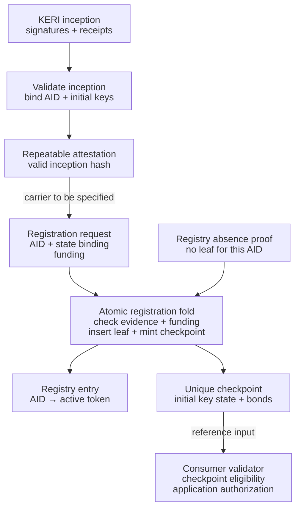
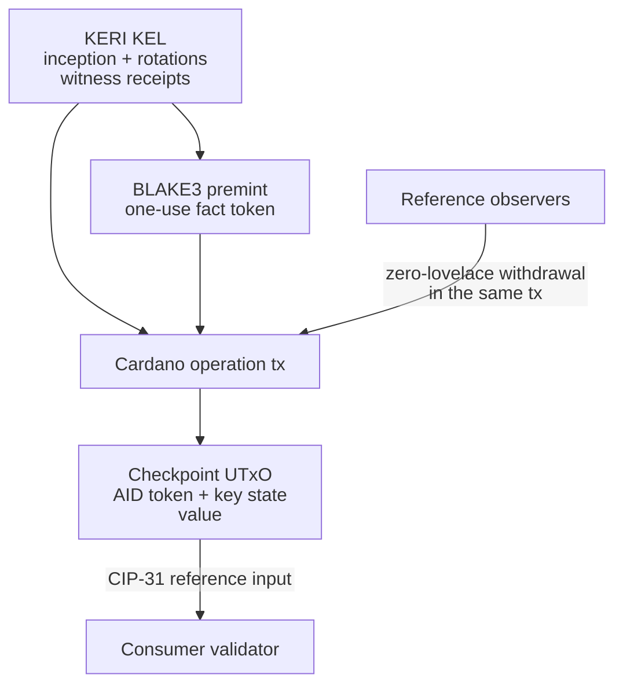
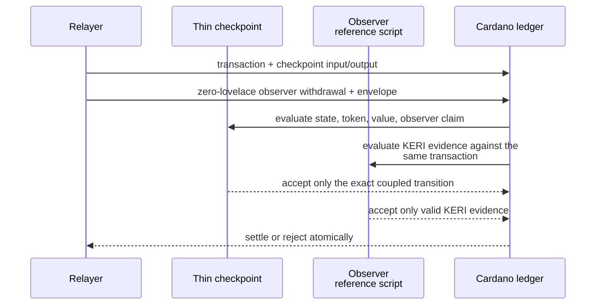

# Architecture overview

cardano-keri gives one KERI identity a stable Cardano checkpoint while its keys
rotate. KERI is Key Event Receipt Infrastructure; its **AID** (Autonomic
Identifier) names an identity, and its **KEL** (Key Event Log) is the signed
history of that identity's key events.

Start with [Follow one identity](follow-one-identity.md) to play registration,
rotation, consumer refusal and registry uniqueness before reading the mechanisms
below.

!!! abstract "Where this page stands"
    The transaction architecture — thin checkpoint, reference observers, zero-lovelace withdrawal, BLAKE3 premint — is that of the earlier deployed design (version 1).
    The proposed M1 registration flow below is an earlier stand-alone proposal that moves full inception admission into a repeatable attestation. It is neither the constitution's requirement (the controller's booking mint validates the inception) nor the behaviour of the model and the validators at this revision (the fold checks it); issue #559 records that conflict and its model-first repair. The proposal is not implemented; the existing BLAKE3 token proves a narrower fact.
    How lifecycle state is *represented* also changes: in version 1 it is role addresses, in the [accepted design](../index.md#the-accepted-design) it is the datum's poison and frozen bits and its pending-termination form, read by the holding predicate. Both are described below, marked.

## The identity plane

Every registered AID owns a sovereign **checkpoint UTxO** (unspent transaction
output) carrying one AID-derived token and an inline datum with its current key
state. Registration must establish both valid initial state and uniqueness;
these are separate guarantees.

### Proposed M1 registration flow



| Boundary | Guarantee | Enforcement responsibility |
|---|---|---|
| Inception attestation | This hash identifies a valid inception and authenticates its initial key state. Multiple attestations of the same inception are allowed. | The designated attestation policy establishes the inception checks, including signatures and witness receipts. |
| First registration | If the AID has never been registered, create its registry entry and checkpoint together. Another attestation cannot authorize a second registration. | MPFS verifies absence and insertion; KERI admission and mint validation bind that insertion to the authenticated checkpoint and required funding in the same transaction. |
| Consumer use | Only an eligible checkpoint may supply keys to the application. | The consumer validates the checkpoint and applies its own authorization rules. Attestation possession and an active registry leaf alone do not authorize use. |

The request need not carry the raw inception if the attestation authenticates
the initial key-state projection as well as the AID. The concrete evidence
carrier, reference or consumption rules, and transaction budgets remain to be
specified and measured. **Attestation is repeatable; checkpoint uniqueness is
enforced by registry admission.** There is no revival: an identity is alive
until it is convicted.
The [registration guarantees](follow-one-identity.md#what-registration-guarantees)
explain the model boundaries and link the playable duplicate-registration case.

### Shipped V1 evidence flow

The existing implementation splits out the hash check only. Registration still
receives the full inception evidence and performs the remaining admission
checks; it has no registry absence check.



In this shipped flow, the parts have deliberately narrow jobs:

- **KERI** produces the identity events, controller signatures, and witness
  receipts.
- **The BLAKE3 premint policy** proves that inception bytes bind to the AID and
  mints a short-lived fact token.
- **The thin checkpoint validator** protects the token, value, exact input, and
  unique successor.
- **Reference observers** validate large KERI evidence through a zero-lovelace
  withdrawal in the same transaction.
- **The checkpoint UTxO** is the current Cardano projection. A rotation spends
  it and creates its next version; no shared root or inclusion proof is needed
  for the key state.

## Stable identity, changing authority

In version 1 the checkpoint token's asset name is derived from the qualified KERI AID; in the accepted design the checkpoint holds the registry's representative asset for the AID. That
policy ID and asset name form the stable Cardano handle. The datum changes as
KERI rotates. In the earlier deployed design it was nine fields of pure key state:

```text
CheckpointDatumV1 {
  cesr_aid
  current controller keys and weighted threshold
  next-key commitments and committed next threshold
  witnesses and toad
  Cardano sequence
  native KERI sequence
}
```

**CESR** is KERI's compact encoding format. `toad` is the threshold of
accountable duplicity: the number of witness receipts required by the event.

An indexer may locate a candidate UTxO by policy and asset name, but it does
not establish authority. A consuming Cardano transaction must revalidate the
exact policy and quantity-one asset, an accepted checkpoint script and version,
the expected AID and a well-formed datum, and its own authorization rule. A
stale index result points to a spent input and fails; an indexer outage can
block discovery, but cannot create false authority.

## How lifecycle state is represented

### Earlier deployed design: role addresses

State is carried by the script role address the token sits at, not by a
caller-controlled status field:

| Role | Meaning | Consumer result |
|---|---|---|
| ACTIVE | current checkpoint | may be considered, subject to all other checks |
| ARMED | a later-event challenge is open | reject |
| FROZEN | the delay bond was claimed | reject |

In that design there was no conviction role: conviction burned the AID token and created no successor, so a consumer met the no-candidate case. That follows from the
projection law — the chain never originates identity state, and no key event
says "this AID is dead" for a validator to project.

### Under the accepted design: the poison bit, the frozen bit and the age

The three roles go. What replaces them is smaller and reads directly off the
checkpoint a consumer already resolves:

| Condition | How it is represented | Consumer result |
|---|---|---|
| poisoned | one bit in the datum, set by the current quorum: the owner's own lock on the checkpoint | reject |
| frozen | the frozen bit in the datum, set by a freeze that paid `B` to the payee it named, cleared by a depositing rotation | reject |
| juvenile | `now − born_at < W` | reject |
| pending termination | retained custody awaiting the matching Registry fold | reject |
| convicted | retired by the matching fold; no output remains | no candidate alone does not tell it from never registered (the reader answers from a complete history) |

Nothing there is a flag a caller can set: the poison and frozen bits change only by the validated steps, and the rest are facts about the output and when the checkpoint was born. The holding predicate is: authenticated context, output at the checkpoint credential, exactly one representative asset, a datum that names the expected AID, state present, unfrozen and unpoisoned, and `born_at + W ≤ now`. The payment's own signature is checked separately.

## Uniqueness: the one shared object

In the earlier deployed design there was none. Registration uses no absence proof, so more than one
candidate checkpoint can exist for an AID and a consumer cannot prove
otherwise.

The accepted design adds exactly one shared structure, and confines it to the
narrowest possible job: a **registry** mapping each AID to absent, active
or permanently retired. A registration must prove absence before inserting,
preventing a second first-registration of that AID. A live checkpoint keeps
the token and the active key until it is convicted. Conviction first enters pending custody; only its
associated consuming Registry fold burns the token and retires the key. See
[the registration guarantee](follow-one-identity.md#what-registration-guarantees).
Rotate, poison, freeze and top-up leave the key active, and consumers do not
use an active key alone as authority.

It is a registry of 32-byte keys, not a record of events — the record tree and
its cursor are retired. Its mechanics are the MPFS cage — a Merkle Patricia
Forestry store whose every update passes through one validator — made
permissionless:
requests are independent UTxOs that a booker submits (the controller, in the constitution's terms) and anyone in the folder role applies in batches
(ruling D-037). It is built today in
[singular](https://github.com/lambdasistemi/singular) and runs on a
development network; what is delivered and what remains is on
[where the registry is built](../design/registry-as-mpfs.md#where-the-registry-is-built). A stalled registry delays registrations and
forges nothing.

## Transaction architecture

The checkpoint is intentionally small. In the shipped operation flow, heavy
KERI verification runs in operation-specific observer reference scripts:



The observer families shipped today are the lifecycle observer for Register,
the advance observer for rotations and ARMED responses, and the enforcement
observer for Freeze. The accepted design removes the third: `observer_advance`
verifies the evidence for both an advance and a freeze — they present the same
rotation and differ only in effect — and `checkpoint_register` dispatches that
effect.

The scripts are stored in reference-script outputs; copying them inline would
exceed the transaction-size limit. See
[Observer architecture](observer-architecture.md) for the wire shape, the
BLAKE3 fact token, sizes and costs — including the three bytes of headroom of the version 1 `observer_advance` that made every datum decision a measured one.

For the proposed registration flow, the heavy inception admission moves to the
earlier attestation transaction. The fold must still authenticate that result
and couple registry insertion, checkpoint mint and output validation. This
changes where registration evidence is checked; it does not remove those checks
or change rotation evidence into inception attestations.
At this revision the fold checks the inception; the constitution requires the controller's booking to do so, and issue #559 records the conflict.

## Permissionless does not mean unauthenticated

In the accepted design, advance and freeze may be submitted by anyone: the evidence they present is public, the key state a rotation installs is the one that evidence establishes, and the submitter names the payee; a rotation carries a deposit only when the owner's new keys have signed its intent. A top-up may be submitted by anyone with a clear top-up mark and at least `P`, with no evidence and no payee. A registration is booked in the controller's role and folded by the registry's folder, a role of Singular's registry that knows nothing of KERI (constitution, principle XII); the model names no signer for either step. A poison needs the current key quorum's authorization, and a conviction needs a commitment opened beforehand. The submitter cannot change the new keys, thresholds and witnesses: they come from the rotation evidence, which the model takes as a premise and requires only to be for a strictly greater sequence number.

Where authority *is* needed, it is a signature over exactly the thing being
decided. In the M1 V1 release, close bound the refund address in a message
the current controllers signed; `ckeri` no longer offers that close.

!!! note "The accepted design changes this"
    Under the design ruled on 2026-09-02/03 (D-036 to D-040; the model is
    `lean/CardanoKeri/Checkpoint.lean`, the play is the
    [checkpoint simulation](../simulator/index.html)) there is no owner
    exit: no close, no parking and no revival; a checkpoint is alive until
    it is convicted
    ([#493](https://github.com/lambdasistemi/cardano-keri/issues/493)). The current
    keys keep exactly one Cardano power, the poison. An identity is
    active, pending conviction, or convicted after the associated
    Registry fold. A `deposit` is signed
    by the keys of the epoch the rotation opens — so a relayer landing
    a public rotation can never unfreeze the owner. The refund address is
    chosen by whoever pays the registration and no step ever changes it.

## Current boundary and future planes

The repository proves the identity-plane rungs on a protocol-11 development
network and on preprod. It does **not** yet show the accepted design's machine settled on a public network (the source tree implements only part of it: there is no poison spend), real three-of-seven GLEIF-scale settlement, a production
deployment or mainnet service, a vLEI credential-chain verifier, a credential
revocation mirror, or a wallet-to-Cardano authorization product.

The credential verifier, revocation state, value-cage authorization and wallet
integration remain later layers. They consume the checkpoint as a reference
input; they are not part of the identity story itself.

## Related pages

- [Story ladder](../story-ladder.md) — settled evidence, dated.
- [Roadmap](../roadmap.md) — the thirteen epics and what each measures.
- [Identity operations](identity-ops.md) — exact operation behavior, shipped
  and designed.
- [Observer architecture](observer-architecture.md) — reference-script
  composition and measured budgets.
- [Trust model](../design/trust-model.md) — guarantees, assumptions, and
  fail-closed boundaries.
