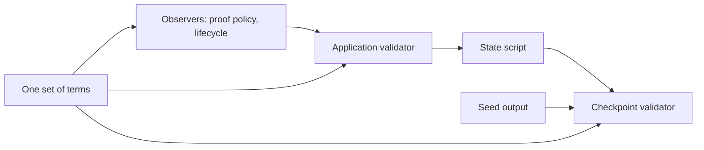

# The identities of this generation

An integrator who wants to run or review a registry on a local test chain asks
which code that registry runs: which model it follows, which public registry
package it builds on, which compiler produced the scripts, and which script
hashes and sizes the chain will see. This page states those numbers for this
generation, and every number comes from a command the page names, so a reader
can run the command and compare.

!!! warning "Not for mainnet"
    This code is not for mainnet.

## The identities

The table is checked: a hosted step recomputes every value and fails when one
differs, so no value here is a stale literal. The application and the state
script do not depend on the registry's seed; the checkpoint validator is
applied to the registry's own identity, which does, so its row is derived for a
fixed reference seed (a transaction id of 32 zero bytes, index 0). A reference
seed is a derivation input, not a deployed registry.

<!-- identities:begin -->
| What | Value |
|---|---|
| Lean model revision | `PENDING` |
| Public Singular commit | `PENDING` |
| Aiken compiler | `PENDING` |
| Application script hash | `PENDING` |
| Application program bytes | `PENDING` |
| State script hash | `PENDING` |
| State script program bytes | `PENDING` |
| Checkpoint validator script hash | `PENDING` |
| Checkpoint validator program bytes | `PENDING` |
| Reference registry name | `PENDING` |
<!-- identities:end -->

## How each value is produced

| Value | Command |
|---|---|
| Lean model revision: the last commit that changed `lean/` | `git log -1 --no-merges --format=%H -- lean` |
| Public Singular commit | the `revision=` line of `onchain/stage-dependencies.sh` |
| Aiken compiler | `nix eval --raw github:NixOS/nixpkgs/753cc8a3a87467296ddd1fa93f0cc3e81120ee46#aiken.version`, equal to `compiler` in `onchain/aiken.toml` |
| Script hashes and program bytes | `PENDING` |
| Whole table against the page | `PENDING` |

`scripts/registry-identities.sh` compiles the scripts from the tracked sources
into the blueprint, then runs `scripts/registry-identities.hs`, which calls the
library's own derivation with the deployed generation's terms. The size is the
length of the applied program, which the chain carries and the transaction size
limit counts.

The application is applied to the observer and the amounts of the deposit; the
state script to the application; the checkpoint validator to the state script,
the registry's name (which the seed fixes) and the same amounts. One set of
terms feeds all three, so the amounts cannot disagree.

## The identity of a devnet registry, per run

A registry on the devnet is created by spending one seed output, which fixes
its name; its state policy follows from the application. Every transaction of
the journey has an identifier that depends on the transaction's contents and
the chain's start. They are therefore derived per run and printed by the run;
none is written here.

The hosted job named "E2E (withDevnet)", step "withDevnet registry and
checkpoint journeys", runs the devnet suite with its log shown. The lines
beginning with `[checkpoint-e2e]` carry the registry's state policy, name and
checkpoint validator hash, and the identifiers of the genesis and delivery
transactions of the registry journey. The first of those lines is
`registry genesis: registry identity`.

## What the check does and does not establish

The check establishes that the values on this page are the ones the derivation
gives for the repository at this commit, and that changing one character of a
stated hash makes the check fail. It does not establish that a deployed
registry's scripts are these: a deployment's hashes come from its own seed and
terms. Local test chain only; not for mainnet.
