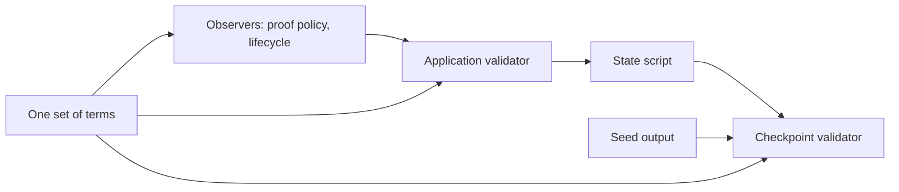

# The identities of this generation

An integrator who wants to run or review a registry on a local test chain asks
which code that registry runs: which model it follows, which public registry
package it builds on, which compiler produced the scripts, which terms the
devnet journey gives the registry, and which script hashes and sizes the chain
will see. This page states those numbers for this generation, and every number
comes from a command the page names, so a reader can run the command and
compare.

!!! warning "Not for mainnet"
    This code is not for mainnet.

## The identities

The table is checked: a hosted step recomputes every row and fails when a row
differs, is missing or is extra, so no value here is a stale literal.

The terms are the ones the devnet journey creates its registry with: the
deployed generation's amounts for the deposit, the freeze bond, the premium and
the network, a short processing window so that a journey can pass a request's
deadline, and the two numbers of a termination: the minimum ADA a checkpoint
output holds, which a convicted checkpoint's pending output holds exactly, and
the carrier a termination request holds beside the tip. The first four and the
last two enter the scripts; the four between are the registry's request
parameters, which the configuration record holds. The checkpoint validator is
also applied to the application's policy, which is how it knows the termination
approvals that release a pending output.

The application and the state script are the same for every seed, and the
checkpoint validator is not: it is applied to the registry's own identity, which
the seed fixes. The derivation checks both for two reference seeds and stops
unless they hold, and the checkpoint validator's rows are those of the first
reference seed, a transaction id of 32 zero bytes at index 0. A reference seed is
a derivation input, not a deployed registry.

<!-- identities:begin -->
| What | Value |
|---|---|
| Lean model revision | `f66889d32fadfbeafa41a940d9b4ad6cdd90a890` |
| Public Singular commit | `d69ab005c3b710aeebf033d3c5cd08c56feb5643` |
| Aiken compiler | `1.1.23` |
| Network discriminator | `0` |
| Registration deposit (lovelace) | `1000000000` |
| Freeze bond (lovelace) | `5000000` |
| Premium (lovelace) | `2000000` |
| Registration cost (lovelace) | `1000000` |
| Minimum tip (lovelace) | `500000` |
| Processing time (milliseconds) | `90000` |
| Booking width (milliseconds) | `5000` |
| Checkpoint minimum ADA (lovelace) | `2000000` |
| Termination request carrier (lovelace) | `1500000` |
| Application script hash | `1cbb18a164c1d958ef85777e5c4dc158abd2362da1d5006278d595f7` |
| Application program bytes | `10469` |
| State script hash | `647d0379b604e0b29f293b5c051a2d1630cb8ea8282af7b34d35dcf1` |
| State script program bytes | `7786` |
| Application and state script across two seeds | `the same` |
| Checkpoint validator script hash | `861d63753c10dd6aab3c8f3db1e050d112c2d6ac557d8fb09ad29609` |
| Checkpoint validator program bytes | `8957` |
| Reference registry name | `a060e76604c811bc4f47264e86a593a4539d57e251709f83af18ad5789d6c0b3` |
<!-- identities:end -->

## How each value is produced

| Value | Command |
|---|---|
| Lean model revision: the last commit that changed `lean/` | `git log -1 --no-merges --format=%H -- lean` (needs the full history) |
| Public Singular commit | the `revision=` line of `onchain/stage-dependencies.sh` |
| Aiken compiler | the compiler the blueprint records, which the pinned compiler wrote when it built the blueprint from the sources |
| Terms, script hashes and program bytes | `bash scripts/registry-identities.sh` |
| The whole table against the page | `bash scripts/check-identities.sh` |

`scripts/registry-identities.sh` compiles the scripts from the tracked sources
into the blueprint, then runs `scripts/registry-identities.hs`, which calls the
library's own derivation with the terms the devnet journey imports from one
module (`Cardano.KERI.AID.E2E.DevnetTerms`). The size is the length of the
applied program, which the chain carries and the transaction size limit counts.

The application is applied to the observer and the amounts of the deposit; the
state script to the application; the checkpoint validator to the state script,
the registry's name (which the seed fixes) and the same amounts. One set of
terms feeds all three, so the amounts cannot disagree.

## The identity of a devnet registry, printed by each run

A registry on the devnet is created by spending one seed output, which fixes
its name; its state policy follows from the application. Every transaction of
the journey has an identifier that depends on the transaction's contents. The
run derives all of them and prints them. The registry identity (state policy and
name) and the genesis transaction were the same in every run observed so far (the
logs of the end-to-end check of this change); nothing checks that they repeat.
Transaction identifiers after genesis differed from run to run. No value is written here; the
printed lines, not this page, are where they are current.

The hosted job named "E2E (withDevnet)", step "withDevnet registry and
checkpoint journeys", builds the devnet check with its log shown. The lines
beginning with `[checkpoint-e2e]` carry the registry's state policy, name and
checkpoint validator hash (the line containing `registry identity`, with the
genesis transaction) and the identifier of each fold that delivers a checkpoint
(the lines containing `registration fold transaction`). The lines are printed
only when the check is built; a build that the cache substitutes runs nothing
and prints nothing, so a reader who needs them builds the check without
substitution.

## What the check does and does not establish

The check establishes that the values on this page are the ones the derivation
gives for the repository at this commit, that a row cannot be changed, deleted
or added without the check failing, and that the application and the state
script do not depend on the seed. It does not establish that a deployed
registry's scripts are these: a deployment's hashes come from its own seed and
terms. Local test chain only; not for mainnet.
