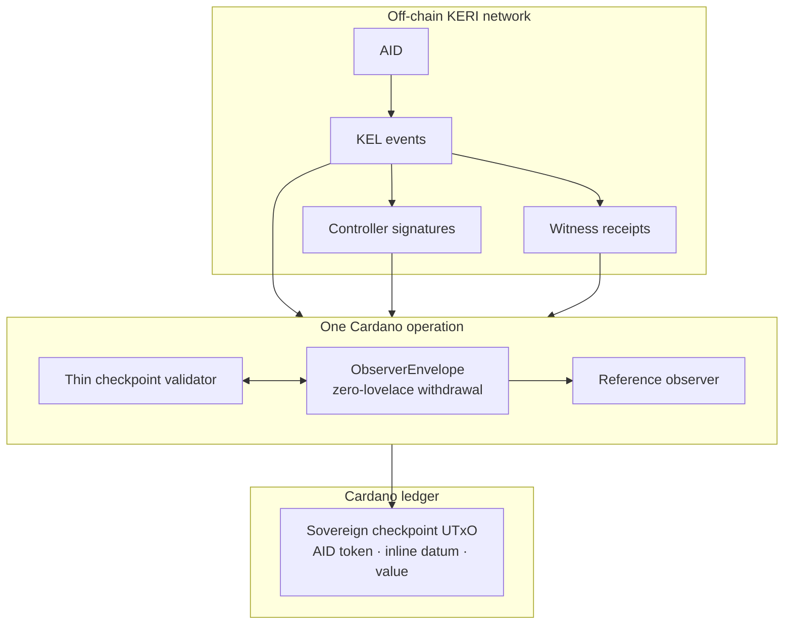
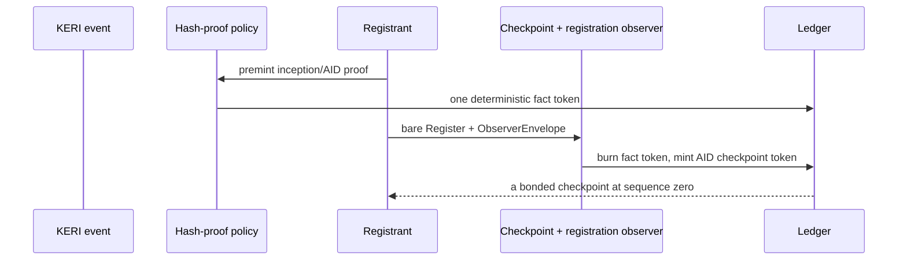
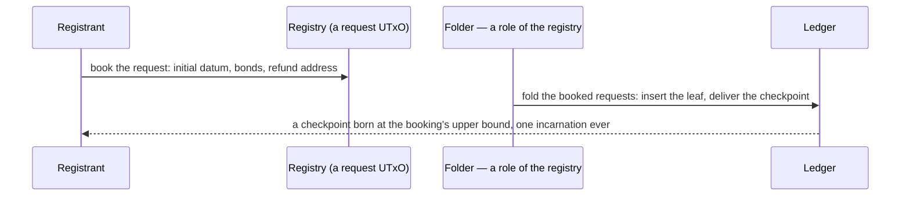
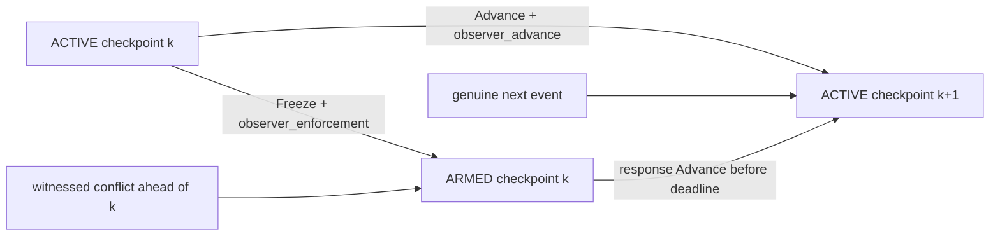
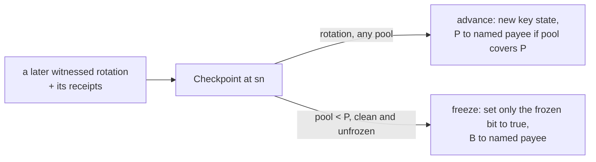
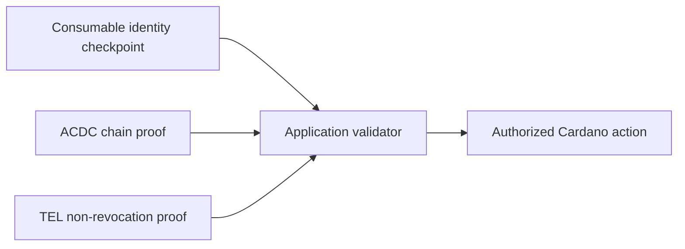

# System architecture

cardano-keri is being built in layers. The only layer with settled vertical
transactions today is the KERI identity checkpoint. Everything above it —
credential verification, value authorization, wallet integration — remains
later work.

!!! abstract "Where this page stands"
    The layer table below is the honest status of each layer. The flows marked **shipped** are those of the earlier deployed design (version 1): register, advance and close settled on preprod, the freeze and response story on a development network. The flows marked **designed** are the Lean machine of the accepted design, proved and playable; the source tree implements part of it (there is no poison spend yet), and this page makes no claim about what is deployed.

## Layer status

| Layer | Purpose | Status |
|---|---|---|
| Identity checkpoint | Project a KERI AID's current keys, thresholds, witnesses and sequence into a sovereign Cardano UTxO | Register, close and advance of the earlier deployed design (version 1) settled on preprod; the enforcement economy settled on a devnet only |
| The accepted design's machine | Poison (the owner's own lock on the checkpoint), three value components, the premium (what a rotation pays from the pool to the payee the submitter names, when the pool holds at least that much) and the freeze (the bond goes to the payee the freeze names), terminal conviction, no owner exit | Proved in Lean, playable in the simulator; the source tree implements part of it (no poison spend yet) — epics #322–#323 |
| Registry | One incarnation per AID, ever | Modeled in Lean, with the application's booking and termination paths in the source tree; the permissionless cage (an MPFS store, a Merkle Patricia Forestry map behind one validator) runs on a development network in [singular](https://github.com/lambdasistemi/singular) (release v0.3.0); the keri leaf map and the registration policy are epic #324 |
| Credential verification | Verify ACDC credential chains and TEL revocation state | Designed and prototyped; no settled vertical story |
| Value authorization | Let an application gate a state change on a consumable checkpoint and credentials | Designed; not a shipped service |
| Wallet bridge | Let KERI/Veridian software authorize Cardano actions | Planned; nobody's deliverable yet |

An **ACDC** is an Authentic Chained Data Container, KERI's signed credential
format. A **TEL** is a Transaction Event Log, which records credential issuance
and revocation events.

## The identity checkpoint — shipped

The KERI network provides public event evidence. A Cardano relayer builds a
transaction around that evidence. The ledger executes both a thin checkpoint
program that protects state, token and value, and a heavy observer reference
program that verifies the KERI evidence. The result is atomic: both validators
accept the same transaction or nothing changes.

## Registration flow — shipped

Registration adds one preliminary step because KERI uses BLAKE3 and Plutus has
no native BLAKE3 builtin:

The proof token only separates expensive hash work from state creation. It adds
no oracle and no privileged registrar. It also does not make registration
unique: nothing in the version 1 flow prevents a second checkpoint for the same AID.

## Registration through the registry — designed

The accepted design puts registration behind the registry, and that is the only place
the checkpoint token can ever be minted:

Folders race on one shared object; the loser wastes work, never safety. The constitution has the controller's booking validate the inception; at this revision the fold does (issue #559). Until its deadline a request can only be folded; from the deadline anyone may return a booked registration to its refund address, less the tip the returner keeps.
A conviction is a local step of the checkpoint; the termination is then booked and folded. Rotations, poisons, freezes and top-ups never touch the registry.

## Advance and enforcement — shipped

An ordinary advance consumes the current checkpoint and creates its exact
successor; the advance observer verifies the next KERI rotation, both
controller thresholds, and witness receipts.

Freeze consumes ACTIVE and creates ARMED when the enforcement observer accepts
a witnessed conflicting rotation still ahead of the checkpoint. A timely
response reuses ordinary advance and returns ACTIVE.

Evidence is bound to the exact KERI tip, so a later round needs fresh evidence.

## The same plane under the accepted design — designed

The enforcement observer goes. `observer_advance` verifies one thing — a later
witnessed rotation with its receipts — and the register validator dispatches
the effect, which is where advance and freeze part company:

Two of the six checkpoint actions cross the boundary of the present state.
Registration creates a present checkpoint and conviction moves it to pending
termination. The associated registry fold completes retirement. A freeze
starts no response clock. A booked registration has a processing deadline,
and a conviction commitment can be revealed only within its slot window.

## How applications consume identity

A protected application resolves the expected AID-derived asset and includes
the checkpoint as a **CIP-31 reference input**. CIP-31 lets a transaction read
a UTxO without spending it.

The application must:

1. resolve the candidate checkpoint for the AID;
2. validate the quantity-one token, script lineage, version, AID and datum;
3. apply the consumer predicate. The version 1 design requires the bare ACTIVE
   role address. The accepted design checks the authenticated context, the
   output credential, the representative asset quantity of one and the
   decoded AID and lifecycle. The checkpoint must be present, unfrozen and
   unpoisoned, and its age must be at least the juvenility window (the age a checkpoint
   must reach before a consumer trusts it);
4. verify its operation-specific controller authorization; and
5. when credentials matter, verify the required ACDC/TEL evidence.

An indexer only helps locate the candidate. The ledger checks establish
authority. A missing or stale lookup fails; it never authorizes a substitute.

## Planned credential plane

The longer-term vLEI path adds credential verification around the identity
checkpoint:

The identity and credential questions stay separate:

- the checkpoint answers **which keys currently control this AID?**
- the credential chain answers **what real-world role or authority has an
  issuer granted to this AID?**

Registering an AID does not prove that it is GLEIF, a Qualified vLEI Issuer, or
a legal entity. Those are credential claims.

## Deployment boundary

The settled evidence runs on a private protocol-11 development network with
production transaction limits, and on preprod. The repository does not
currently operate a public checkpoint service, a production KERI watcher or
hunter service, a Cardano mainnet deployment, a full vLEI credential mirror, or
an application that treats these checkpoints as production authority.

See the [story ladder](../story-ladder.md) for exact settled transactions and
the [roadmap](../roadmap.md) for the ordered work beyond them.
