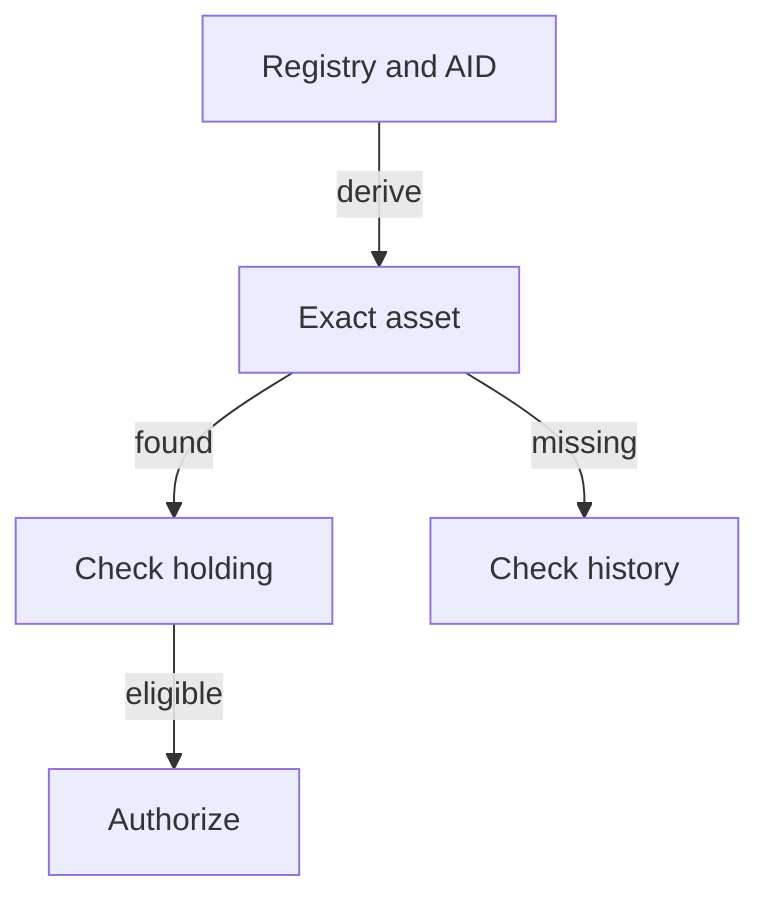

# Value authorization

Value authorization is a future consumer of the identity checkpoint. The
small settled stories prove checkpoint creation and lifecycle transitions;
they do not yet ship an application that authorizes value writes from it.

This page states the current integration boundary so later application
validators do not reintroduce the retired shared-registry model.

!!! abstract "Where this page stands"
    The resolution rules, the indexer boundary and the rotation race are those of the earlier deployed design (version 1) and carry over to the accepted design; the authorization modes are designs for a future application. Under the accepted design, the holding check uses the checkpoint credential, the representative asset and the decoded lifecycle state, and the application checks its own operation's authorization separately. Both predicates are given below.

## Resolve current authority

For the deployed V1 checkpoint family, given a KERI AID an application
derives the expected checkpoint asset:

```text
(checkpoint_policy_id, deriveAidAssetName(cesr_aid))
```

It includes the candidate checkpoint as a **CIP-31 reference input**. CIP-31
lets the transaction read the UTxO without spending it.

The application validator must require:

1. exactly one supplied candidate for that AID;
2. the accepted checkpoint policy and script lineage;
3. exactly one AID-derived token;
4. a well-formed inline `CheckpointDatumV1`;
5. the expected AID and current sequence;
6. the bare ACTIVE role address; and
7. the operation's controller authorization against the current weighted key
   state.

Every other case fails closed: no checkpoint; multiple ACTIVE candidates; a
stale or already spent outref; a wrong policy or asset; a malformed or
mismatched datum; ARMED; or FROZEN.

A convicted identity (the terminal state after a duplicity proof) is not a
further role to reject. In version 1 conviction burned the AID token, so it left nothing to resolve and the application met the no-checkpoint case. There is no identity-root inclusion proof and no separate
Freeze-registry absence proof: Freeze changes the sovereign checkpoint's own
role address.

### Under the accepted design

The holding predicate authenticates the network, release and checkpoint
credential. It requires the output at that credential to hold exactly one
unit of the representative asset derived for the registry and AID.

```text
eligible holding iff authenticated network, release and checkpoint credential
                 ∧ output at that credential
                 ∧ expected representative asset quantity = 1
                 ∧ datum decodes for the release and names the expected AID
                 ∧ state is present, unfrozen and unpoisoned
                 ∧ born_at + W ≤ now
```

The lifecycle check accepts a present checkpoint when its frozen and poisoned
bits are clear and its age is at least the juvenility window (`born_at + W ≤ now`,
equality included). A frozen, poisoned, juvenile, pending-termination or convicted
checkpoint is refused, and so is an absent one. There is no parked state: a
checkpoint is alive until it is convicted. The relying application checks
authorization for its own operation separately.

Three consequences an integrator should plan for:

- **Freeze changes both datum and value.** Only the frozen bit in the datum
  changes to true. `B` leaves the output, to the payee the freeze names. Changing
  only the lovelace leaves the holding predicate’s result unchanged. A caller
  relying on `realizesState` must establish the exact lovelace held for the
  state, including the registry minimum ADA.
- **Step 1 becomes a guarantee rather than a hope.** The redesigned registry admits one
  incarnation per AID, ever within that registry, so "exactly one candidate" is enforced on chain
  instead of being a residual the consumer carries.
- **Conviction is the only end, and it is terminal.** The chain follows
  KERI: no key event un-duplicates an identifier, so `Convicted` has no
  exit. There is no owner exit either, so a registered AID is alive until it
  is convicted. An application must not expect a convicted one to return.

## Pending Singular registry integration

As a contract author adopting the redesigned registry, require a token bound
to the intended registry as well as the AID. The V1 formula above is not the
new registry token formula. Under the public
[Singular reader design](https://github.com/lambdasistemi/singular/issues/744),
the [registry address](https://github.com/lambdasistemi/singular/issues/728)
carries the state policy `S` and registry name `R`, with the network in the
bech32 prefix. The expected policy is `S = state(A_keri)` for the chosen
application release. The name `R` commits a State preimage containing the
seed; the active token name commits an Active preimage containing `(S, R)`
and the AID key. Both names use `blake2b_256` over serialized Plutus Data.

The model fixes one concrete choice for these commitments (`ConsumerBytes.lean`):
the registry key of an AID is its qualified CESR text bytes, the preimage is the
Plutus Data serialisation of Singular's preimage type at the pinned revision, and
the hash is BLAKE2b-256. The general consumer model takes the datum decoder as an
input; one concrete version 2 decoder is declared (`CheckpointDatum.lean`). The
collision freedom of the hash, the faithfulness of observation and the release
provider remain assumptions. Registration approval binds the full holding
address, including its payment and stake parts.



A future consumer queries that exact asset under `S`, requires quantity one,
authenticates the canonical registry and checks the holding's KERI datum
and eligibility. A token in pending termination custody is not
an eligible checkpoint. A missing token alone does not distinguish terminal
from never registered; that requires a complete registry history through the asked point; how a reader obtains one is an open decision of issue #353. Provider failure must be reported as unavailable.

The model binds the public Singular library at the revision pinned in `lean/lake-manifest.json`, and `lean/CardanoKeri/ConsumerIdentity.lean` states the consumer predicate for the registry holding ([#439](https://github.com/lambdasistemi/cardano-keri/issues/439), closed). The open escalations are kept in the [Lean correspondence register](https://github.com/lambdasistemi/cardano-keri/issues/435); the value and exact-chain-point provider questions of #353 stay open there. Parking, described by earlier revisions of this page, is removed:
there is no owner exit
([#493](https://github.com/lambdasistemi/cardano-keri/issues/493)). No model or runtime behavior is
changed by this documentation. See the
[complete mapping](../demos/d02-registry-mapping.md) for the remaining stories
and evidence.

## Indexer boundary

An indexer may return the candidate outref for
`(checkpoint_policy_id, aid_asset_name)`. It is not trusted for authority.
The ledger validations above remain mandatory.

- A stale result refers to an input that no longer exists and rejects.
- A false result fails token, script, datum, or AID validation.
- An outage prevents construction but cannot authorize a fallback key.

Clients should refresh on contention and fail over between indexers or local
chain sync when availability matters.

## Authorization modes

Two application patterns are candidates for a future application.

### Native Cardano signer

The application may require Cardano transaction signatures corresponding to
the current checkpoint controller keys. This is simple for software that can
make those KERI-controlled Ed25519 keys available through a compatible signing
interface.

The validator:

1. resolves the eligible checkpoint holding (in version 1, the ACTIVE checkpoint);
2. reads the current weighted key set;
3. checks the required transaction signatories; and
4. evaluates the checkpoint's threshold.

This mode binds authorization to the complete Cardano transaction body but may
not fit existing KERI wallet APIs.

### Detached intent signature

A future wallet bridge may put domain-separated signatures in the redeemer.
The signed intent must bind at least:

```text
AuthorizationIntent {
  domain
  network_id
  application_policy
  operation
  checkpoint_policy
  aid_asset_name
  checkpoint_input
  checkpoint_sequence
  application_input
  intended_output_or_effect
  nonce_or_counter
  valid_from
  valid_until
}
```

The application reconstructs this message rather than accepting
caller-supplied message bytes. It then evaluates signatures under the current
checkpoint's weighted controller threshold.

Binding the exact checkpoint input and sequence makes an authorization stale
after rotation. Binding application input/output or operation effect prevents
a batcher from repurposing a valid signature. Domain, network, policy, and
validity fields prevent cross-protocol and cross-deployment replay.

The exact envelope remains a later roadmap deliverable. This shape is a
security requirement, not a claim that the SDK is published.

## Value-cage oracle

Some MPFS value-cage designs — a cage is an MPFS store, a Merkle Patricia
Forestry map behind one validator — have an operator or oracle that serializes
writes to their own cage UTxO. That authority is separate from AID authority.

If a cage keeps an oracle, a mutation should require both:

- the AID controller threshold resolved from the current eligible checkpoint (in version 1, the ACTIVE checkpoint);
  and
- the cage's own operator authorization.

The oracle is then necessary but not sufficient. It may affect liveness or
ordering, but it cannot forge the identity owner's authorization.

## Rotation and transaction races

A value transaction references one exact checkpoint UTxO. If Advance spends
that checkpoint first, the value transaction becomes invalid and must be
rebuilt against the successor.

This is the desired safety property: pending authorization does not silently
survive a key rotation. It is also an operational race that builders must
handle.

## Refusal behavior

**Earlier deployed design (version 1).** As soon as Freeze settles, the checkpoint token moves from
ACTIVE to ARMED. A value transaction referring to the old ACTIVE input is
stale, and a new transaction resolving ARMED must reject by role. A timely
response Advance creates a new ACTIVE checkpoint at the next sequence, so the
application must obtain fresh authorization against that input. Conviction
produces no output to resolve at all.

**Under the accepted design.** A refusal that follows a spend of the checkpoint (poison, freeze, conviction) makes the referring transaction stale, and a rebuild against the successor applies the predicate afresh. Time changes one premise: the age condition becomes true when the juvenility window has elapsed, and the checkpoint is then eligible only if it is also unpoisoned, unfrozen and authenticated. A wrong context, or a datum that does not decode for the release or name the AID, is refused by the holding predicate with no change to the checkpoint. A stale reference or a missing reader observation is a separate premise of the reader, which answers only from the candidate the ledger supplies and the observations and history it is given; when its observation shows no holder, the leaf its history establishes decides terminal or never registered, and without one it answers unavailable. The refusals differ in who caused them and in how they clear:

| Refusal | Caused by | Clears when |
|---|---|---|
| Poisoned | the owner's current quorum | any witnessed rotation |
| Frozen | a freeze, which pays `B` to the payee it names, because the pool of advance funds was below the premium | a rotation with `deposit` (the unfreeze) |
| Juvenile | time, after a registration | `W` slots elapse |
| Pending termination | anyone, with a duplicity proof and an eligible commitment | its associated consuming Registry fold completes retirement |
| Convicted | the associated fold after a duplicity proof | never |

An application should not treat any of these as an error condition to retry.
Each is a statement that the identity is currently unfit to authorize, and each clears by its own rule in the table (a witnessed rotation, a depositing rotation, or time) — except the last two rows: a pending termination ends only when the matching fold consumes its termination request, and a convicted identity never returns.

## Compromised controller keys

Every check on this page answers *"do the current controllers of this AID
authorize this operation?"*. An attacker holding the current KERI signing keys
answers it correctly, and no validator can separate them from the owner.

That is the intended boundary, not a defect in the checks: identity
authorization is only as strong as the controller's key custody. Two
consequences an integrator must plan for:

- **Rotation is the remedy, and it is not retroactive.** Once a rotation
  settles, authorizations bound to the previous checkpoint input are stale, but
  a transaction that already settled under the old checkpoint (in version 1, the ACTIVE one) stands.
- **Freshness policy is load-bearing.** The narrower the accepted checkpoint
  age, the smaller the window a stolen key can be used in.

Under the accepted design the owner gains one instrument here, and the application
must honour it: the **poison**. A quorum of the current keys can declare their
own epoch compromised, and a consumer that checks `¬poisoned` shuts the stolen
keys out immediately, before the owner has assembled a rotation. An application
that skips that conjunct discards the only signal the owner can send on her
worst day.

[Compromise of the current keys](../design/key-compromise.md) states the full
case, including why an interaction event is an off-chain instrument and never
touches the checkpoint.

## Credential-gated actions

Identity authorization answers:

> Do the current controllers of this AID authorize the operation?

It does not answer:

> Does this AID represent a particular legal entity or hold a current role?

A credential-gated application must additionally verify the required ACDC
credential chain and TEL non-revocation evidence. Those layers are later
roadmap work.

## Minimum consumer checklist

Before treating an integration as secure, prove with applied-boundary tests
that it rejects:

- the right token at the wrong credential (in version 1, the wrong role);
- the right AID with several candidate holdings for one registry and asset (in version 1, multiple ACTIVE candidates);
- a stale checkpoint outref;
- a well-signed intent for another checkpoint sequence;
- a well-signed intent for another application input or output;
- signatures below the weighted threshold;
- an expired intent;
- a wrong network or policy; and
- a valid identity signature with missing or revoked credentials when the
  application requires credentials.

See the [Trust model](../design/trust-model.md) and
[Architecture overview](overview.md).
