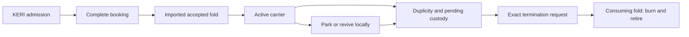

# Map the Singular registry to Cardano KERI

As a KERI integrator, I need to see which layer admits an identity, retains its
parked output and completes permanent retirement. As a relying party, I must
not mistake an active registry key for a consumable checkpoint.

This page maps the current Lean model and its simulators. It does not establish
production validator, builder or deployment conformance. The preprod V1
baseline is a separate implementation. Start with
[the runnable identity examples](../architecture/follow-one-identity.md) or
[the Registry design](../design/registry-as-mpfs.md) for the full premises.

## Bound sources and acceptance boundary

The public Singular dependency is commit
`d69ab005c3b710aeebf033d3c5cd08c56feb5643`, tree
`2979dcfc58b092313b0ce7fa0493722539b9ea65`. `Registry.lean` imports its economic
booking and fold judgments; `RegistryAgreement.lean` binds the projection.
`Checkpoint.lean` governs the funded lifecycle and associated system;
`CheckpointCertificate.lean` executes the receipt interface.

The [parking ruling](https://github.com/lambdasistemi/cardano-keri/issues/437)
requires retained output/token/key state and minimum ADA. The
[correspondence register](https://github.com/lambdasistemi/cardano-keri/issues/435)
keeps other open model obligations. The earlier mapping is retained in the
[historical source](https://github.com/lambdasistemi/cardano-keri/blob/70f3fc800fb3e49f9eb55584b62a2c87a82eb08d/docs/demos/d02-registry-mapping.md).

## Registration and termination boundary

The Registry adapter uses actual imported transactions, including their inputs,
outputs, assets and validity intervals. KERI still owns its application
admission and custody metadata. Registration creates the active carrier and
permanent binding only after an accepted fold. Termination completes only when
an accepted fold consumes the associated pending request.

| Owner story | Model responsibility | Remaining implementation boundary |
| --- | --- | --- |
| Register once | Actual booking/fold plus KERI inception; unique permanent binding | Concrete inception/receipt verification and transaction mapping |
| Park and return | Retained output/token/`Mc`; rotation from the parked key; fresh bonds | Validator and builder correspondence |
| Convict | Concrete Checkpoint duplicity; pending state; exact booking association | Evidence codec and actual on-chain custody |
| Complete retirement | Stored-context replay and exact consumed request; burn only at fold | Transaction construction and chain confirmation |
| Read eligibility | Present, mature, unpoisoned, unfrozen checkpoint | Exact token/canonical registry and consuming transaction checks |
| Recover a registration request | Imported generic recovery transaction | Broader KERI recovery obligations |

## Value and authorization

Checkpoint close binds its premium payee and optional refund address through
new-key intent. A copied close with another payee is refused. Parking refunds
bonds and pool but retains minimum ADA. Conviction of a live checkpoint pays
its conviction bond to the convictor and returns held freeze bond and pool to
the refund address; a parked checkpoint holds neither bond nor pool.

Termination booking splits `Mc` into `Mr + tip` for the request and
`Mc - Mr - tip` for the booker. The booker pays its booking fee separately.
The actual fold accounting does not guarantee that `Mr` returns to that booker.
Self-fold accounting names the recipient and requires all its stated output,
fee and matching-booking premises.

Registry's coarse evidence predicates and Checkpoint's concrete evidence are
not interchangeable. The associated system combines local Checkpoint evidence
with a replayed accepted Registry origin and receipt. A same-context receipt
for another request cannot complete the selected identity.

## Registry identity and lookup

An active key remains active while its output is parked or termination is
pending. The reader must classify the holding before treating it as eligible.
The model's integer token counter is not a Cardano asset-name specification.
Exact identity, canonical registry selection and validity extensions remain in
[consumer authentication](https://github.com/lambdasistemi/cardano-keri/issues/439).
A provider failure must not become evidence of absence.

Public upstream requirements for
[registration](https://github.com/lambdasistemi/singular/issues/742),
[termination](https://github.com/lambdasistemi/singular/issues/743) and
[reading](https://github.com/lambdasistemi/singular/issues/744) remain separate
from this pinned model execution and from KERI deployment evidence.

## What can be checked now

Play the [Registry simulator](../simulator/registry/index.html) for complete
transactions and the [Checkpoint simulator](../simulator/index.html) for local
stories and associated receipt journeys. Fresh Lean corpora are compared with
the independent JavaScript cores, CLI results and embedded pages. Full states
and addressed flows are compared, not only accepted/refused counts.

Kernel proofs, finite executions, model mutations and fabricated checker
controls remain distinct evidence. This mapping does not close broader
[request lifecycle](https://github.com/lambdasistemi/cardano-keri/issues/468),
consumer authentication or production correspondence. Every production invariant
still needs its bound story and both implementation test layers.
