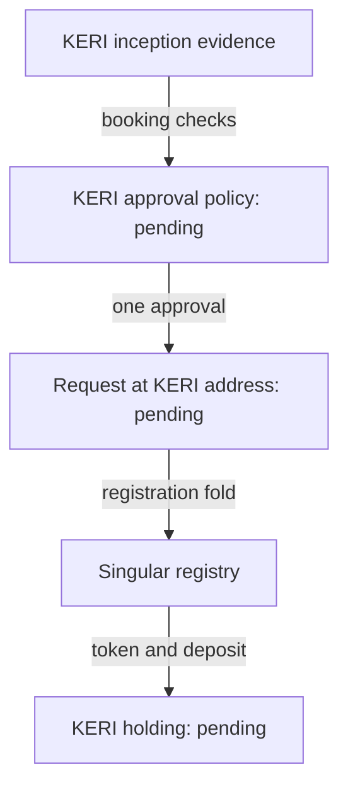

# Map the redesigned Singular registry to Cardano KERI

As a Cardano KERI integrator, compare what the upstream registry will provide
with the identity behavior KERI still needs to model and implement. A second
registration must fail, a parked identity must retain its recovery state, and
proven duplicity must retire the identity permanently within its registry.
**This page is a migration map, not a claim that KERI integration ships.**

The [preprod V1 baseline](preprod-v1-baseline.md) demonstrates the older
checkpoint family. It does not demonstrate the Singular integration below.

## Bound sources and acceptance boundary

This comparison reads Cardano KERI at
`7cb4e716107d8ca7cc53dcdb0cd26549315ee256`:
[Registry.lean](https://github.com/lambdasistemi/cardano-keri/blob/7cb4e716107d8ca7cc53dcdb0cd26549315ee256/lean/CardanoKeri/Registry.lean),
[Checkpoint.lean](https://github.com/lambdasistemi/cardano-keri/blob/7cb4e716107d8ca7cc53dcdb0cd26549315ee256/lean/CardanoKeri/Checkpoint.lean)
and [SingularBinding.lean](https://github.com/lambdasistemi/cardano-keri/blob/7cb4e716107d8ca7cc53dcdb0cd26549315ee256/lean/CardanoKeri/SingularBinding.lean).
Its Singular dependency is still `f844a8f423eaf65009c587b9d7dd9ad3e00d21af`.
The binding proves one excluded-edge refusal through the older `step`
interface; it proves no translation between the two state machines.

The upstream target is the public
[Singular redesign](https://github.com/lambdasistemi/singular/issues/731),
with [registration](https://github.com/lambdasistemi/singular/issues/742),
[termination](https://github.com/lambdasistemi/singular/issues/743) and
[reading](https://github.com/lambdasistemi/singular/issues/744) described in
its child issues. These are delivery requirements, not release receipts.
The epic retains earlier proposal text; this comparison uses the later
registration and termination descriptions. Integration and release remain
tracked by [Singular's integration issue](https://github.com/lambdasistemi/singular/issues/747).

The [Lean correspondence register](https://github.com/lambdasistemi/cardano-keri/issues/435)
owns the KERI-side conflicts. Its parking ruling requires a retained
application output, but the checked-in model still has `Status.dormant k`.
The model must change before affected implementation is accepted.

## Registration and termination boundary

The redesigned registry has one state script per application policy,
`S = state(A)`. After genesis, it acts only at folds, and its datum holds the
registry's trie root. Requests sit at the application's address with an
application approval. Singular has no request script, request tag, rejection
operation, booking checks, configured tip or treasury routing. The application
owns booking, request protection, reclaim, refunds and cleanup.

The planned KERI policy checks the inception before issuing approval. Singular
then consumes the matching approval and a proof that the key is absent, and
mints exactly one active token into the committed holding with at least the
committed deposit. The initial datum is fixed at booking. KERI must therefore
model its birth slot at booking, rather than assigning it when a fold lands.

Termination moves the registry leaf from active to terminal and burns the
active token. KERI must authorize conviction using its own duplicity evidence
before issuing termination approval. Open datum's controller and treasury
rules are its own application rules; they do not define KERI conviction or
refunds.

## What changes for a KERI integrator

The comparison covers preserved requirements, changed responsibilities and
behavior the redesigned registry does not offer. Every KERI consequence in
the final column remains pending model alignment and implementation evidence.

| Reader's requirement | Checked-in KERI model or requirement | Redesigned Singular target | Pending KERI consequence |
| --- | --- | --- | --- |
| Register an AID once | `processBody .register` requires inception and no leaf; duplicates fail at any batch position. | Registration needs an unknown key and a proof that the key is absent; changes apply in order. | Preserve duplicate refusal in the composed registration journey. |
| Receive a genuine checkpoint | Registration creates a checkpoint and locks its bond. | One active token is minted into the holding committed by the approval. | Bind registry, key, holding destination, initial-datum hash and deposit in the approval. |
| Check inception, refunds and bonds | `processBody` checks inception during processing; concrete refund and datum obligations need binding. | The fold checks the approval commitment; application admission happens at booking. | Put inception and receipt checks, refund binding, bond checks and birth slot in the KERI booking policy. |
| Keep conviction permanent | `Status.convicted` has no exit. | Termination burns the active token; a terminal key cannot register again. | Bind KERI-conformant conviction to termination, including a parked identity. |
| Park and revive | `Status.dormant k` stores the state for `Op.revive`. | The leaf carries no application payload or dormant state. | Follow the parking ruling: keep the token and last key state in a KERI output; leave the registry active. |
| Recover a closed checkpoint's minimum ADA | `Action.reap` burns before a later registry fold and models a reaper reward. | Only termination burns the active token. | Revise the reap and its economics; retaining a parked output retains its minimum ADA. |
| Recover an unprocessed request | `inPhase2`, `rejectable` and `rejectOne` govern retract and reject. | There is no Singular request inbox or rejection. | Model KERI-owned processing, reclaim and cleanup, with protected refunds and permissionless folding. |
| Pay a folder | `Params.tip` and `Flow.tips` describe a configured payment. | A folder takes request ADA above what the application requires to remain; a termination request can release its whole ADA value. | Define and prove KERI's retained value, refunds and processing incentive. Singular routes no treasury payment. |
| Bind the application | `Sys.plugin` is preserved across folds. | `S = state(A)` binds the application in the script identity. | Derive the expected state policy from the KERI application release. |
| Reject stale or empty folds | Generation, nonempty batch and unchanged application checks are required. | Stale and empty folds are refused; registry writes occur only at folds after genesis. | Rebind the corresponding KERI requirements to the new fold interface. |
| Keep registry history permanent | Registered leaves are never deleted. | No delete edge exists. | Preserve permanence without inventing a dormant-leaf update. |
| Authenticate the canonical registry | A consumer must authenticate its configured seed and registry. | Registry identity is the state policy plus a name hashed from a State preimage containing the seed. | Authenticate the full identity and network; a rival seed still makes a different valid registry. |
| Resolve the exact token | The consumer requires the right policy, quantity one and AID-derived identity. | The active name hashes an Active preimage containing the full registry identity and key. | Replace any raw-key expectation; bind the AID key encoding and reject other registries' tokens. |
| Keep the registration bond locked | Registration locks `Params.D`. | The holding must contain at least the deposit committed by approval. | Map KERI's bond components to that deposit and test underfunded delivery refusal. |
| Require evidence for conviction | `Env.duplicity` supplies the model's evidence premise. | The application mints termination approval at booking. | Make duplicity concrete under the correspondence register and require it before approval. |
| Use the upstream Lean library | `singular_step_binding` consumes the older `step` and edge interface. | The redesigned interface replaces that model. | Rebind to a published revised library; compilation against the old dependency establishes no new correspondence. |
| Explain status to a user | V1 commands report ACTIVE or NOT REGISTERED; the model also has dormant and convicted leaves. | A live token can be in a holding or a pending termination; no token alone does not classify history. | Distinguish an active checkpoint, parked output, pending termination, terminal key and never-registered key. |

## Registry identity and lookup

The [registry address](https://github.com/lambdasistemi/singular/issues/728)
is a bech32 spelling of state policy and registry name, with the network in
its prefix. Write the identity as `(S, R)`. Conceptually, `R` hashes a
`State{seed}` Plutus Data preimage, and the active token name hashes an
`Active{(S, R), key}` preimage, using `blake2b_256` over `serialiseData`.
These are descriptions of the committed fields, **not byte-layout specifications**.
The exact preimage bytes and termination approval vectors are **not settled
upstream**. Registration approval binds the full holding address, including
both its payment and stake parts.

A future KERI reader will decode the address, authenticate the network and
expected `S = state(A_keri)`, derive the active name from the registry and AID
key, and query that one asset. It must classify the output holding the token:
an active checkpoint can authorize; a parked output or pending termination
cannot. A missing token needs registry history replay or a proof against the
on-chain root to distinguish terminal from never registered. Provider failure
must remain unavailable, not become absence.

“One incarnation per AID, ever” is scoped to one registry. A new application
policy or an additional registry edge requires a new state policy and new
registries. A consumer must choose its canonical registry explicitly.

## Decisions and work still required

| Integration choice | Alternative excluded by the target | Reason |
| --- | --- | --- |
| Application-held requests | A Singular-owned request script | Booking and recovery belong to the application. |
| Application-level parking | A dormant registry leaf or deletion and reinsertion | The registry offers only registration and permanent termination. |
| Registry-bound hashed token names | A readable key as the asset name | Identity must include the registry; a qualified AID also exceeds the asset-name size limit. |
| Separate KERI checkpoint and fact token policy | Reuse of the approval policy for those assets | A request carries exactly one application-policy token and other fold inputs cannot carry one. |

Rotations, witness changes, delegation and bond changes remain KERI
operations, preserving the Singular token in the successor output. The
checkpoint datum needs the registry identity and active asset to carry that
obligation. The AID's exact key bytes, booking-time age semantics, request
recovery rules and revised conviction custody need model-first alignment in
[registry integration](https://github.com/lambdasistemi/cardano-keri/issues/324),
[request lifecycle](https://github.com/lambdasistemi/cardano-keri/issues/468)
and [consumer authentication](https://github.com/lambdasistemi/cardano-keri/issues/439).

For each invariant, acceptance needs a bound Given/When/Then story and both
implementation-level tests and connected boundary tests, including refusals.
No transaction receipts, new Lean proofs or implementation conformance are
established by this documentation comparison.
