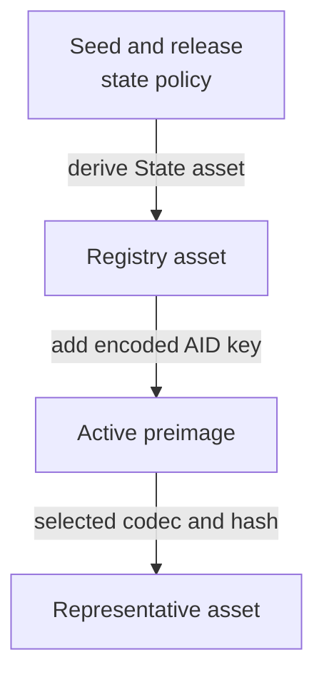
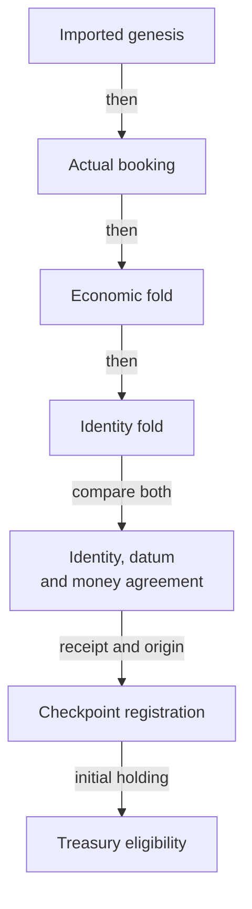

# Exact consumer identity

A relying contract wants Alice's eligible checkpoint in one chosen registry.
A valid checkpoint elsewhere must not authorize its payment. The reviewed
model makes that choice explicit before it examines a candidate holding.

## Identity and authority

The model binds to the public Singular revision
[`d69ab005c3b710aeebf033d3c5cd08c56feb5643`](https://github.com/lambdasistemi/singular/tree/d69ab005c3b710aeebf033d3c5cd08c56feb5643).
It imports the actual
[application-held identity declarations](https://github.com/lambdasistemi/singular/blob/d69ab005c3b710aeebf033d3c5cd08c56feb5643/models/singular-application-held/lean/SingularApplicationHeld/Core.lean)
from that same pinned tree. This nested model coexists with Singular's reduced
economic model; importing it does not establish a production implementation.

`stateAsset` returns the release's state policy and the hash of the encoded
State preimage containing the creation seed. `activeAsset` uses that full
registry asset and the encoded AID key in its Active preimage. The active
asset's policy is the registry's policy. These are the imported functions,
not a second naming algorithm copied into KERI.

The consumer definitions live in `CardanoKeri.ConsumerIdentity`; their exact
source identities and theorem statements are recorded in the repository's
consumer bindings and theorem-story ledger. The preserved custody baseline is
KERI revision `ff78b1c0d87a29d2f856cb32f1261591f84831db`.
All existing lifecycle eligibility, custody and economic contracts remain in
force. The new holding predicate adds identity and observation requirements.

| Choice | Alternative excluded | Reason |
|---|---|---|
| Independently fixed context | Let the candidate select its registry or release | Self-consistency does not authenticate the intended identity |
| Imported complete State and Active identities | Treat the reduced model's raw key or registry label as the asset name | The two representations have different purposes |
| Explicit finite codec and collision premises | Assume a finite cryptographic hash is globally injective | Separation claims need stated, bounded assumptions |
| Actual economic fold plus identity fold | Replace economic routing with the identity-only fold | The identity fold does not route request money |
| Preserved state eligibility inside the holding check | Treat any retained token or active leaf as consumable | Parked and pending holdings must refuse |

## The bounded registration bridge

The connected model begins at actual genesis and executes both folds. It
never starts by declaring that a final holding is valid.

`createRegistry` checks configuration correspondence and actual imported
genesis. `registerJoint` executes booking, the preserved economic fold, the
full-identity fold and Checkpoint registration. It checks the selected
outputs' key, reference, credential, datum, quantity, deposit and trie
mapping, then constructs the stored registration origin.

`moneyAgreementB` compares complete spent references, input reference/value
pairs, ordered output amounts, fee, donation and validity interval between
the two fold observations. This does not equate physical holding lovelace
with Checkpoint conviction bond, freeze bond and pool values. Those remain
separate abstractions pending a real decoder and observer.

The proofs establish inversion, completeness under the explicit component
premises, delivered-origin correspondence and preservation of the old
eligibility predicate. The connected fixture continues through all four
rotation branches, freeze and recovery, poison and clearing, park and local
revival, concrete conviction, booking and matching completion. It executes a
full-identity terminal fold against the same state reference and money
observations. A valid foreign request cannot complete the stored pending
request; a mixed fold that consumes that request can.

## What the interpretation must establish

The model takes a codec, hash, AID-to-key function and release-indexed datum
decoder as interpretation inputs. Its finite separation theorems expose the
codec and collision premises in their types. Distinct AID labels do not
imply distinct encoded keys without a corresponding mapping premise.

The executable corpus publishes its finite preimage tables and checks every
pair in the declared domain. Constant codecs, constant hashes and a constant
reduced-registry map fail their respective premises. These controls use a
fixture codec and hash; the concrete bytes follow in the next section.

| Boundary still owed | Effect on a real consumer |
|---|---|
| Hash collision freedom | Rely on BLAKE2b-256 having no collision over the identity domain; this is assumed, not proved |
| Published scripts | Bind actual policy application and script hashes to an authenticated release manifest |
| Network and release resolution | Obtain them independently; missing or conflicting evidence refuses |
| Datum and complete physical value | Decode the same output and establish its relation to the model's state and bonds |
| Current reference and holding movement | Verify current unspentness and observation fidelity; registration Origin is immutable metadata |
| Reduced registry identifier | Establish the explicit finite faithful mapping when separation relies on that representation |
| Discovery and settlement | Do not infer absence or terminality from an empty lookup or a provider failure |

`realizesState` checks the credential, representative quantity and decoded
AID/state. It has no current-reference or unspentness check. Local fixture
observations are explicitly selected model interpretations, not a production
observer. No checkpoint expiry or renewal behavior is supplied by the model.

## The concrete bytes

The model declares one concrete interpretation in
`CardanoKeri.ConsumerIdentity.Bytes`. The registry key of an AID is the
AID's qualified CESR text bytes. The codec is the Plutus Data serialisation of
the `Preimage` type in Singular's
[`singular_state/preimage` module](https://github.com/lambdasistemi/singular/blob/d69ab005c3b710aeebf033d3c5cd08c56feb5643/onchain/lib/singular_state/preimage.ak)
at the pinned revision. The hash is BLAKE2b-256, as in that module. The datum
decoder remains an input to the interpretation.

The upstream model carries byte strings such as transaction ids, policies,
asset names and keys as natural numbers. Each such field carries its bytes
through a bijective base-256 numeral, so empty strings and leading zero bytes
keep their identity. Output indices and deposits are plain integers.

| Premise of the consumer statements | Status for the concrete bytes |
|---|---|
| Finite encoding over the identity domain | Proved for every pair of contexts: reading the serialisation back recovers the seed, the registry and the key |
| Finite collision freedom over the identity domain | Reduced to BLAKE2b-256 having no collision over the same four preimages, which stays an explicit assumption |
| Distinct AIDs have distinct keys | Proved: the key is the AID's CESR text, so equal keys mean equal AIDs |

A 256-bit digest of inputs of any length cannot be injective, so no proof of
collision freedom exists; the statements name the assumption in their types.
With it, the theorems for different AIDs, different seeds and a rival seed's
registry hold for the concrete bytes.

The [vector table](https://github.com/lambdasistemi/cardano-keri/blob/a17ab42a1482b6515406a361dedfb4297c69ac04/lean/consumer-identity-vectors.json)
lists, for each state policy, seed and AID, the key, both serialised
preimages, both names and the representative asset a genuine holding
carries. The Lean emits the table and checks the committed copy. Each row runs
the consumer predicate: the committed asset is accepted, and a changed state
policy, transaction id, output index, AID or asset name is refused. Changing
any committed field of the table fails the check. The same code reproduces
every preimage and name of Singular's own table at the pinned revision,
across its five roles.

These checks cover the listed inputs only. The registration approval role
splices an already serialised holding address and is outside the consumer
statements. The Aiken consumer predicate must reproduce the table under
[the consumer implementation ticket](https://github.com/lambdasistemi/cardano-keri/issues/343).

## The consumer predicate in Aiken

`onchain/lib/cardano_keri/consumer.ak` is `consumableHoldingB` clause for
clause, in the Lean order: authenticated network and complete release, the
release's application credential, a total quantity of one for the
representative asset, and a decoded datum for the intended AID in a consumable
state (present, unfrozen, unpoisoned, at least `W` old). The registry and
representative asset names follow `registryAsset` and `representativeAsset`.
The network, release, seed and AID are arguments fixed by the relying contract.
The hash, codec, AID-to-key map and datum decoder are four function arguments
(Aiken data types cannot hold functions, so the Lean's `Interpretation` record
becomes those four arguments); the candidate output selects none of them.

| Lean | Aiken |
|---|---|
| `registryAsset` | `registry_asset` |
| `representativeAsset` | `representative_asset` |
| `decoded` | `decoded` (an inline datum goes to the decoder; any other datum is `None`) |
| `authenticatedContextB` | `authenticated_context` |
| `Checkpoint.consumableStateB` | `consumable_state` |
| `consumableHoldingB` | `consumable_holding` |

Two executable layers check it. All 32 queries of
`simulator/consumer-corpus.json` are generated by `scripts/consumer-vectors.mjs`
into `consumer_corpus_vectors.ak`, one test per row carrying the row's own
expected result; the four rows whose interpretation tables are incomplete or
ambiguous require the predicate to fail, never to answer. Property tests
(`consumer_tests.ak`) run each clause beside its refusal over generated
variations and name the theorem they mirror (CI01 to CI16). The vectors are
regenerated and compared by `node scripts/consumer-vectors.mjs --check`.

### The connected example

`consumer_example` is a spending validator for a relying contract. It is
parameterised by the consumer context (network, release, seed, AID) and the
checkpoint parameters, and it spends only if some reference input is a
consumable holding for that context. The end-to-end specification
(`ConsumerE2ESpec`) runs it on a local test chain: one transaction that
references the eligible holding settles, and transactions that reference a
rival registry's token, a holding of quantity two, a parked holding, a holding
with termination pending, and a retired holding (convicted, and absent) are
rejected when the consumer script evaluates false. Each refusal carries no
other script and passes the ledger rules, so the rejection is the consumer's
own verdict.

Two labels bound what this proves.

- **Test interpretation, not the registry byte layout.** The connected layer
  uses the declared functions of `consumer_test_interpretation`: the hash is
  blake2b-256; the code of a State preimage is `0x00`, the seed transaction
  id and the output index as eight bytes; the code of an Active preimage is
  `0x01`, the registry policy, the registry asset name and the AID as eight
  bytes; the AID's key is the AID as eight bytes; the decoder reads the inline
  datum as the decoded datum itself. None of this is the Singular registry's
  layout. A later change replaces that one module.
- **Seeded holding, not a registration journey.** The holdings are minted by a
  test-only policy at a test application credential. The genuine registration
  journey belongs to #324.

Declared limits of the example. A script cannot observe the network or resolve
a release, so the example's environment is the context it is parameterised with
(the trusted integration's observation). `now` is the lower bound of the
transaction's validity interval, in the same unit as the datum's birth time and
the maturity parameter; a transaction with no finite lower bound is refused.
A datum that does not decode as the declared shape makes the test decoder fail
rather than answer. The acceptance item that binds the predicate to the actual
Singular-backed output stays open: binding the Aiken predicate to the
concrete bytes above is the next slice of
[the consumer implementation ticket](https://github.com/lambdasistemi/cardano-keri/issues/343).

## Evidence and implementation acceptance

The source includes twenty-six proved consumer statements with bound
Given/When/Then stories. The model driver emits the complete accepted and
refused queries, connected certificate events and actual fold observations.
The browser and command-line simulator use the same pure consumer function;
their replay gates compare those observations with freshly generated Lean
output. Mutation controls change executable decision sites and retain setup
failures separately from detected behavioral faults.

This establishes a local model and simulator candidate. Independent acceptance,
hosted checks and publication are separate evidence. Production completion
under [the consumer implementation ticket](https://github.com/lambdasistemi/cardano-keri/issues/343)
requires both real implementation properties and connected ledger-boundary
tests, including the observation obligations above. Neither layer is supplied
by proving the model or replaying its corpus. This code is not for mainnet.

Start with the [consumer checklist](../user/consumer-checklist.md), then
[play the treasury story](../simulator/index.html?story=11).
