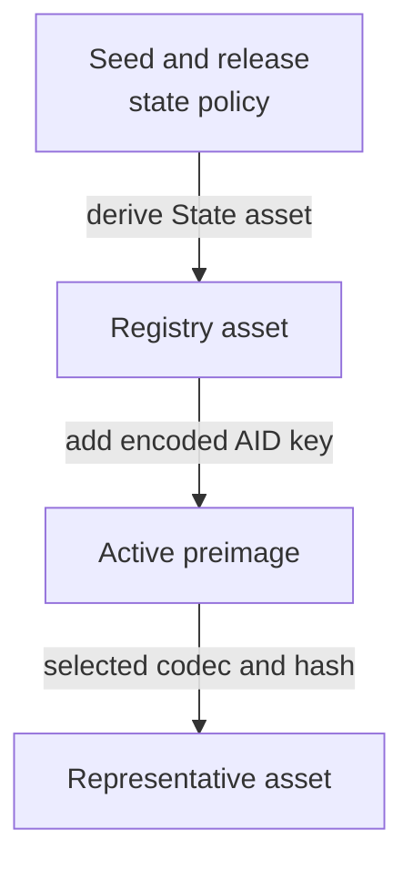
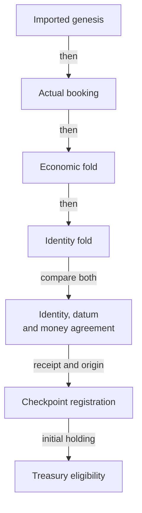

# Exact consumer identity

A relying contract wants Alice's eligible checkpoint in one chosen registry.
A valid checkpoint elsewhere must not authorize its payment. The reviewed
model makes that choice explicit before it examines a candidate holding.

## Identity and authority

The model binds to the public Singular revision
[`d69ab005c3b710aeebf033d3c5cd08c56feb5643`](https://github.com/lambdasistemi/singular/tree/d69ab005c3b710aeebf033d3c5cd08c56feb5643).
It imports the actual
[application-held identity declarations](https://github.com/lambdasistemi/singular/blob/d69ab005c3b710aeebf033d3c5cd08c56feb5643/models/singular-application-held/lean/SingularApplicationHeld/Core.lean)
from that same pinned tree. This nested model coexists with Singular's reduced
economic model; importing it does not establish a production implementation.

`stateAsset` returns the release's state policy and the hash of the encoded
State preimage containing the creation seed. `activeAsset` uses that full
registry asset and the encoded AID key in its Active preimage. The active
asset's policy is the registry's policy. These are the imported functions,
not a second naming algorithm copied into KERI.

The consumer definitions live in `CardanoKeri.ConsumerIdentity`; their exact
source identities and theorem statements are recorded in the repository's
consumer bindings and theorem-story ledger. The preserved custody baseline is
KERI revision `ff78b1c0d87a29d2f856cb32f1261591f84831db`.
All existing lifecycle eligibility, custody and economic contracts remain in
force. The new holding predicate adds identity and observation requirements.

| Choice | Alternative excluded | Reason |
|---|---|---|
| Independently fixed context | Let the candidate select its registry or release | Self-consistency does not authenticate the intended identity |
| Imported complete State and Active identities | Treat the reduced model's raw key or registry label as the asset name | The two representations have different purposes |
| Explicit finite codec and collision premises | Assume a finite cryptographic hash is globally injective | Separation claims need stated, bounded assumptions |
| Actual economic fold plus identity fold | Replace economic routing with the identity-only fold | The identity fold does not route request money |
| Preserved state eligibility inside the holding check | Treat any retained token or active leaf as consumable | Parked and pending holdings must refuse |

## The bounded registration bridge

The connected model begins at actual genesis and executes both folds. It
never starts by declaring that a final holding is valid.

`createRegistry` checks configuration correspondence and actual imported
genesis. `registerJoint` executes booking, the preserved economic fold, the
full-identity fold and Checkpoint registration. It checks the selected
outputs' key, reference, credential, datum, quantity, deposit and trie
mapping, then constructs the stored registration origin.

`moneyAgreementB` compares complete spent references, input reference/value
pairs, ordered output amounts, fee, donation and validity interval between
the two fold observations. This does not equate physical holding lovelace
with Checkpoint conviction bond, freeze bond and pool values. Those remain
separate abstractions pending a real decoder and observer.

The proofs establish inversion, completeness under the explicit component
premises, delivered-origin correspondence and preservation of the old
eligibility predicate. The connected fixture continues through all four
rotation branches, freeze and recovery, poison and clearing, park and local
revival, concrete conviction, booking and matching completion. It executes a
full-identity terminal fold against the same state reference and money
observations. A valid foreign request cannot complete the stored pending
request; a mixed fold that consumes that request can.

## What the interpretation must establish

The model takes a codec, hash, AID-to-key function and release-indexed datum
decoder as interpretation inputs. Its finite separation theorems expose the
codec and collision premises in their types. Distinct AID labels do not
imply distinct encoded keys without a corresponding mapping premise.

The executable corpus publishes its finite preimage tables and checks every
pair in the declared domain. Constant codecs, constant hashes and a constant
reduced-registry map fail their respective premises. These controls are not
cryptographic proofs or Cardano byte vectors.

| Boundary still owed | Effect on a real consumer |
|---|---|
| AID key encoding and State/Active serialization | Bind concrete KERI bytes to the selected upstream preimages and reviewed vectors |
| Hash and published scripts | Bind actual policy application and script hashes to an authenticated release manifest |
| Network and release resolution | Obtain them independently; missing or conflicting evidence refuses |
| Datum and complete physical value | Decode the same output and establish its relation to the model's state and bonds |
| Current reference and holding movement | Verify current unspentness and observation fidelity; registration Origin is immutable metadata |
| Reduced registry identifier | Establish the explicit finite faithful mapping when separation relies on that representation |
| Discovery and settlement | Do not infer absence or terminality from an empty lookup or a provider failure |

`realizesState` checks the credential, representative quantity and decoded
AID/state. It has no current-reference or unspentness check. Local fixture
observations are explicitly selected model interpretations, not a production
observer. No checkpoint expiry or renewal behavior is supplied by the model.

## Evidence and implementation acceptance

The source includes twenty-six proved consumer statements with bound
Given/When/Then stories. The model driver emits the complete accepted and
refused queries, connected certificate events and actual fold observations.
The browser and command-line simulator use the same pure consumer function;
their replay gates compare those observations with freshly generated Lean
output. Mutation controls change executable decision sites and retain setup
failures separately from detected behavioral faults.

This establishes a local model and simulator candidate. Independent acceptance,
hosted checks and publication are separate evidence. Production completion
under [the consumer implementation ticket](https://github.com/lambdasistemi/cardano-keri/issues/343)
requires both real implementation properties and connected ledger-boundary
tests, including the observation obligations above. Neither layer is supplied
by proving the model or replaying its corpus. This code is not for mainnet.

Start with the [consumer checklist](../user/consumer-checklist.md), then
[play the treasury story](../simulator/index.html?story=11).
