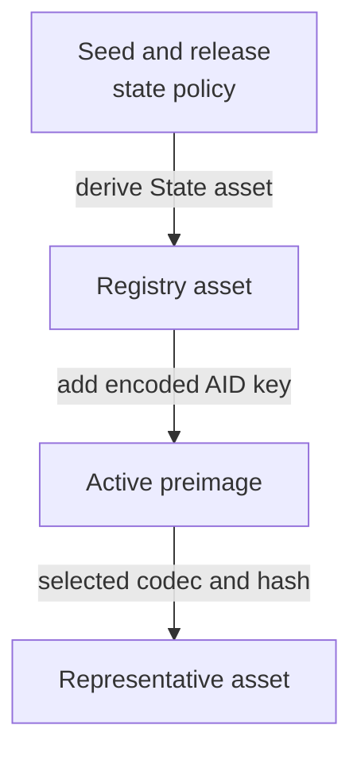
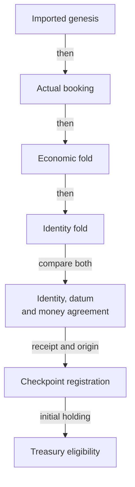
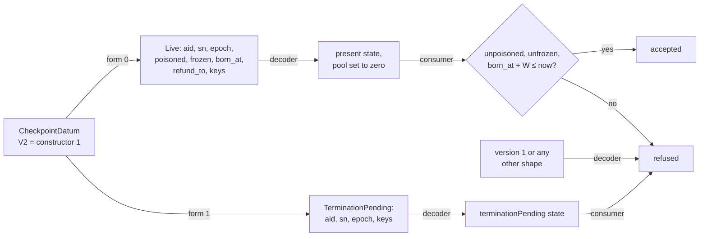
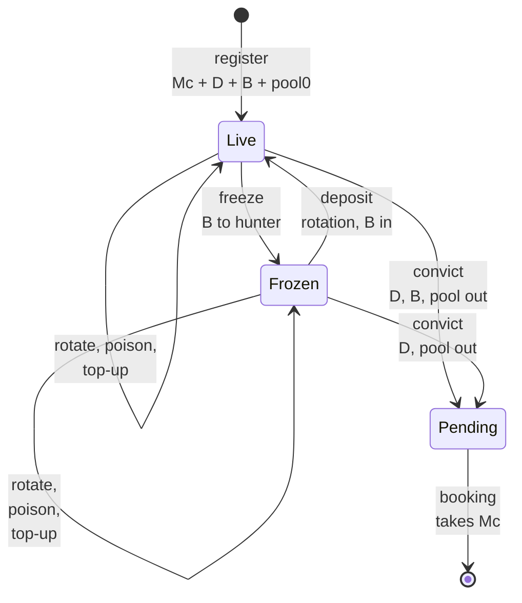

# Exact consumer identity

A relying contract wants Alice's eligible checkpoint in one chosen registry.
A valid checkpoint elsewhere must not authorize its payment. The reviewed
model makes that choice explicit before it examines a candidate holding.

## Identity and authority

The model binds to the public Singular revision
[`d69ab005c3b710aeebf033d3c5cd08c56feb5643`](https://github.com/lambdasistemi/singular/tree/d69ab005c3b710aeebf033d3c5cd08c56feb5643).
It imports the actual
[application-held identity declarations](https://github.com/lambdasistemi/singular/blob/d69ab005c3b710aeebf033d3c5cd08c56feb5643/models/singular-application-held/lean/SingularApplicationHeld/Core.lean)
from that same pinned tree. This nested model coexists with Singular's reduced
economic model; importing it does not establish a production implementation.

`stateAsset` returns the release's state policy and the hash of the encoded
State preimage containing the creation seed. `activeAsset` uses that full
registry asset and the encoded AID key in its Active preimage. The active
asset's policy is the registry's policy. These are the imported functions,
not a second naming algorithm copied into KERI.

The consumer definitions live in `CardanoKeri.ConsumerIdentity`; their exact
source identities and theorem statements are recorded in the repository's
consumer bindings and theorem-story ledger. The preserved custody baseline is
KERI revision `ff78b1c0d87a29d2f856cb32f1261591f84831db`.
All existing lifecycle eligibility, custody and economic contracts remain in
force. The new holding predicate adds identity and observation requirements.

| Choice | Alternative excluded | Reason |
|---|---|---|
| Independently fixed context | Let the candidate select its registry or release | Self-consistency does not authenticate the intended identity |
| Imported complete State and Active identities | Treat the reduced model's raw key or registry label as the asset name | The two representations have different purposes |
| Explicit finite codec and collision premises | Assume a finite cryptographic hash is globally injective | Separation claims need stated, bounded assumptions |
| Actual economic fold plus identity fold | Replace economic routing with the identity-only fold | The identity fold does not route request money |
| Preserved state eligibility inside the holding check | Treat any retained token or active leaf as consumable | Pending holdings must refuse |

## The bounded registration bridge

The connected model begins at actual genesis and executes both folds. It
never starts by declaring that a final holding is valid.

`createRegistry` checks configuration correspondence and actual imported
genesis. `registerJoint` executes booking, the preserved economic fold, the
full-identity fold and Checkpoint registration. It checks the selected
outputs' key, reference, credential, datum, quantity, deposit and trie
mapping, then constructs the stored registration origin.

`moneyAgreementB` compares complete spent references, input reference/value
pairs, ordered output amounts, fee, donation and validity interval between
the two fold observations. The bridge also requires the registry's deposit to be
the checkpoint's deposit plus freeze bond, and the declared carrier to be exactly
the lovelace the registered checkpoint holds, so the initial pool is what the
carrier holds above the minimum ADA, the deposit and the freeze bond (see [the
checkpoint output's value](#the-checkpoint-outputs-value)).

The proofs establish inversion, completeness under the explicit component
premises, delivered-origin correspondence and preservation of the old
eligibility predicate. The connected fixture continues through all four
rotation branches, freeze and recovery, poison and clearing, concrete
conviction, booking and matching completion. It executes a
full-identity terminal fold against the same state reference and money
observations. A valid foreign request cannot complete the stored pending
request; a mixed fold that consumes that request can.

## What the interpretation must establish

The model takes a codec, hash, AID-to-key function and release-indexed datum
decoder as interpretation inputs. Its finite separation theorems expose the
codec and collision premises in their types. Distinct AID labels do not
imply distinct encoded keys without a corresponding mapping premise.

The executable corpus publishes its finite preimage tables and checks every
pair in the declared domain. Constant codecs, constant hashes and a constant
reduced-registry map fail their respective premises. These controls use a
fixture codec and hash; the concrete bytes follow in the next section.

| Boundary still owed | Effect on a real consumer |
|---|---|
| Hash collision freedom | Rely on BLAKE2b-256 having no collision over the identity domain; this is assumed, not proved |
| Published scripts | Bind actual policy application and script hashes to an authenticated release manifest |
| Network and release resolution | Obtain them independently; missing or conflicting evidence refuses |
| Physical value | Read the premium pool from the output's value and require at least the minimum ADA, the deposit and the freeze bond the datum says are held (see [the checkpoint output's value](#the-checkpoint-outputs-value)); the validator enforcing it on chain is the datum version 2 work ([#339](https://github.com/lambdasistemi/cardano-keri/issues/339)) |
| Current reference and holding movement | Verify current unspentness and observation fidelity; registration Origin is immutable metadata |
| Reduced registry identifier | Establish the explicit finite faithful mapping when separation relies on that representation |
| Discovery and settlement | Do not infer absence or terminality from an empty lookup or a provider failure |

`realizesState` checks the credential, representative quantity, decoded AID and
datum facts, and the output's lovelace: the decoded state is compared with the
intended state, both with the pool set to zero, because the pool is an amount
held in the value and not a fact in the datum; the lovelace must be exactly
what the intended state holds. It has no current-reference or unspentness check. Local fixture
observations are explicitly selected model interpretations, not a production
observer. No checkpoint expiry or renewal behavior is supplied by the model.

## The concrete bytes

The model declares one concrete interpretation in
`CardanoKeri.ConsumerIdentity.Bytes`. The registry key of an AID is the
AID's qualified CESR text bytes. The codec is the Plutus Data serialisation of
the `Preimage` type in Singular's
[`singular_state/preimage` module](https://github.com/lambdasistemi/singular/blob/d69ab005c3b710aeebf033d3c5cd08c56feb5643/onchain/lib/singular_state/preimage.ak)
at the pinned revision. The hash is BLAKE2b-256, as in that module. The datum
decoder is declared in [the checkpoint datum](#the-checkpoint-datum).

The upstream model carries byte strings such as transaction ids, policies,
asset names and keys as natural numbers. Each such field carries its bytes
through a bijective base-256 numeral, so empty strings and leading zero bytes
keep their identity. Output indices and deposits are plain integers.

| Premise of the consumer statements | Status for the concrete bytes |
|---|---|
| Finite encoding over the identity domain | Proved for every pair of contexts: reading the serialisation back recovers the seed, the registry and the key |
| Finite collision freedom over the identity domain | Reduced to BLAKE2b-256 having no collision over the same four preimages, which stays an explicit assumption |
| Distinct AIDs have distinct keys | Proved: the key is the AID's CESR text, so equal keys mean equal AIDs |

A 256-bit digest of inputs of any length cannot be injective, so no proof of
collision freedom exists; the statements name the assumption in their types.
With it, the theorems for different AIDs, different seeds and a rival seed's
registry hold for the concrete bytes.

The [vector table](https://github.com/lambdasistemi/cardano-keri/blob/a17ab42a1482b6515406a361dedfb4297c69ac04/lean/consumer-identity-vectors.json)
lists, for each state policy, seed and AID, the key, both serialised
preimages, both names and the representative asset a genuine holding
carries. The Lean emits the table and checks the committed copy. Each row runs
the consumer predicate: the committed asset is accepted, and a changed state
policy, transaction id, output index, AID or asset name is refused. Changing
any committed field of the table fails the check. The same code reproduces
every preimage and name of Singular's own table at the pinned revision,
across its five roles.

These checks cover the listed inputs only. The registration approval role
splices an already serialised holding address and is outside the consumer
statements. The Aiken consumer predicate reproduces the table, as described
in [the concrete identity bytes in Aiken](#the-concrete-identity-bytes-in-aiken).

## The checkpoint datum

A contract author holds a candidate checkpoint output with an inline datum.
The consumer must read that datum exactly as the checkpoint writes it: which
AID it belongs to, whether it is live or awaiting termination, whether it is
poisoned, whether its bond is frozen and when it was born. A datum that does
not have that shape is refused. The model declares this datum, version 2, in
`CardanoKeri.CheckpointDatum`, together with the decoder the consumer runs.

Version 1, constructor 0, is the layout the checkpoint validator writes today.
It carries keys, thresholds, witnesses and counters, but no poison, no freeze,
no birth slot and no pending-termination form, so a poisoned checkpoint and a
clean one would be byte-identical. The decoder refuses it. Version 2 is
written by the model first; the on-chain validator adopts it later.

| Position | Field | Kind | Lean state | What the consumer does with it |
|---|---|---|---|---|
| Live 0, Pending 0 | `aid` | byte string: the qualified CESR text | `DecodedDatum.aid` | Requires it to equal the AID the relying contract fixed |
| Live 1, Pending 1 | `sn` | non-negative integer | `Live.sn`, `Hash.sn` | Nothing |
| Live 2, Pending 2 | `epoch` | non-negative integer | `Live.epoch`, `Hash.epoch` | Nothing |
| Live 3 | `poisoned` | Boolean | `Live.poisoned` | Refuses when true |
| Live 4 | `frozen` | Boolean | `Live.frozen` | Refuses when true: the bond is not held |
| Live 5 | `born_at` | non-negative integer | `Live.bornAt` | Refuses until `born_at + W ≤ now` |
| Live 6 | `refund_to` | byte string | `Live.refundTo` | Nothing |
| Live 7, Pending 3 | `keys` | key material | none | Checks its shape only |
| none | the premium pool | not in the datum | `Live.pool`, decoded as zero | Nothing; the amount is held in the value |

The key material is constructor 0 with six fields, in the version 1 types:
current keys (a list of byte strings), current threshold, next keys, next
threshold, witnesses (a list of byte strings) and `toad` (an integer). A
threshold is constructor 0 over an integer (unweighted) or constructor 1 over
a list of clauses, each a list of weights; a weight is constructor 0 over a
numerator and a denominator. A Boolean is Aiken's: false is constructor 0 and
true is constructor 1, both without fields.

| Decision | Chosen | Rejected | Why |
|---|---|---|---|
| Which datum the consumer reads | Version 2, declared in the Lean first | Decoding version 1 as written today | Version 1 carries none of the facts the consumer needs |
| How the AID is carried | Its qualified CESR text, the registry key of [the concrete bytes](#the-concrete-bytes) | The 32 raw digest bytes | The key is the text; rebuilding it from a digest needs a derivation code the datum does not carry |
| Where the pool and the bonds live | In the output's value | In the datum | The datum carries facts, the value carries amounts |
| What the decoder validates | Every shape in the whole datum; the values of the fields it reads | The full well-formedness of the key material | Key widths, threshold ranges, witness duplicates and `toad` are the checkpoint validator's obligation when it writes the datum |

The serialisation is Plutus Data's: constructors 0 to 6 as tags 121 to 127,
7 to 127 as tags 1280 to 1400, any other index as tag 102 over the index and
the fields; non-empty lists indefinite; maps definite; byte strings definite up
to 64 bytes, otherwise in chunks of 64; integers plain below 2^64, otherwise
tagged big numbers. A raw application datum is these bytes carried through the
same bijective numeral as the identity bytes. The reader also accepts the other
well-formed encodings of the same Data. One layout serves every release at this
model revision; a new layout is a new version constructor.

What the Lean proves about it:

- Reading back: every Data, read from its serialisation with any rest, returns
  with that rest (`parse_cbor`), and every serialised element is a byte, so the
  raw carrier is faithful (`decode_raw`).
- Written datums decode: for every AID, key material and state with an output,
  the decoder returns that AID and the state's facts (`decodeData_datum`,
  `decode_written`).
- Nothing else decodes: an accepted Data is exactly a written datum
  (`decodeData_complete`). A wrong version, version 1 included, a wrong number
  of fields, an unknown form and a field of the wrong kind are each refused
  (`wrong_version_refused`, `version_one_refused`, `version_arity_refused`,
  `unknown_form_refused`, `live_arity_refused`, `pending_arity_refused`,
  `live_fields_typed`, `pending_fields_typed`).
- The decoder is a function of the raw datum alone: one datum, one result,
  under every release (`decode_deterministic`, `decode_release_independent`).
- The consumer: with this decoder in the concrete interpretation, a holding
  carrying the datum written for any state, funded pools included, is accepted
  exactly when that state is consumable (`written_holding_iff`). A funded
  registration passes the registration bridge's datum check
  (`funded_registration_agrees`), and a version 1 datum is refused
  (`version_one_holding_refused`).

The twenty-six consumer statements are proved for every interpretation, so they
hold with this one. Their wording is unchanged; the three that compare a
decoded state with an intended one, through `realizesState` and the
registration bridge, compare the datum's facts and the output's lovelace, so
they apply to funded registrations too.

The vector table `lean/checkpoint-datum-vectors.json` lists seven written
datums with the decoder's result and the consumer's verdict on a genuine
holding (registered and funded, juvenile, rotated with weighted thresholds and
witnesses, poisoned, frozen, pending termination, numbers beyond 2^64), and
twenty-nine datums the decoder refuses, each a named change: version 1, an
unknown version, every wrong arity, every field of the wrong kind, a trailing
byte, a truncated datum. The Lean emits the table and checks the committed
copy against the decoder and the consumer predicate. Changing any committed
field fails the check, and every node of every accepted datum, replaced by a
node of another kind, is refused.

These checks cover the listed inputs; the theorems cover all inputs. The
Aiken consumer decodes version 2 ([the datum decoder in
Aiken](#the-datum-decoder-in-aiken)); the on-chain validator does not write
version 2 yet. Reading the pool and the bonds from the value is modelled in
[the checkpoint output's value](#the-checkpoint-outputs-value). This code is
not for mainnet.

## The checkpoint output's value

A contract author holds a candidate checkpoint output and has read its datum.
The datum says the checkpoint is live and its bond is not frozen, but it
carries no amounts. The author wants to know the bonds are really there: the
output's lovelace must be what that state holds, and a holding missing part of
a bond must be refused. The model states this amount in
`CardanoKeri.CheckpointValue` as `State.heldValue`.

The diagram reads in words: a registration delivers the minimum ADA, the
deposit, the freeze bond and the initial pool the registrant chooses. Every
later step moves exactly the amounts its flow names. A freeze pays the freeze
bond to the hunter, a rotation with a deposit brings it back, and a conviction
pays the deposit to the convictor and the bond and pool to the refund address.
The pending output keeps only the minimum ADA, which the termination booking
consumes.

| State | Lovelace the output holds | Floor: below it the holding is refused |
|---|---|---|
| Live, not frozen | `Mc + D + B + pool` | `Mc + D + B` |
| Live, frozen | `Mc + D + pool` | `Mc + D` |
| Pending termination | `Mc` | `Mc` |
| Absent or convicted | no output | none |

Here `Mc` is the registry's minimum ADA, `D` the deposit and `B` the freeze bond
of the checkpoint's parameters, and `pool` the premium pool. The datum's facts
and the lovelace together give back the whole state: the pool is the lovelace
above the floor (`withValue_iff`, `realizes_determines_state`).

- Every step keeps the amounts: what the input holds plus what the step takes
  in equals what the output holds plus what it pays out
  (`held_amounts_conserved`, `held_value_conserved`); a registration holds the
  minimum ADA plus everything it takes in (`registration_holds_carrier`).
- A conviction pays out everything the live checkpoint held except the minimum
  ADA, and the pending output holds exactly the minimum ADA the termination
  booking requires (`conviction_pays_out_every_amount`,
  `pending_holds_minimum_ada`).
- A holding below the floor realizes no state with those facts, whatever its
  pool (`short_holding_refused`, `missing_bond_lovelace_refused`).
- The registry books a carrier of at least `Mc + D_registry`, where the
  registry's deposit is the checkpoint's deposit plus freeze bond; one lovelace
  short is refused (`short_carrier_registration_refused`). A successful joint
  registration delivers exactly `Mc + D + B + pool0` (`registerJoint_value`).

| Decision | Chosen | Rejected | Why |
|---|---|---|---|
| The minimum ADA | Separate from the deposit, and the registry's `Mc` | Part of the deposit; a checkpoint parameter of its own | A conviction pays the whole deposit out, yet the pending output exists until the termination booking, which requires `Mc` of it |
| What registration delivers | A carrier of `Mc + D + B + pool0`, the pool chosen per registration | A fixed carrier; a pool or bond paid outside the carrier | The registry's fold delivers exactly the declared carrier to the output |
| Where the amounts live | In the output's value | In the datum | The datum carries facts; the value carries amounts |

The vector table `lean/checkpoint-value-vectors.json` takes the seven states of
the datum vectors and gives, for each, the lovelace its output holds, its floor
and what a holding with those datum facts reads as at lovelace values around
them: the state itself only at the lovelace it holds. It also books
registration carriers with initial pools of 0, 3 and five million, refuses one
carrier short by one lovelace, and records the connected registration fixture,
whose carrier of 17 is the minimum ADA 4, the deposit 8, the freeze bond 2 and
the pool 3. The Lean emits the table and checks the committed copy; changing
any committed field fails the check.

These checks cover the listed inputs; the theorems cover all inputs. The
consumer predicate itself does not read the value: a relying contract that
needs the bonds checks the lovelace against the floor, and the validator that
enforces the amounts on chain is the datum version 2 work
([#339](https://github.com/lambdasistemi/cardano-keri/issues/339)). How an
honest owner recovers the deposit, the freeze bond or the pool is not settled
by the model.

## The consumer predicate in Aiken

`onchain/lib/cardano_keri/consumer.ak` is `consumableHoldingB` clause for
clause, in the Lean order: authenticated network and complete release, the
release's application credential, a total quantity of one for the
representative asset, and a decoded datum for the intended AID in a consumable
state (present, unfrozen, unpoisoned, at least `W` old). The registry and
representative asset names follow `registryAsset` and `representativeAsset`.
The network, release, seed and AID are arguments fixed by the relying contract.
The hash, codec, AID-to-key map and datum decoder are four function arguments
(Aiken data types cannot hold functions, so the Lean's `Interpretation` record
becomes those four arguments); the candidate output selects none of them.

| Lean | Aiken |
|---|---|
| `registryAsset` | `registry_asset` |
| `representativeAsset` | `representative_asset` |
| `decoded` | `decoded` (an inline datum goes to the decoder; any other datum is `None`) |
| `authenticatedContextB` | `authenticated_context` |
| `Checkpoint.consumableStateB` | `consumable_state` |
| `consumableHoldingB` | `consumable_holding` |

Two executable layers check it. All 32 queries of
`simulator/consumer-corpus.json` are generated by `scripts/consumer-vectors.mjs`
into `consumer_corpus_vectors.ak`, one test per row carrying the row's own
expected result; the four rows whose interpretation tables are incomplete or
ambiguous require the predicate to fail, never to answer. Property tests
(`consumer_tests.ak`) run each clause beside its refusal over generated
variations and name the theorem they mirror (CI01 to CI16). The vectors are
regenerated and compared by `node scripts/consumer-vectors.mjs --check`.

### The connected example

`consumer_identity_example` is a spending validator for a relying contract. It
is parameterised by the consumer context (network, release, seed, AID) and the
checkpoint parameters, and it spends only if some reference input is a
consumable holding for that context, on the concrete identity bytes and the
datum decoder of the Lean model. The end-to-end specification
(`ConsumerE2ESpec`) runs it on a local test chain: one transaction that
references the eligible holding settles, and transactions that reference a
rival registry's token, a rival seed's token, a holding of quantity two, a
holding with termination pending, and a holding carrying a version 1 datum are
rejected when the consumer script evaluates false. Each refusal carries no
other script and passes the ledger rules, so the rejection is the consumer's
own verdict. The holdings carry version 2 datums written field by field from
the Lean layout, the AID as its qualified CESR text.

The Lean writes no datum for an absent or a convicted state
(`CheckpointDatum.datum` is `none` for both), so a retired holding with a
version 2 datum does not exist; those two arms of `consumable_state` stay
covered by the Aiken predicate tests.

One label bounds what this proves.

- **Seeded holding, not a registration journey.** The holdings are minted by a
  test-only policy at a test application credential. The genuine registration
  journey belongs to #324.

Declared limits of the example. A script cannot observe the network or resolve
a release, so the example's environment is the context it is parameterised with
(the trusted integration's observation). `now` is the lower bound of the
transaction's validity interval, in the same unit as the datum's birth time and
the maturity parameter; a transaction with no finite lower bound is refused.
A datum the decoder does not accept makes the consumer refuse the holding; it
never makes the script fail. The pool and the bond amounts are held in the
output's value and are not read from it (the datum decodes with a pool of 0;
[#339](https://github.com/lambdasistemi/cardano-keri/issues/339)). The
acceptance item that binds the predicate to the actual Singular-backed output
stays open: the registration journey is still outstanding.

### The concrete identity bytes in Aiken

`onchain/lib/cardano_keri/consumer_identity_bytes.ak` computes, in Aiken, the
names the Lean concrete interpretation computes. It is plugged into the
predicate through the existing function arguments; the predicate is unchanged.

| Lean (`CardanoKeri.ConsumerIdentity.Bytes`) | Aiken (`consumer_identity_bytes`) |
|---|---|
| `hash` | `hash`: BLAKE2b-256 |
| `code` of a State preimage | `code`: constructor 0 holding the seed's output reference, serialised as Plutus Data |
| `code` of an Active preimage | `code`: constructor 1 holding the registry (state policy, registry name) and the key, serialised as Plutus Data |
| `keyOf` of an AID, through the carrier `unpack` | `key_of`: the bytes the AID's number carries, which are its qualified CESR text |
| `aidOfCesr`, `pack` | `aid_of_cesr`, `pack` |

The relying contract fixes the state policy, the seed and the AID. The AID is
the Lean `aidOfCesr` of its CESR text: the bijective base-256 number of the
text's UTF-8 bytes. Only the State and Active preimages are computed, because
the predicate uses only those two roles.

Three executable layers check it.

- **The Lean vectors.** `consumer_identity_vectors.ak` is generated by
  `scripts/consumer-identity-vectors.mjs` from
  `lean/consumer-identity-vectors.json` (`just gen-consumer-identity-vectors`).
  `just check-consumer-identity-vectors` rejects any drift and runs in the
  Onchain CI job beside the corpus vectors check. For each of the eight
  vectors there is one test per claim: the state preimage, the registry name,
  the key (and the AID back from the key), the active preimage, the active
  name and the representative asset, each compared with the Lean bytes.
- **Properties** (`consumer_identity_tests.ak`): the byte carrier laws, every
  width of the output index, the change of the active name under each
  committed field (seed transaction id, seed output index, state policy, AID)
  over a grid of seventy-two contexts, and the predicate itself accepting the
  holding named by the concrete bytes and refusing every rival's.
- **Connected.** `ConsumerE2ESpec` recomputes the names from the Lean layout,
  checks them against the vectors, and on the local test chain settles a spend
  that references the holding so named and refuses, in the consumer script, a
  spend that references a rival seed's holding.

What stays a declared test choice: the environment (the contract's own context
stands for the trusted integration's observation) and the seeded holdings (the
genuine registration journey belongs to
[#324](https://github.com/lambdasistemi/cardano-keri/issues/324)). These
checks cover the vectors and the generated variations only: byte strings of
more than 64 bytes would be serialised in chunks, which no vector reaches (a
CESR text is 44 bytes). This code is not for mainnet.

### The datum decoder in Aiken

`onchain/lib/cardano_keri/consumer_checkpoint_datum.ak` is
`CardanoKeri.CheckpointDatum.decodeData` and `decode` over the inline datum as
Plutus data, with the Lean's field readers under the same names. The consumer
validator passes the concrete identity bytes and this decoder to the predicate.

| Lean (`CardanoKeri.CheckpointDatum`) | Aiken (`consumer_checkpoint_datum`) |
|---|---|
| `decodeData` | `decode_data` |
| `decode` (ignores the release) | `decode`, the predicate's decoder argument |
| `bool?`, `nat?`, `byteString?` | `bool`, `nat`, `byte_string` |
| `bytesList?`, `weight?`, `clause?` | `bytes_list`, `weight`, `clause` |
| `threshold?`, `keyMaterial?` | `threshold`, `key_material` |
| `pack` of the `aid` and `refund_to` bytes | `consumer_identity_bytes.pack` |
| the pool decoded as 0 | `pool: 0` |
| `parse`, `ofBytes?`, `cbor` (the raw bytes layer) | none on chain; see below |

**Raw bytes are the ledger's.** The Lean reads the datum's serialised bytes.
On chain the ledger delivers the inline datum to the script already as plutus
data, so the Aiken decoder starts at the data and has no counterpart of
`parse`. This is a representation boundary, declared here: nothing in this
repository runs the ledger's parse, and the connected test above is the only
evidence that the data the ledger delivers is the data the Lean describes. In
the Aiken tests, `aiken/cbor.deserialise` of a vector's datum bytes stands in
for the ledger's parse; bytes that are not one whole datum never reach the
decoder, as the Lean's `ofBytes?` refuses them. The one vector with tagged big
numbers (`large-numbers`) cannot be read that way, because that function stops
the whole test run on a tagged big number. Its tests use data the generator
builds, and require that this data serialises, with the plutus serialiser, to
the vector's bytes, so the bytes of that row are checked against the Lean's
inside the suite.

**The decoder never fails.** Every unwrap of plutus data follows a test of its
kind, so a datum the decoder does not accept is `None`, never an abort: a
contract that scans reference inputs skips an unrelated output's datum instead
of failing on it.

Two executable layers check it, beside the connected run.

- **The Lean vectors.** `consumer_checkpoint_datum_vectors.ak` is generated by
  `scripts/checkpoint-datum-vectors.mjs` from
  `lean/checkpoint-datum-vectors.json` (`just gen-checkpoint-datum-vectors`).
  Each of the thirty-six rows has a test that the decoder returns the row's
  result and a test that the consumer predicate, on the concrete identity bytes
  and this decoder, returns the row's verdict; each test is named after the
  row. The Lean CI job runs `node scripts/checkpoint-datum-vectors.mjs --check`
  as the last step of `scripts/check-consumer-design.sh` and fails on any
  drift; `just check-checkpoint-datum-vectors` runs the same check locally.
- **Properties** (`consumer_checkpoint_datum_tests.ak`): the decoder never
  fails on arbitrary data; every value of each field it reads decodes to the
  Lean's result; and every other kind of node in each position, including each
  component of the key material, is refused.

These checks cover the vectors and the generated variations only. This code is
not for mainnet.

## Evidence and implementation acceptance

The source includes twenty-six proved consumer statements with bound
Given/When/Then stories. The model driver emits the complete accepted and
refused queries, connected certificate events and actual fold observations.
The browser and command-line simulator use the same pure consumer function;
their replay gates compare those observations with freshly generated Lean
output. Mutation controls change executable decision sites and retain setup
failures separately from detected behavioral faults.

This establishes a local model and simulator candidate. Independent acceptance,
hosted checks and publication are separate evidence. Production completion
under [the consumer implementation ticket](https://github.com/lambdasistemi/cardano-keri/issues/343)
requires both real implementation properties and connected ledger-boundary
tests, including the observation obligations above. Neither layer is supplied
by proving the model or replaying its corpus. This code is not for mainnet.

Start with the [consumer checklist](../user/consumer-checklist.md), then
[play the treasury story](../simulator/index.html?story=11).
