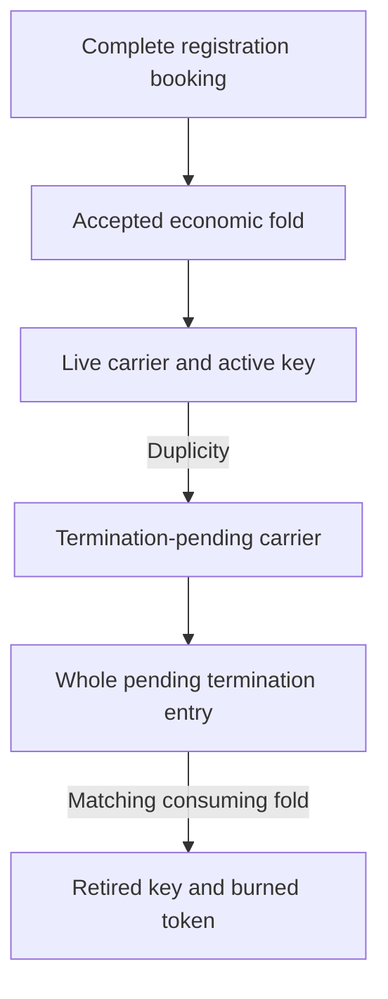

# The registry and retained identity outputs

As an identity owner, I keep my checkpoint alive — bonds, rotations,
unfreezing — until it is convicted; there is no owner exit, no parking and no
revival. As a relying party, I see a checkpoint that is either alive or
convicted, and I must refuse a termination-pending output. As a folder, I can
process an admitted request without becoming the identity's controller.

These are model guarantees under their stated premises. The simulators execute
model transactions; they do not establish Aiken, builder or deployed conformance.
The [no owner exit revision](https://github.com/lambdasistemi/cardano-keri/issues/493)
and the [correspondence register](https://github.com/lambdasistemi/cardano-keri/issues/435)
own the lifecycle revision; the earlier
[parking revision](https://github.com/lambdasistemi/cardano-keri/issues/437) is superseded. The
[earlier design record](https://github.com/lambdasistemi/cardano-keri/blob/70f3fc800fb3e49f9eb55584b62a2c87a82eb08d/docs/design/registry-as-mpfs.md)
remains historical; its replaced lifecycle and economic claims are not current guarantees.

## Where the registry is built

The model imports the public Singular commit
`d69ab005c3b710aeebf033d3c5cd08c56feb5643`, tree
`2979dcfc58b092313b0ce7fa0493722539b9ea65`, under Lean 4.27.0.
The pinned sources define the imported generic booking, economic fold and
registration-recovery judgments. Public upstream requirements include
[registration](https://github.com/lambdasistemi/singular/issues/742),
[termination](https://github.com/lambdasistemi/singular/issues/743),
[reading](https://github.com/lambdasistemi/singular/issues/744) and
[integration](https://github.com/lambdasistemi/singular/issues/747).
The executable model pin and those product requirements are distinct evidence.

`Registry.Sys.toWorld` projects KERI carriers and pending entries to the
imported `Singular.World`. Registration booking and termination booking invoke
its actual judgments. `Registry.fold` invokes `Singular.foldAccepted`, then
reconstructs the KERI state and checks that its projection equals the returned
world. `RegistryAgreement.lean` binds this correspondence. KERI retains its
own admission, authorization, custody metadata and addressed local flows.

## The machine (`Registry.lean`)

`Sys` contains the generation, imported configuration and trie, carriers,
registration bookings, complete termination entries, treasury, permanent
AID/token bindings and next token counter. A carrier stores its original
holding, AID, token, key counter, local state and minimum ADA. A termination
entry retains the complete generic booking and the original carrier metadata.

| Action | Given | When | Then |
| --- | --- | --- | --- |
| Registration booking | A complete generic booking with carrier value at least `Mc + D` (minimum ADA, then the checkpoint's deposit and freeze bond, then the initial pool the registrant chooses) and the configured tip | `bookRegistration` accepts; a carrier one lovelace short is refused | The request is pending; no carrier has been created yet. |
| Registration fold | Reachable state, the matching generation/plugin, KERI inception and an accepted imported economic transaction | `fold` consumes the booking | A carrier and permanent AID/token binding are installed with the committed holding. |
| Convict carrier | A live carrier and duplicity against its key counter | `convictCkpt` accepts | Retain a termination-pending carrier and the active registry key. |
| Book termination | That pending carrier and an exactly matching generic booking | `bookTermination` accepts | Move custody into the whole pending entry; retain its token/key/original holding association. |
| Complete termination | A reachable pending entry and accepted consuming fold | `fold` consumes that request | Remove that pending entry, burn its active token and retire its key. Unconsumed entries remain whole. |
| Registration recovery | The complete imported retraction or rejection transaction | The generic recovery judgment accepts | Reconstruct precisely the resulting pending registrations without changing unrelated custody. |

The coarse Registry predicates are `inception` and `duplicity`. They are declared abstractions, not cryptographic verification
or a proof that they equal Checkpoint's concrete evidence predicates. In
particular, the Registry flow does not summarize the Checkpoint conviction's
bond and pool distribution.

`Carrier.original` is the stable imported holding descriptor retained as
provenance. It does not prove equality with the complete serialized, evolving
Checkpoint datum or a current ledger output reference. The separate coarse
key counter and concrete Checkpoint key-state encoding are not universally
equated by this adapter.

## What registration guarantees

Given a reachable Registry state, the model preserves unique carrier and
pending custody, permanent bindings and the imported world's invariant.
A second successful first-registration cannot replace an active or retired
key. There is no park and no revival, so no local step mints a new
incarnation. These guarantees are scoped to one model registry.

`RegistryReach.lean` proves reachable well-formedness. `RegistryCustody.lean`
and `RegistryBurns.lean` prove custody and the fold-only retirement boundary.
`RegistryMetadata.lean`, `RegistryFold.lean` and `RegistryCompleteness.lean`
prove reconstruction and completeness under the complete premises.
`RegistryAuthorization.lean` proves the local authorization consequences.
The numbered public consequences and inversions remain in `RegistryGoals.lean`.

An active key is not a consumer authorization. The reader must inspect the
application output and enforce the consumer contract. Exact token bytes,
canonical registry selection and transaction validity extensions remain in
[consumer authentication](https://github.com/lambdasistemi/cardano-keri/issues/439).

## Checkpoint and the associated system

`Checkpoint.lean` owns the funded local lifecycle: concrete duplicity,
rotation and signed intent, conviction/freeze bonds, pool, refund address,
poison, freeze and juvenility. There is no `close` and no `reopen`: a
checkpoint leaves the live states only by conviction. The proved
`consumableStateB` mirror refuses pending and convicted states.

`SysStep` adds the actual registered origin and pending request association.
`CheckpointCertificate.lean` replays Registry history under the stored
parameters, environment and initial configuration. Registration requires an
actual accepted registration. Booking binds the request reference, AID, token,
key state and complete entry to the origin. Completion needs an accepted fold
consuming that exact entry. A valid receipt for a different request in the same
context is insufficient. A local pending state has no local exit.

`CheckpointCompletionGoals.lean` states these receipt consequences.
`CheckpointSystemFixtures.lean` supplies connected registration, rotation,
conviction, booking and completion journeys, including a mixed fold and
other-request refusals. The page's associated-system panel shows both addressed
Checkpoint flow and Registry flow beside their full states.

## Booking and fold economics

Given `Mr + tip ≤ Mc`, booking splits the carrier minimum ADA exactly:

- `Mr + tip` funds the termination request.
- `Mc - Mr - tip` is the booker's premium.
- The booking fee is paid separately by the booker.

A live carrier retains `Mc`; it cannot pay that value to a reaper. Booking needs
conviction first. `Samaritan.booker_nonloss_iff` compares the premium with the
booking fee. There is no unconditional promise that a booker makes a profit.

The imported fold accounts for actual inputs, outputs, fees and donation.
Registration delivers the declared carrier ADA, destination and datum to the
token-bearing output and routes registration cost to treasury. Termination
creates no carrier output: request ADA less declared tip goes to treasury,
which is `Mr` for a matching KERI booking. Declared tips are ordinary value
subject to transaction accounting, not an automatic payment to a named person.
`termination_fold_accounting` and `self_fold_addressed_accounting` use those
values. The latter requires all ordinary outputs at the named address, matching
booking data and its other explicit transaction premises. A fold does not
promise an automatic refund of `Mr` to the booker. Booking conservation and
addressed self-fold accounting are different claims.

## Executable evidence and limits

The [Registry simulator](../simulator/registry/index.html) replays complete
wire-v3 transactions, including refusals and economic boundaries. The
[Checkpoint simulator](../simulator/index.html) has local lifecycle stories and
a separate associated-system player. The canonical reader stories are
`simulator/M1-STORIES.md` and `simulator/REGISTRY-STORIES.md`.

The Lean build, exact contract checks, compiled axiom inventory, finite model
mutations, fresh corpus replay and browser/CLI checks cover separate evidence
classes. Their source bindings are recorded with the candidate. Finite examples
are not the universal proofs; checker mutations are not model mutations.

The model does not establish production transaction construction, submission,
rollback handling, live-chain availability or cryptographic codec correctness.
Broader application request recovery remains in
[request lifecycle](https://github.com/lambdasistemi/cardano-keri/issues/468).
Those obligations require their own model correspondence and both implementation
test layers before production acceptance.
