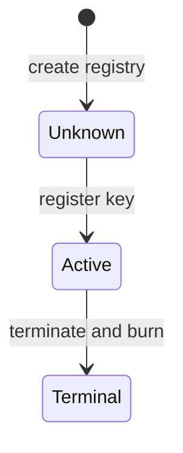

# The registry as an MPFS instance

For KERI integrators, the [current upstream comparison](#where-the-registry-is-built)
explains the registry KERI is preparing to bind to. The earlier model record
on this page is historical context. Its dormant leaf, burn-on-reap and
request-rejection descriptions require the model-first alignment recorded in
the [Lean correspondence register](https://github.com/lambdasistemi/cardano-keri/issues/435).

!!! note "What ships, and the accepted design"
    Unless a paragraph below is marked as preprod or `main` today, it
    describes the accepted design (D-036 to D-040). In that design an
    identity is **active**, **parked** (no checkpoint on chain; the registry
    leaf keeps the hash of its last key state) or **convicted** (terminal,
    after a duplicity proof); there is no withdraw; the only close is **the
    reap**, a rotation by the next keys; a `deposit` rotation is the
    unfreeze; and the **poison**, the owner's own lock on the checkpoint,
    lasts one epoch and is cleared by rotation. Play the
    [checkpoint simulation](../simulator/index.html).
    What ships today is the V1 checkpoint with role addresses.

The AID registry ruled by D-024 — one UTxO holding the MPF root over every
AID ever registered — built as a cage (an MPFS store, a Merkle Patricia
Forestry map behind one validator) of the Merkle
Patricia Forestry store
([cardano-mpfs-onchain](https://github.com/cardano-foundation/cardano-mpfs-onchain))
on its plugin path, after the rulings of 2026-09-02/03, and built today in
[singular](https://github.com/lambdasistemi/singular); see
[Where the registry is built](#where-the-registry-is-built). This page names the
Lean declaration behind every claim. The machine is
`lean/CardanoKeri/Registry.lean`; the theorems are
`lean/CardanoKeri/RegistryGoals.lean`; the generic cage and the divergence
from mpfs as shipped are `lean/CardanoKeri/Cage.lean`; the reaper's
economics — the samaritan is whoever performs a reap or a fold on another
identity's behalf, and the module proves they never lose money doing it — are
`lean/CardanoKeri/Samaritan.lean`; the simulator is
[Registry Simulator](../simulator/registry/index.html).

## Why a cage, and why the leaf carries state

D-024 as first stated has every registration spend the registry UTxO
directly: "inceptions queue on the registry UTxO." Cardano has no queue for
conflicting spends: each node keeps the first spend it hears and never
switches (the consensus layer's *linear consistency*, IOG technical report
§13.1), the slot leader includes its own first arrival, losers fail phase 1
at no cost but must rebuild against the new root. A burst of N registrants
clears in about N blocks with O(N²) rebuilds. The cage shape moves the race
away from the users: a registration is a **request**, an inbox UTxO that
contends with nothing, and a **fold** spends the registry with many at once.
Folders race; requesters are served by whichever fold lands, or fold their
own request.

Checkpoints come and go — an owner parks, a thief is convicted, a min-ADA
is worth reclaiming — so the registry tracks their "go" state. The cage never
interprets a leaf; the value is the protocol's:

| leaf | meaning |
|---|---|
| `active token` | a checkpoint carries that token; consumers resolve the token, never the leaf, so rotations never write the registry |
| `dormant k` | the checkpoint has left the chain; `k` is the key state a revival must rotate from |
| `convicted` | for ever |

The guarantee is one leaf and at most one checkpoint per AID in the model;
`active` does not establish consumer eligibility. During the reap/fold handoff
it can refer to a pending go-request instead of an existing checkpoint.
`token` and `k` are abstract values, not specified asset-name or key-state
encodings. For when minting occurs, what the plugin must establish and which
parts remain abstract, read
[What registration guarantees](../architecture/follow-one-identity.md#what-registration-guarantees).

## Where the registry is built

As a KERI integrator, use the redesigned Singular registry to obtain one
active token per key in a chosen registry, while keeping KERI admission and
recovery rules in the KERI application. The public target is
[Singular's redesign](https://github.com/lambdasistemi/singular/issues/731),
particularly [registration](https://github.com/lambdasistemi/singular/issues/742),
[termination](https://github.com/lambdasistemi/singular/issues/743) and
[reading](https://github.com/lambdasistemi/singular/issues/744).
This section describes that upstream target as read on 26 October 2026,
not behavior already implemented by Cardano KERI.

The state policy is `S = state(A)`, the state contract applied to the
application policy. Its datum holds the registry's trie root. After genesis,
it acts only at a fold. There is no Singular request script, request tag,
rejection operation, booking check, configured tip or treasury routing.
Requests sit at the application's address with one application approval;
the application owns request protection, reclaim, cleanup and refunds.

Registration requires a proof that the key is absent and the matching
application approval. The same fold inserts the active leaf and mints one
active token into a holding with the committed destination, initial datum
and minimum deposit. Termination consumes its approval, burns the active
token and leaves a permanent terminal leaf. There is no delete or registry
revival edge. Rotation and application payload changes carry the token to a
successor holding without changing the registry.

### Canonical identity and exact token

A permissionless registry does not prohibit another registry created from
another seed. Consumers authenticate the canonical registry they intend to
use. Its identity is `(S, R)`: the state policy and the registry token name.
The [registry address](https://github.com/lambdasistemi/singular/issues/728)
encodes that pair in bech32, with the network in its prefix. The expected
state policy is derived from the Singular and KERI application releases.

The redesigned names use `blake2b_256` over serialized Plutus Data: the
registry name commits a `State{seed}` preimage; the active name commits an
`Active{(S, R), key}` preimage. The latter is a hash bound to the full registry
identity, not the raw key. These expressions name the committed fields,
not an implementable encoding. **The exact preimage byte specification and
termination approval vectors are not settled upstream.** Whether registration
approval commits the holding's payment credential or its full address is
also **not settled upstream**. No encoder should infer those choices from
this page.

The reader derives the active asset and queries it under `S`. Finding it
is not yet KERI authorization: its holding may be a checkpoint, a parked
output or a pending termination. A missing token cannot distinguish never
registered from terminal; use history replay or a proof against the on-chain
root. Wrong network, an unknown application release or provider failure must
not become a successful negative lookup.

### KERI changes remain pending

At Cardano KERI `7cb4e716107d8ca7cc53dcdb0cd26549315ee256`,
`Registry.lean` still carries `Status.dormant k`, `Op.revive`, `rejectOne`
and a reap that burns before a later fold. `SingularBinding.lean` still
imports the old interface from dependency
`f844a8f423eaf65009c587b9d7dd9ad3e00d21af`; its one refusal theorem does not
establish correspondence with the redesign. The
[full comparison](../demos/d02-registry-mapping.md) records the affected
requirements against those revisions.

For an identity owner to park and later revive, the
[recorded parking ruling](https://github.com/lambdasistemi/cardano-keri/issues/437)
requires a KERI output retaining the token and last key state, with the
registry leaf staying active. The retained output also retains its minimum
ADA. For a relying party to refuse proven duplicity permanently, KERI must
validate the duplicity evidence before issuing termination approval. Both
stories require the model changes tracked in the
[Lean correspondence register](https://github.com/lambdasistemi/cardano-keri/issues/435).
They are not delivered by this page or by the existing model simulator.

For a registrant to receive the checkpoint approved at booking, KERI's
approval policy must check inception evidence and receipts, the refund
address, bonds and initial datum before minting approval. The initial datum
is committed then, so the birth slot must be modeled at booking, not at the
fold. The checkpoint datum must carry registry identity and the active
asset, and the AID's exact key encoding must be bound. Checkpoint and fact
tokens need a separate policy from approvals: each request carries exactly
one application-policy token and no other fold input may carry one.

For a requester to recover funds safely, KERI must model its own processing,
reclaim and cleanup rules. The folder takes the request ADA above what the
application requires to remain; a termination request can release all its
ADA to the folder. KERI must bind its refunds and conviction economics,
not inherit open datum's controller or treasury choices. Singular supplies
no early rejection for an unprocessable registration.

| Choice in the upstream target | Alternative it replaces | Consequence for KERI |
| --- | --- | --- |
| Application policy fixed in the state script | Application pin supplied in a datum | Derive the expected state policy for each release. |
| Approval commits registration delivery | KERI admission performed during the fold | Validate admission at booking and preserve the committed datum and deposit. |
| Application-held parking | Dormant registry leaf and revival by reminting | Align the KERI model first; retain the active token. |
| Registration and permanent termination only | Additional registry lifecycle edges | A further edge needs a new state policy and new registries. |

Uniqueness is per registry, not across all releases and all registries.
[Registry integration](https://github.com/lambdasistemi/cardano-keri/issues/324),
[request recovery](https://github.com/lambdasistemi/cardano-keri/issues/468)
and [consumer authentication](https://github.com/lambdasistemi/cardano-keri/issues/439)
remain pending. The public
[integration and release ticket](https://github.com/lambdasistemi/singular/issues/747)
is not a receipt for KERI behavior. The sections below retain the earlier
model rationale and theorem record; they do not describe the redesigned
upstream contract or establish its implementation acceptance.

## The rulings, verbatim (2026-09-02/03)

The operator's words in the design conversation, in order, with the precision
added when asked. The machine's doc comments and the theorems cite them; a
ruling that lived only in the transcript would not exist.

1. "no 69 is wrong, I just want permissionless to remove censorship in
   cardano-keri aid registry (inception registration and aid convition or
   sunsetting)" — the purpose: permissionless registration, conviction and
   sunsetting, against censorship by an oracle.
2. "normal operation consume the leaves indirection (a UTxO). The problem is
   registry snapshotting" — the leaf is an indirection; readers consume the
   UTxO it points at.
3. "the registry provide aid utxo uniqueness. Can we prove that a checkpoint
   for an id is unique ? Can a mint policy depend on the registry and mint
   only unique assetName based on that ?" — uniqueness is the registry's
   job; the mint couples to the absence proof (R1d, R2).
4. "Yes permissionless version can't be closed" — no close edge in the
   registry; a checkpoint leaves only by reap (and the checkpoint machine
   must follow: clarity Q-R1).
5. "Now we nned to model the pluggability in lean or we cannot reuse the
   mpfs theorems. What about the permissioning divergence ? Is lean
   accounting for that ?" and "convicting an aid needs special code on-chain,
   so aiken contract has to admit staking withdrawals based plugins" —
   `Cage.lean`: `AuthMode`, `Plugin`, `ValueMode`, the divergence theorems.
6. "checkpoints come and go, the registry should track their "go" state.
   When an aid is active the registry store it's indirection (UTxO), when
   the aid is inactive the registry tell us what it's checkpoint can be if
   revived: to be rotated or convicted for ever" — the leaf
   `active token | dormant k | convicted`; the indirection is **the
   checkpoint token** (asked and answered); a dormant AID is **revived by a
   witnessed rotation from the recorded key state, or convicted forever**
   (asked and answered).
7. "this is why the cage update is pluggable" — the leaf operation is the
   cage's; its admission and its coupling are the plugin's (`processBody`).
8. "there is a problem with incentives, who pays to move a "go" in the
   registry , when the bond was already taken ?" then "So the premium is the
   min-ada recovered from the checkpoint ? I want to be sure that there is a
   permissionless incentive to burn checkpoints closed and convicted" and
   "but checkpoints also have freeze bond and advance premium, I bet those
   are returned to the return addrss" — the reap: the go-request is funded
   from the checkpoint's min-ADA, the rest is the reaper's premium; bonds
   and pool went back to the refund address before (the parked checkpoint
   holds only `Mc`).
9. "can you prove the good samaritan recovering abandoned checkpoints will
   not lose ada in requesting their un-referencing ?" — `Samaritan.lean`,
   `R11_reap_is_samaritan`, with the condition the theorem carries
   (`tip + fee ≤ Mc`, after the go-request is folded).
10. "for the rest we are good togo" — the slice's scope closed there.
11. (2026-09-03, evening) "aren't SPOs the only obvious beneficiaries of
    paid permissionless liveness systems ? MPFS permissionless version style
    i.e. and in particular the current block producer", "it's even worse, as
    the block producer can just observe the mempool and steal the value", and
    the ruling: "whenever a user needs a reaper, it should try to be one
    obliging the leader to steal or lose the premium" — the tip and the
    premium are the block producer's when it wants them; the requester and
    the owner post their own folds and reaps, and the leader serves them
    either way. See "Who is paid" below and Q-R6.

## The machine (`Registry.lean`)

`Sys` is the registry UTxO (`gen`, `plugin`, `leaves`), the checkpoint
UTxOs (`ckpts`: `live`, `parked since`, `tomb`, each with its token and key
state), and the inbox (`requests`, `nextReq`), plus the next token the
checkpoint policy mints. `Action` is the cage's redeemers, the reap, and the
checkpoint edges the registry must never see:

| action | actor | guard | effect |
|---|---|---|---|
| `contribute aid owner submittedAt op` | anyone | `op.userPostable` (register, revive, convict) | a request; `op.bond + tip` deposited |
| `fold folder gen plugin batch` | anyone | `gen = s.gen`, `plugin = s.plugin`, `batch ≠ []`, then per entry | registry spent; per request `processOne` or `rejectOne`; `tip` per request to the folder |
| `retract req` | the owner | `inPhase2` | bond and tip back; registry untouched |
| `reap reaper aid` | anyone | `reapable`: a tombstone; a parked checkpoint after `since + W`, or with `quorum` | token burned; go-request posted with `submittedAt := far`; premium `Mc − Mr − tip` to the reaper, `Mr + tip` into the request |
| `pause aid` | next keys | live, `rotationFrom aid k` | parked at `now`, key state `k + 1`; registry untouched |
| `resume aid` | next keys | parked, `rotationFrom aid k` | live, `k + 1`; registry untouched |
| `convictCkpt aid` | a proof | not a tombstone, `duplicity aid k` | tombstone; registry untouched |

Per request in a fold, after the cage's `inPhase1` (`processOne`), the
plugin's body `processBody`:

| op | admission | leaf | coupling |
|---|---|---|---|
| `register` | `inception aid`, no leaf | `active nextToken` | live checkpoint minted, `D` locked |
| `revive` | leaf `dormant k`, `rotationFrom aid k`, no checkpoint | `active nextToken` | live checkpoint at `k + 1`, `D` locked |
| `goDormant k` | leaf `active _` | `dormant k` | `Mr` back to the reaper |
| `goConvicted` | leaf `active _` | `convicted` | `Mr` back to the reaper |
| `convict` | leaf `dormant k`, `duplicity aid k` | `convicted` | `Mr` back to the requester |

`rejectOne` needs `rejectable` and `op.userPostable`: the plugin refuses
`Rejected` on a go-request. The phases are the cage's at a point:
`inPhase1 := now < submittedAt + process`, `inPhase2` the next `retract`
slots, `rejectable := submittedAt + process + retract ≤ now ∨ now < submittedAt`.

The evidence `Env` is four predicates the plugin, the checkpoint policy and
the observers verify: `inception` (#114), `rotationFrom` (the advance
predicate: pause, resume, revive), `duplicity` (D-030), `quorum` (the owner
reaping early).

## The invariant and the theorems

`Inv` (`Registry.lean`), proved reachable-preserved before the end of time
(`inv_init`, `inv_step`, `reach_inv` over `ReachFar`): a checkpoint exists only
for an active leaf; an active leaf has the checkpoint carrying its token, or a
pending go-request (the token is the indirection: `activeCkpt` names it); while a go-request is pending there is no checkpoint and the
leaf is active; at most one go-request per AID; a go-request is dated `far`;
one checkpoint, one leaf per AID; unique request identifiers.

| id | claim | Lean |
|---|---|---|
| R1 | leaf and checkpoint: a checkpoint implies an active leaf; an active leaf has the checkpoint carrying its token or a go-request; dormant and convicted leaves have none; a registered AID cannot be registered again, ever, at any position of a batch | `R1_ckpt_implies_active`, `R1_active_ckpt_or_go`, `R1_not_active_no_ckpt`, `R1_registered_refused` |
| R2 | at most one checkpoint, one leaf, one go-request per AID | `R2_one_ckpt_per_aid`, `R2_one_leaf_per_aid`, `R2_one_go_per_aid` |
| R3 | a convicted leaf never changes; a convicted AID is never registered again | `R3_convicted_permanent`, `R3_convicted_never_registered` |
| R4 | a leaf never leaves the root | `R4_leaf_permanent` |
| R5 | the plugin is pinned | `R5_plugin_pinned` |
| R6 | the generation moves exactly on the fold; contribute, retract, reap, pause, resume and a checkpoint conviction never write the registry | `R6_gen_step`, `R6_registry_untouched`, `R6_fold_advances` |
| R7 | a stale fold is refused with no state change; one fold per generation | `R7_stale_fold_refused`, `R7_one_fold_per_generation` |
| R8 | an empty fold and a plugin swap are refused | `R8_empty_fold_refused`, `R8_plugin_swap_refused` |
| R9 | requester exit and no bricking: a posted request retracts in phase 2 and is rejected when rejectable; a go-request is never retracted before the end of time and never rejected | `R9_retract_enabled`, `R9_retract_needs_phase2`, `R9_reject_enabled`, `R9_reject_needs_rejectable`, `R9_go_never_retracted`, `R9_go_never_rejected` |
| R10 | the phases are exclusive | `R10_phase1_phase2_exclusive`, `R10_phase2_reject_exclusive`, `R10_honest_phase1_reject_exclusive` |
| R11 | value: a processed go-request refunds `Mr` to the reaper; a reap splits exactly `Mc`; the reap is a `Samaritan.Reap`; requests deposit and retracts return bond plus tip; the checkpoint edges move no request value | `R11_go_refunds_reaper`, `R11_reap_flow`, `R11_reap_is_samaritan`, `R11_samaritan_never_loses`, `R11_contribute_value`, `R11_retract_value`, `R11_ckpt_edges_move_no_value` |
| R12 | a leaf enters and changes only by a fold | `R12_leaf_enters_only_by_fold`, `R12_leaf_changes_only_by_fold` |
| R13 | the reap: never a bonded checkpoint; a tombstone at once; a parked checkpoint by a stranger only after the grace window, by the owner at any time | `R13_live_never_reaped`, `R13_tomb_reaped`, `R13_parked_needs_grace`, `R13_parked_after_grace`, `R13_owner_reaps_early` |
| R14 | every conviction needs a duplicity proof against the recorded key state — of a checkpoint, of a dormant AID in a singleton batch, and at any position of any batch against the accumulator the fold reached | `R14_convictCkpt_needs_proof`, `R14_convict_dormant_needs_proof`, `R14_convict_in_batch_needs_proof`, `R14_convict_at_position` |

All theorems build with no `sorry` on `propext` and `Quot.sound` only. The
mutation campaign is `lean/REGISTRY-MUTANTS.md`.

## The good samaritan (`Samaritan.lean`)

A parked or convicted checkpoint holds only its min-ADA `Mc`. The reap
splits it into the go-request (`Mr + tip`) and the reaper's premium; the fold
returns `Mr` to the reaper and the tip to the folder. `reap_conserves`,
`reaper_recovers`, `samaritan_never_loses` (`tip + fReap ≤ Mc` suffices),
`self_folding_reaper_never_loses`, `fold_conserves`, and the converse
`unprofitable_when_tip_too_high`. `R11_reap_is_samaritan` binds the machine's
reap to that model — its two numeric outputs, the premium and what goes into
the go-request. What the theorems say, exactly: the reaper's position is
whole *after* the go-request is folded (`samaritan_never_loses` counts
`(fold r).toOwner`), under `tip + fReap ≤ Mc`; it is an eventual, conditional
accounting, not a per-transaction guarantee. With the story values
(`Mc` 4, `Mr` 1, `tip` 2, a reap fee of 2) the reaper receives 1 at the reap
and is down 1 until the fold returns `Mr`. Fee funding, the receipt token that
carries the reap's evidence into the go-request, and the identity of the
reaper across the two transactions are outside both theorems. Consequence
for deployment, as a design statement rather than a theorem: the registry
cage's tip must sit below a checkpoint's min-ADA minus the reap fee, or the
reap is unprofitable and parked checkpoints stay.

## Pluggability and the permissioning divergence (`Cage.lean`)

The cage as mpfs ships it is parameterised by what the epic changes:
`AuthMode` (owner-keyed; owner and hook, #79 as shipped; delegated, the
hook alone), `Plugin` (`Plugin.registry` with body `processBody`;
`Plugin.trivial`, the shipped `staking.ak` that applies the leaf operation
with no evidence and no checkpoint), and `ValueMode` (`refundAll`, an
idealised reading of today's `validModify`; `delegatedRouting`, #101).

Where the cage model is an idealisation of `validators/state.ak` on
cardano-mpfs-onchain main, and not the code (audit of 2026-09-03; singular
imported that code unchanged, so the same holds of its cage partition):

- **Refunds.** `refundAll` returns each processed request's exact bond to its
  owner and pays the tip to the folder. `validModify` checks an aggregate
  refund range, less the transaction fee and `n × tip`; `sumRefunds` does not
  read each owner's input amount, and no check names the folder as the tip's
  recipient. `refundAll_never_locks` is therefore true of the model's
  `routeValue`, not a statement about `validModify`.
- **Batch cardinality.** The model consumes an exact non-empty batch of named
  request identifiers. `validModify` discards the tail of its action list
  (`let (expectedNewRoot, _, …)`) and returns true when no request input
  matched, so an empty `Modify` and surplus actions validate today; the
  rejection of the empty fold is #100.
- **The owner pin.** `Sys` carries the plugin and nothing else the cage is
  parameterised by; `R5` proves the plugin pinned. Today's `types.ak` lets a
  `Modify` change the owner; #100 pins owner and hook together, and the
  model will carry both fields when it lands.
- **Rejection of a go-request.** `rejectable` holds for a request dated in
  the future — a go-request dated `far` is rejectable *by the cage*; what
  saves its key state is the plugin veto in `rejectOne`
  (`r.op.userPostable = true`). On main, `Rejected` has no plugin veto
  (`state.ak` 113–121): the go-request is safe only once #102 gives the
  plugin a say on `Rejected`. `R9_go_never_rejected` is a theorem of the
  model with that veto.

- `delegated_is_registry`: under replace semantics with the keri plugin and
  delegated routing, the cage *is* `Registry.stepFn` for every transaction
  that ran the plugin, whoever signed it, so every theorem above holds of
  it; `delegated_permissionless`.
- `ownerKeyed_needs_owner`, `ownerAndHook_needs_owner`: on the shipped paths
  nobody but the owner folds.
- `owner_bypass_breaks_inv`, `ownerAndHook_trivial_breaks_inv`: the owner
  registers an AID with no inception evidence and no checkpoint, and `Inv`
  fails in the result — the argument for replace semantics.
- `owner_swaps_plugin` / `delegated_pins_plugin`: #100.
- `refundAll_never_locks`: under `validModify` as shipped no checkpoint is
  ever funded — #101.

The generic cage is written to be lifted into `cardano-mpfs-onchain/lean`;
today that repository is on Lean 4.16 and has no cage machine, so the reuse
runs upstream from here, not downstream. Singular carries its own Lean model of
its registry rather than this cage machine; reconciling the two is part of the
leaf-map question under [Where the registry is built](#where-the-registry-is-built).

### Building against the public Singular Lean library

The KERI Lean project pins Singular commit
`f844a8f423eaf65009c587b9d7dd9ad3e00d21af` under Lean 4.27.0 (#478).
At repository root, `just check-singular-lean` builds `CardanoKeri`,
`CardanoKeriStatements` and the full `Singular` root in a clean Nix sandbox.
The dedicated CI job retains the source, lock, compiler, proof and control
receipts. The contributor commands and bound Given/When/Then proposition are
in [the Lean build guide](https://github.com/lambdasistemi/cardano-keri/blob/main/lean/README.md).

Dependency resolution and compiler packaging are the declared technical scope
of this slice; no new lifecycle meaning is assigned by that tooling.
The binding proves the upstream `step` refusal of the canonical `updateActive`
request for any upstream registry state and executes finite API controls.
It supplies no translation from KERI's registry states to Singular's, no
validator or builder correspondence, and no connected lifecycle evidence.
The model acceptance obligations #437, #438, #439 and #468 remain open.
The frozen v0.6.1 lane #446 and draft #447 retain their historical evidence;
owner disposition is required before accepting the successor dependency slice.

## The plugin's contract, derived

For each action of a fold the keri plugin requires, in the same transaction:
a mint of `{aid: +1}` under the checkpoint policy and a bonded checkpoint
output for a registration or a revival (the policy verifies the inception; the
advance observer's withdrawal bound to `k` verifies the rotation); the receipt
token minted by the checkpoint's reap for a go-request, burned here; the
enforcement observer's withdrawal bound to `k` for a conviction of a dormant
AID. It refuses `Delete`, `Rejected` on a receipt-carrying request, `End`, and
any mint or burn under the checkpoint or receipt policies no action accounts
for. Pinning the plugin and refusing empty batches are cage-level (#100); the
grace window and the min-ADA split are the checkpoint validator's reap edge.

## What the model decides that the Lean did not, and what it does not say

- **The end of time.** A go-request is dated `far`; the theorems about it
  hold for steps at `now < far` (`ReachFar`). On chain `far` is a
  `submitted_at` far beyond any slot the chain will reach.
- **The receipt token** that carries the reap's evidence into the go-request
  is not modelled: in the model the reap creates the request itself.
- **Fees** are outside the machine; `Samaritan.lean` carries them as
  parameters.
- **Two guards are defence in depth** and unreachable from genesis by `Inv`:
  a revive while a checkpoint exists (`checkpoint-exists`), a go-request on a
  leaf that is not active (`not-active`). The scenario gate exempts them by
  name.
- **The checkpoint machine's `close`.** `Checkpoint.lean` on the base branch
  (PR 315) still lets the quorum close a present checkpoint to `gone`; this
  registry has no edge for it, so under the pair of machines an owner who
  closes leaves an active leaf with neither checkpoint nor go-request, and
  `Inv.activeCkpt` does not hold of the pair. The ruling of 2026-09-03 is
  that the permissionless registry cannot be closed: `close` leaves the
  checkpoint machine and becomes park + reap. That change belongs to the
  checkpoint's own slice; until it lands the two models are not composable
  on that edge (clarity record Q-R1).
- **The retract's signer.** `stepFn` checks a retract by request id and
  phase only; `request.ak` on mpfs main requires the owner's signature. In
  the model a stranger can cancel a request in phase 2 — the refund still
  goes to the recorded owner (Q-R3, a ruling pending: the machine has no
  signer anywhere else).
- **Cryptography**: evidence is a table. **The checkpoint's rotations that
  keep it live, its bonds beyond one abstract `D`, poison**: the checkpoint
  machine. **Ordering among folders, and who is paid** (ruling 11): the slot leader
  chooses the block's contents; Praos guarantees nothing about transaction
  order, and every fold and reap is public in the mempool with a free payee
  field (`folder`, `reaper` carry no signature). A producer copies the
  transaction, rewrites the payee, includes its copy; the original is stale
  at no cost. What it can take is exactly the tip and the reap's split of
  `Mc` — never a bond, which goes where `R11` says, position by position.
  So the requester folds their own request and the owner reaps their own
  checkpoint: the leader then serves them and takes the fee, or lets them
  through and takes nothing. Liveness never depends on a third party; the
  exposure per action is `tip` for a fold and `Mc` for a reap. The model
  says a stale fold is refused, not who wins; no CIP or CPS addresses the
  copy (CIP-0183 makes the race a fee auction the producer still wins for
  free; CPS-0031 records that SPOs are not committed to any order).
  **Starving the queue** (the operator, same evening: "the bad part is that
  now the leader can starve the queue, but that will favor next leader
  economically"): a leader that folds nothing in its block forfeits every
  tip in the inbox to the next leader, who folds the accumulated batch and
  is paid `n × tip` for it (`R11`); starvation buys one block of censorship
  at the price of the whole batch's tips, and repeating it only enriches
  whoever comes next. What it can achieve is pushing a request past phase 1
  into the phases where it can only be retracted or rejected — so
  `process_time` is the censorship budget and must span many blocks, not
  the ten slots the stories play (a mainnet block is about twenty slots):
  a request survives phase 1 as long as one of the leaders in that window
  is not the censor.
  **Open (Q-R6):** the owner's quorum evidence is `env.quorum aid`, bound to
  the AID and not to the reaper, so a copy of her early reap inside the grace
  window is admitted with another payee (story 11's branch "the block
  producer copies Alice's early reap"); binding the payee into the signed
  quorum message would close it, as D-038 did for the refund address. **Censorship**: a folder
  may omit a request; the remedy is folding it oneself.
