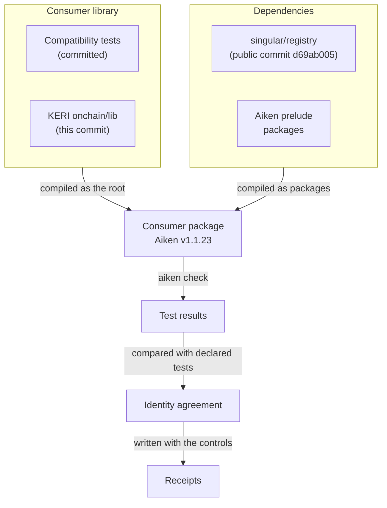
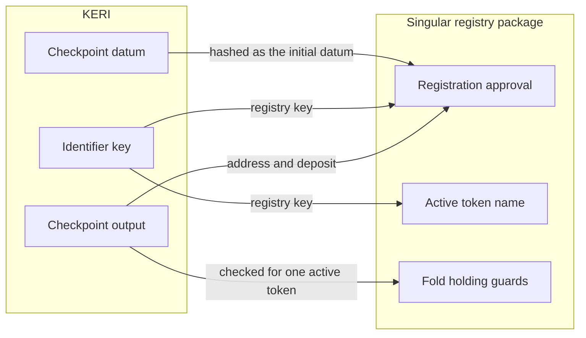

# Building the KERI Libraries Against the Singular Package

A contributor preparing the KERI integration with the redesigned
[Singular](https://github.com/lambdasistemi/singular) registry runs one
command and learns whether the reusable KERI Aiken libraries still compile and
test next to the published Singular registry package. When Singular's
interface moves underneath them, the same command fails and names what moved:
a value that is no longer exported, a module that no longer exists, or an
approval that no longer commits to a field KERI relies on.

```sh
just check-singular-aiken
```

The command builds the Nix check in
`aiken-singular-consumer/`
from a clean checkout. Hosted CI runs the same check in the required
**Onchain (Aiken)** job and keeps the compiler, lock, test and control
receipts as the `singular-aiken-consumer-<commit>` workflow artifact for
fourteen days.

This is technical preparation. It shows that the libraries meet at the
package interface. It does not show that KERI registration and
conviction behave as the KERI model says once they run through Singular; that
is the application work of
[#324](https://github.com/lambdasistemi/cardano-keri/issues/324).

!!! warning "Not for mainnet"
    The consumer package and the contracts it compiles are not for mainnet.

## What the check assembles



The consumer package is assembled inside the Nix sandbox from sources only.
Its own library is the committed compatibility tests together with the KERI
libraries of the same commit. Its dependencies are the Singular registry
package at the public Singular commit
[`d69ab005`](https://github.com/lambdasistemi/singular/commit/d69ab005c3b710aeebf033d3c5cd08c56feb5643),
the same commit the KERI Lean model is built against, and the shared Aiken
prelude packages at the versions both projects already
use. The compiler is the Aiken release every other onchain recipe of this
repository uses. The whole graph is compiled, then the compatibility tests and
the retained KERI registration tests are run.

The check then reads the tests declared in those modules and requires the
tests the compiler reports to be exactly the same set, every one passed, and
none of the sets empty. A selection that silently runs fewer tests fails the
check.

## The package boundary



A package that depends on Singular sees only its library modules; its
validators are not importable. The KERI side uses the redesigned
`singular_state` namespaces:

| Singular value | What KERI gives it | What the compatibility tests require |
|---|---|---|
| Registration approval (`approval_for`, `registration_preimage`, `approval_name`) | The checkpoint output: its inline checkpoint datum, its address and its deposit, and the identifier key | The approval Singular recomputes equals the hash of the published approval structure, and changes when any one of the registry, the key, the stake part of the address, the payment part of the address, the initial checkpoint datum or the deposit changes |
| Approval matching (`change_approval`) | A request carrying the approval | The approval of one change is not accepted for another |
| Active token name (`active_token_name`) | The registry and the identifier key | One name per registry and key, never equal to a state, configuration, termination or registration approval name of the same key |
| Registry identity (`registry_identity`) | The registry's seed and state policy | The registry is named by the state token of its seed |
| Holding guards (`registration_placement`, `registration_deposit`) | A checkpoint output holding the active token | One active token in the checkpoint output is accepted and a second one elsewhere is refused; the registration deposit floor is held and one lovelace less is refused |

Singular calls nothing in KERI. The only KERI value it reads is the checkpoint
output named by a registration: its address, its value and the datum it
carries, which Singular hashes without interpreting. These requirements are
the ones the public Singular issues
[#742](https://github.com/lambdasistemi/singular/issues/742) and
[#743](https://github.com/lambdasistemi/singular/issues/743) state for a
registration and its approval.

## What the tests show, and what they do not

| Test set | What it is | What it shows |
|---|---|---|
| Fifteen compatibility tests | New tests importing KERI and Singular together, over the generated KERI registration vectors | The published interface accepts real KERI values and commits to every field of the registration approval |
| Sixty-four retained registration tests | The existing KERI registration tests, run unchanged inside the consumer | The legacy KERI registration predicate still compiles and holds next to the Singular package |

Reusing the legacy registration predicate is not the redesigned
application. The redesign moves registration to a KERI approval policy that
Singular's fold consumes; that policy does not exist yet, so no test here can
show that KERI and Singular agree on a registration as a whole.

The 12 October 2026 local probe passed two compatibility tests and the same
sixty-four registration tests. Those two probe tests were never committed and
are retired; the fifteen compatibility tests replace them. The registration
tests, the predicate they exercise and their generated vectors are unchanged
since that probe, and so are the sixty-four test names.

## Controls

Each control runs inside the same check and must fail for its stated reason,
or the check fails.

| Control | What changes | Required failure |
|---|---|---|
| Skipped test | One test is dropped from the reported results | The discovered and executed test sets differ |
| Broken interface | The Singular package stops exporting `approval_for` | Compilation fails with an unknown import of `approval_for` |
| Broken import | The compatibility tests import a Singular module that does not exist | Compilation fails with an unknown module |
| Changed commitment, one per approval field | The Singular approval stops committing the registry, the key, the stake part, the payment part, the initial datum or the deposit | The compatibility test for that field fails, and no retained registration test changes verdict |
| Invalid lock | The consumer lock names another package version | The check stops before compiling |

## Decisions

| Decision | Chosen | Rejected, and why |
|---|---|---|
| Where the consumer lives | A separate package, `aiken-singular-consumer/`, assembled from sources at check time | Adding Singular to `onchain/`: both projects have top-level modules named `types` and `lib`, so the names collide |
| How the KERI libraries enter | As the consumer's own library | As a dependency: Aiken runs only the tests of the project being checked, so the retained registration tests would never run |
| Which Singular | The public commit the Lean model is built against | A moving `main` or a local checkout: neither is reproducible from a clean clone |
| Which compiler | The Aiken release of every other onchain recipe here | Singular's declared compiler: the libraries must keep compiling with the compiler KERI ships its scripts with |
| Which tests define success | The declared tests of the selected modules, compared with the reported ones | A pass count: a selection that runs nothing reports zero failures |

## Remaining production work

The check stops at the package boundary. The production work it leaves,
tracked in [#324](https://github.com/lambdasistemi/cardano-keri/issues/324):

- the KERI approval policy that checks the inception evidence, signatures,
  receipts, refund binding, bond amounts and initial checkpoint datum at
  booking, and mints the registration approval Singular consumes
  ([#348](https://github.com/lambdasistemi/cardano-keri/issues/348));
- a token policy for checkpoint and fact tokens separate from the approval
  policy, since a registration request carries exactly one application token;
- the registry identity and active token in the checkpoint datum, which
  changes the checkpoint datum encoding;
- the encoding of the approval preimage in the off-chain builders, bound to
  the published Singular byte specification once it is settled upstream;
- termination approvals for conviction
  ([#350](https://github.com/lambdasistemi/cardano-keri/issues/350)), whose
  upstream vectors are not settled
  ([#743](https://github.com/lambdasistemi/singular/issues/743)), and the
  released Singular compatibility of
  [#747](https://github.com/lambdasistemi/singular/issues/747).
