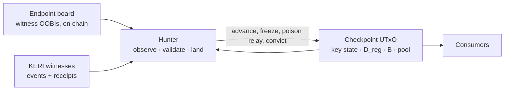

# The hunter: relayer, evidence submitter, and paid maintainer

A **hunter** is an off-chain service that watches KERI and Cardano and lands
the transactions that keep an identity's checkpoint current. It is a role any
party may perform, not a trusted oracle or an identity administrator. In
KERI's vocabulary it is a
[watcher](https://trustoverip.github.io/kswg-keri-specification/#indirect-exchange-via-witnesses-and-watchers) that also submits. Earlier
pages called this role the *super watcher*; the accepted design gives it a wage and a
name.

!!! abstract "Where this page stands"
    The cross-plane problem, the evidence rules for advance, and what the role is *not* are those of the earlier deployed design (version 1) — its advance transactions settled on preprod. The
    hunter's economics (the premium paid for landing a rotation, the freeze,
    the conviction payout) are the
    **accepted design**, proved in the Lean and playable in the checkpoint
    simulator. No hunter daemon is shipped; it is epic
    [#325](https://github.com/lambdasistemi/cardano-keri/issues/325).

## The cross-plane problem

KERI events happen off chain. Cardano checkpoints move only when a transaction
reveals and validates an event. Therefore either side can temporarily be
ahead:

- KERI may have a new witnessed rotation while Cardano still shows the old key
  state.
- Cardano may have settled an advance while a particular off-chain client has
  not refreshed its KEL or ledger view.

The hunter observes both and closes that gap. The owner does not: the owner rotates with `kli`; on Cardano the controller books the registration, funds the pool and, when needed, authorizes a deposit with the new keys or a poison with the current key quorum. That asymmetry is deliberate.

The hunter seeds its own watcher from the witness OOBIs published on the
[endpoint board](../user/discovery-endpoint-board.md), so discovery itself does
not require asking anybody.

## What a hunter could do in version 1

Against the version 1 programs published on preprod, a hunter could:

- relay a public inception through premint and register;
- relay a genuine witnessed rotation through advance;
- monitor transaction settlement and the new unspent checkpoint.

There was no payment for any of it. Routine event relay had no on-chain fee, so a commercial relayer needed an off-chain payment model. That is the
gap the accepted design closes.

## The hunter's wage — accepted design

The owner keeps three separate sums in the checkpoint, and only two of them go to a payee that a hunter names:

| Component | What it is for | Who receives it, and when |
|---|---|---|
| the **pool** | the owner's advance funds | the payee the submitter names, when a rotation lands with the pool covering the premium `P` |
| `B`, the **freeze bond** | forcing the owner's engagement: what a freeze pays to the payee it names when the pool cannot pay | the payee the freeze names, and only while `pool < P` with the checkpoint clean and unfrozen |
| `D_reg`, the **conviction bond** | the stake a duplicity proof seizes | the payee of the eligible commitment, at an accepted conviction; never a fee |

**The loop.** The hunter sees the owner's rotation on KERI. It looks at
Cardano:

- if the pool covers the premium, it lands the rotation and names the payee of `P`;
- if the pool is short and the checkpoint is neither frozen nor poisoned, it can **freeze** the checkpoint on its old keys with a later witnessed rotation and a freeze attestation for the spent checkpoint. The freeze sets only the frozen bit in the datum and pays `B` to the payee it names. The checkpoint stays frozen until a depositing rotation restores the bond. A rotation with a short pool still lands, unpaid.

The freeze is therefore not a punishment for lag. It is what makes a
non-paying owner come back, and it is bounded by two things the owner
controls: fund the pool, or do not rotate.

**Two hunters racing** produce one winner. If the pool covers `P` the first
advance wins and the second fails on the spent input; if it does not, the first freeze pays `B` and the second is refused because the checkpoint is already frozen.

**No bounty.** There is no payment for detecting misbehaviour, because a flow
whose profitability depends on another party's misbehaviour invites staged
misbehaviour. The single exception is the conviction, and it is an exception
on principled ground: two rotations of different content at one sequence, both valid against the same previous commitments and each receipted by its own witnesses, are a KERI verdict
([duplicity](https://trustoverip.github.io/kswg-keri-specification/#duplicity)), not a judgement the chain invents.

## What a hunter is not

A hunter is not:

- a KERI witness;
- a controller key custodian;
- a recovery service;
- a source of legal identity;
- an authoritative indexer;
- a checkpoint owner;
- a branch-selection oracle; or
- a service capable of rolling back settled Cardano actions.

It can submit only evidence the validators accept. When cryptographic evidence
is absent, it may alert users but cannot manufacture an on-chain truth. It
cannot forge controller signatures or witness receipts, activate uncommitted
keys, move the refund address, or reset the owner's juvenility
(the age her checkpoint must reach before a consumer trusts it)
window: no step changes the refund address, and a `deposit` is signed by
the keys of the epoch the rotation opens.

## Evidence rules

### Advance

The hunter must collect:

- the exact next KERI rotation bytes;
- controller signatures satisfying both thresholds;
- the required witness [receipts](https://trustoverip.github.io/kswg-keri-specification/#receipt-messages); and
- the current checkpoint outref.

The advance observer reconstructs and validates the transition. The hunter
cannot choose alternate keys, and the sequence number only ever
moves forward — the checkpoint cannot roll back (ruling D-022).

!!! warning "One unsettled question inside advance"
    For a rotation that cuts or adds witnesses, the version 1 validator counted receipts against the **new** witness set and the **new** `toad`. Whether
    `keripy` applies the same rule, or tallies against the parent's set, is not
    yet established. Epic
    [#320](https://github.com/lambdasistemi/cardano-keri/issues/320) builds the
    parity oracle that settles it. It matters most on exactly the rotations
    that matter: witness replacement after a compromise.

### Freeze — accepted design

The hunter presents a later witnessed rotation with its receipts. The transaction must mint the freeze attestation for the checkpoint input it spends. The pool must be below `P` and the checkpoint must be neither frozen nor poisoned; `B` goes to the payee the freeze names.

### Poison relay — accepted design

The poison is a declaration the owner's current key quorum authorizes; the model does not yet specify the bytes they sign, and no validator implements the poison spend.
It is never witnessed, and anyone may land it. A hunter that carries poisons
promptly is doing the most valuable thing in the system: the poison's whole
purpose is to be fast.

### Convict — accepted design

The conviction proof is narrower than any lag evidence. It requires a rival rotation at the native sequence of the accepted one, valid against the same previous commitments: it satisfies the previous next-key commitment and its own signing threshold, carries receipts from its own derived witnesses, and differs in complete content from the accepted one. The comparison runs against the authenticated context the checkpoint selects, never one the rival chooses.

A stranger cannot manufacture this. Only a holder of the pre-committed keys
could have signed the second rotation, and each rotation needs the receipts of its own derived witnesses at its own threshold; the comparison does not itself require the two receipt sets to overlap. The conviction reveals a commitment opened beforehand, within its window and naming this identifier, deployment and key state; its payee takes `D_reg` in full, and the freeze bond still held and the pool go to the refund address. The checkpoint becomes a pending termination; the booking that moves the pending output into the termination request and the fold that consumes that request then retire the identity, which is terminal.

## Operational loop

A robust hunter would:

1. maintain verified KEL state for watched AIDs, seeded from the endpoint
   board;
2. collect and verify witness receipts;
3. resolve each AID's current Cardano checkpoint and read its pool;
4. compare the native KERI sequence with the checkpoint's;
5. choose the permitted public projection — a rotation (paid when the pool covers `P`, unpaid otherwise), a freeze when the pool is below `P` and the checkpoint is clean and unfrozen, a poison relay when one exists, a conviction when the proof is in hand and its commitment is eligible, and no transaction when evidence is incomplete;
6. construct the transaction for the chosen step with the evidence it needs;
7. evaluate and budget every script purpose;
8. submit and wait for settlement;
9. handle contention and rollback; and
10. record transaction IDs and evidence provenance.

The service must never treat mempool acceptance as settlement.

## Freshness and availability

A hunter improves discovery latency but cannot eliminate KERI witness outages,
network partitions, Cardano inclusion delay, chain rollbacks, block-level
censorship, or a colluding witness threshold.

Applications should not silently outsource all freshness policy to one hunter.
A relying application checks a checkpoint’s age against the juvenility window
`W`. It can use a clean, unfrozen checkpoint only once the current slot
reaches its birth slot plus `W`. The planned devnet measurement of the time
from witness receipt to landed rotation will inform the choice of `W` in epic
[#325](https://github.com/lambdasistemi/cardano-keri/issues/325).

## Credential-plane extension

Later, a hunter may also follow ACDC credential chains and TEL revocation
events. That duty is separate from identity checkpoint authority: identity
relay answers which keys currently control the AID; credential monitoring
answers which issued roles remain valid. Only the first plane is in M1.

## Security principle

The hunter is safe to make permissionless because it pays to submit public
proofs whose key state is fixed by the evidence, and nothing in the validators pays the submitter as such: the rest of the outcome is fixed by the whole transaction, which names the payee and the deposit option; when the pool covers the premium, the premium goes from value the owner chose to keep there to the address the rotation names, which need not be the submitter's; a rotation with a short pool lands unpaid. A hostile hunter can withhold its own service or waste
fees on invalid transactions. It cannot install a key state other than the one its evidence establishes, take `D_reg` without an accepted conviction, or take `B` while the pool pays. For a paid rotation the submitter names the payee of the premium from the pool; a freeze pays the bond to the address it names. When the owner's new keys have signed a deposit intent, the same evidence supports a rotation that keeps the frozen state and one that deposits and clears it; the intent authorizes the deposit amount for that checkpoint input.
