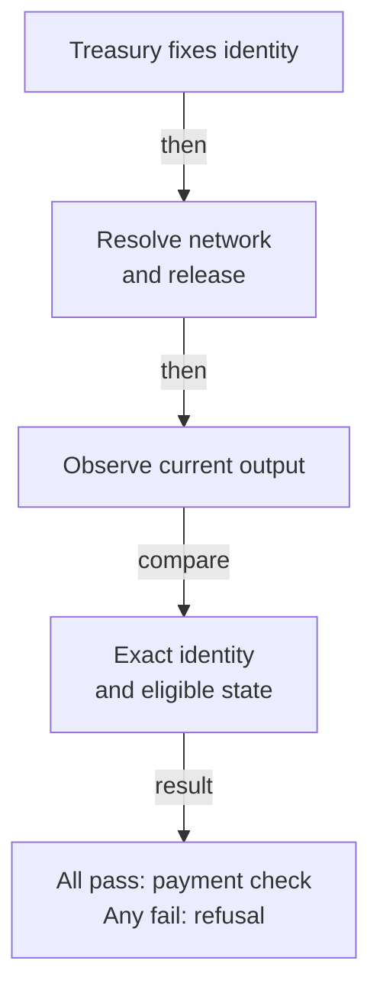
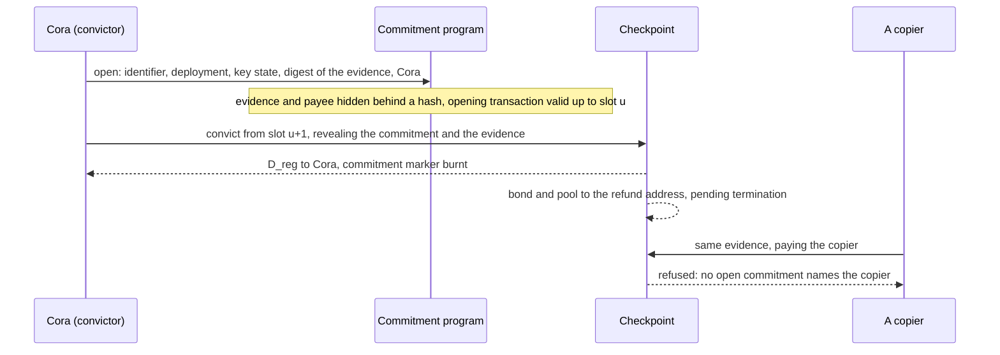
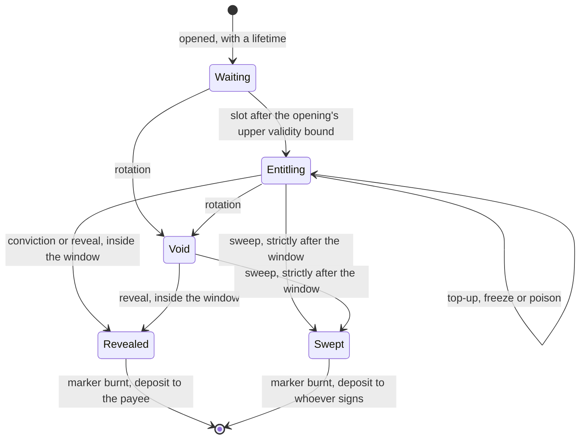

# Trust model

A relying application wants to know which checkpoint it can trust, what the
chain verifies, and what its own integration must establish. cardano-keri
projects public KERI events into a Cardano checkpoint. KERI is
Key Event Receipt Infrastructure; a KERI **AID** (Autonomic Identifier) has a
signed **KEL** (Key Event Log). The chain does not discover KEL events by
itself. It verifies the event evidence supplied in a transaction.

!!! abstract "Where this page stands"
    Two sections describe the **earlier deployed design** (version 1, published on preprod on 2026-07-28; its validators are no longer in the source tree): what its validators guarantee, and the residuals that follow from it. The rest
    describes the **accepted design** — the Lean machine of
    `lean/CardanoKeri/Checkpoint.lean` — and each such section says so. For
    settled transaction IDs and dates, see the
    [story ladder](../story-ladder.md).

## The projection law

One rule sits above everything else on this page: **the chain projects the
KEL and never originates identity state.** Every arrow points one way. The
design is built only against what a controller and its witnesses already
publish; the chain never asks KERI for anything, and never pronounces a
verdict KERI itself would not. Where KERI says a verdict is formed is
[validator roles and event locality](https://trustoverip.github.io/kswg-keri-specification/#validator-roles-and-event-locality).

Two consequences that shape the whole trust boundary:

- **Possession of the next keys is control** ([pre-rotation](https://trustoverip.github.io/kswg-keri-specification/#pre-rotation)). If a thief holds them, her
  witnessed rotation is legitimate under KERI's own rule and the chain follows
  it. Nothing the chain does may outlive that rotation.
- **Proven [duplicity](https://trustoverip.github.io/kswg-keri-specification/#duplicity) cannot be unseen**: two receipted
  rotations at one sequence are a fact of the record for ever, and KERI has no
  event that un-duplicates an identifier. What KERI leaves to each validator is
  the trust decision, which it may take either way (the
  [review's reading of the specification's own text](watcher-conformance.md#the-specification-has-a-trust-text-tension)).
  **This project's selected policy is that conviction is terminal**: the
  convicted (terminal after a duplicity proof) leaf never reopens and the
  conviction bond, the stake posted against that proof, is seized. The reasons
  are ours, not KERI's: a bond that could be recovered would not deter, and
  inventing a recovery event KERI lacks would be the chain originating identity
  state.

## What the earlier deployed validators guarantee

### Inception bytes bind to the AID

Registration first runs the project's Aiken BLAKE3 implementation in a
premint transaction. The resulting proof token has a deterministic name bound
to the inception bytes and claimed AID.

The Register transaction consumes and burns that token. Its registration
observer then verifies:

- the event fields project to the checkpoint datum;
- indexed controller signatures satisfy the event's weighted threshold;
- indexed witness receipts satisfy `toad`, the event's witness threshold; and
- the thin checkpoint creates exactly one correctly named token in one output
  with the required escrow.

The registrant cannot copy a victim's public inception and substitute attacker
keys. The event, signatures, receipts, AID, and projected checkpoint must
agree.

### Rotation cannot choose an arbitrary successor

Advance verifies one genuine KERI rotation against the exact checkpoint input:

- the event continues from the recorded prior KERI event;
- revealed controller keys match the stored next-key commitments;
- the event's own controller threshold passes;
- the previously committed next threshold also passes;
- witness receipts cover the exact event bytes and satisfy the incoming
  witness threshold; and
- the output is the unique sequence-plus-one successor with the same token and
  complete value.

A relayer may submit the public event but cannot alter its result. A stolen set
of current keys is insufficient to replace the pre-committed successor. A
controller-signed event without the required witness receipts is also
insufficient.

`ixn`, `dip` and `drt` events are rejected, not merely unrepresentable:
advance requires the type span to read `rot` and registration requires `icp`.

### The sequence never moves backward

The successor must satisfy `new.seq == spent.seq + 1` and
`new.native_sn > spent.native_sn`. No superseding recovery exists on chain, and
the accepted design does not add one. KERI's superseding rule applies
to a rotation over an interaction, and interactions never reach the chain, so
every recovery the checkpoint can express is a forward advance. The one
scenario that would need a rollback is a thief who declined the winning move;
it is an accepted, stated limit.

### Close cannot redirect the refund

In the earlier deployed design, Close required the current controller threshold. Its signed evidence
binds the network, checkpoint policy, exact input reference, AID, sequence, and
refund address. The transaction burns the checkpoint token and refunds the
complete checkpoint value only to that address.

!!! warning "Close is removed in the accepted design"
    In the accepted model there is no owner exit: no close, no parking and
    no revival; a checkpoint is alive until it is convicted. That is what
    stops a thief holding only the current keys from erasing the owner's
    Cardano presence. See
    [Compromise of the current keys](key-compromise.md).

## Residuals of the earlier deployed design

### Duplicate live registration

There is no shared global AID registry or absence proof. Independent
transactions may create more than one candidate for the same AID.

A consumer must fail closed unless it resolves exactly one accepted
checkpoint — and it cannot prove that no other candidate exists, which is why
this is a residual rather than an inconvenience. A holder of some past epoch's
keys can mint a second checkpoint and advance it exactly to their epoch.

The registry of the accepted design removes this: one leaf per AID, an absence proof
required to insert, and the token mint-once by construction.

### Current-key theft

Pre-rotation stops an attacker holding only the current keys from taking the
identity **forward**: they cannot rotate, so they cannot advance the checkpoint
or replace the committed successor.

It does not stop them from using the identity **now**. Until a rotation
settles, the stolen keys are the current authority, and no validator can tell
them from the owner. Worse, in the earlier deployed design `Close` was a current-controller operation, so a thief could burn the checkpoint and send the escrow to an address the signed message names.

The accepted design has no close, and its current key quorum can poison the checkpoint so that consumers refuse it until a rotation clears it; that does not prevent a use of the stolen keys that lands before the poison.
[Compromise of the current keys](key-compromise.md) works the case through in
full.

### Next-key theft

Theft of the committed successor private keys, or total loss of all current and
reserve keys, is not solved here and cannot be. Those are KERI key-management and
[recovery](https://trustoverip.github.io/kswg-keri-specification/#superseding-recovery-and-reconciliation) problems, and by the projection law the chain follows KERI's
verdict rather than overruling it.

### Discovery lag

Cardano cannot react to a KERI event nobody has submitted. Between KERI
publication and a settled advance, an application may still see the old
checkpoint. High-value applications must state how they monitor KERI and how
fresh a checkpoint must be. The accepted design turns that from advice into two
mechanisms: the pool of advance funds that pays the payee a hunter names (a hunter being anyone paid to land rotations, or to freeze a checkpoint that cannot pay for one) to be prompt, and the
juvenility window (the age a checkpoint must reach before a consumer trusts it)
`W` that a consumer enforces.

### Scale

The two-key fixture fits production protocol limits. The real three-of-seven
GLEIF shape has not completed the vertical ladder and is expected to exceed
current mainnet execution limits in later operations. Epic
[#321](https://github.com/lambdasistemi/cardano-keri/issues/321) measures that
gap; it is not assumed away.

---

## What the accepted design guarantees

Each item below is a theorem of the Lean machine defined in `lean/CardanoKeri/Checkpoint.lean` and proved in `CheckpointGoals.lean` and `CheckpointCommitmentGoals.lean`, and is playable in the checkpoint simulator. The source tree implements part of it (there is no poison spend); this page makes no claim about what is deployed.

| Guarantee | Why it holds |
|---|---|
| The keys move only by a rotation; the poison (the owner's own lock on the checkpoint) never moves them | a poison touches the poison bit and nothing else |
| The poison is epoch-local | any witnessed rotation clears it, and only a poison sets it |
| Poisoned checkpoints cannot authorize a consumer | the consumer rejects poison; a rotation clears it |
| A present state whose top-up mark is clear has a step | a top-up of at least `P` is enabled while the mark is clear; a rotation needs accepted rotation evidence, and a deposit also needs the new keys' signature on its intent |
| One incarnation per AID in the chosen registry | registration requires an unknown key; a retired key cannot register again |
| Only conviction is terminal | there is no owner exit: no close, no parking, no revival |
| `D_reg` is never a fee source | it leaves only at a conviction |
| The pool never gates a rotation | an unpaid rotation is still a valid rotation; a pool below `P` is what allows a freeze, together with accepted evidence of a later rotation and a checkpoint that is neither frozen nor poisoned; a rotation pays `P` to the payee the submitter names only when the pool covers it; a top-up must add at least `P` whatever the pool holds; and the application's initial state needs a pool of at least `P` while the registry's own floor is `Mc + D` |
| A deposit needs the successor keys' authorization | the successor keys authorize the deposit by signing its bound intent; the submitter, who may be anyone, selects keep or the authorized deposit when the rotation premises hold. The successor threshold must accept the verified signer positions, and a positive signature count follows only when that threshold refuses the empty signer set |
| A live checkpoint preserves the refund address named at registration | After any sequence of accepted steps from registration to a live checkpoint, conviction sends the freeze bond still held and the entire remaining pool to that address. |
| A conviction pays only the payee of a commitment opened beforehand over this identifier, deployment, key state and evidence | see [Who a conviction pays](#who-a-conviction-pays) |
| A top-up, a freeze and a poison keep an open commitment; only a rotation voids it | a commitment names the key state, not the output, and only a rotation changes the key state |

### The consumer's predicate

A treasury fixes its intended network, published release, checkpoint
credential, registry seed and AID independently of a candidate. The reviewed
holding predicate requires matching validated network, release and checkpoint
credential, the output at that checkpoint credential (the checkpoint
validator's, not the application's), exactly one complete expected
representative asset, and a decoded application
datum for that AID. Its unchanged lifecycle condition then requires a present,
unfrozen, unpoisoned state at least the juvenility window old.

The output cannot select the context against which it is authenticated.
[Exact consumer identity](consumer-identity.md) binds the actual pinned
Singular State/Active declarations, finite naming premises, registration
bridge and model evidence. The [consumer checklist](../user/consumer-checklist.md)
explains the complete integration rule.

Pending conviction retains custody but refuses consumption; there is no
parking and no revival. Permanent retirement requires
the matching actual terminal fold. Another registry may register the same AID;
its holding still fails the original treasury's context.

The model's present/unfrozen state represents full bonds. A real decoder and
observer must establish that those fields correspond to the same output's
physical value. The holding predicate and `realizesState` do not validate
current unspentness. Network/release discovery, byte encodings and faithful
observation remain explicit implementation obligations. The payment's own
threshold check is separate, and no checkpoint expiry field is modeled.

The consumer implementation remains unaccepted until both real implementation
properties and a connected ledger-boundary journey execute. Lean proofs and
simulator replay count as neither production layer. A consumer still cannot
know from this state alone whether an unseen KERI rotation has occurred.

## Trust and responsibility boundaries

### KERI witnesses

For an identity with `toad > 0`, the system assumes the configured KERI
witness threshold provides meaningful public acceptance. The validator checks
the receipts; it cannot make a colluding witness quorum honest. The
threshold's assumptions are KERI's
[witness agreement algorithm](https://trustoverip.github.io/kswg-keri-specification/#keris-algorithm-for-witness-agreement-kawa)
and [witnessing policy](https://trustoverip.github.io/kswg-keri-specification/#witnessing-policy).

An identity may choose `toad = 0`. That weaker mode carries no witness
receipts at all, so the checkpoint accepts signature-only advances for it. It
is served at the consumer's risk: `toad` is on the consumer surface precisely
so an application requiring public KERI acceptance can reject such identities
by policy.

A colluding quorum at or above `toad` can do one thing worse than lying about
liveness: it can receipt two rotations at one sequence. That is part of the
duplicity a conviction proves, which also needs both rotations valid against the same previous commitments, one native sequence and different content, and it is why the conviction's exposure is
bounded by `D_reg` and by the witness set the controller chose.

### Relayers and hunters

Relayers and hunters are untrusted submitters. They may censor their own
service, delay submission, or pay fees strategically. They cannot fabricate
valid signatures, receipts, preimages, or conflicts, and they cannot install a key state other than the one their evidence establishes. See [the hunter](super-watcher.md).

Permissionless submission gives other parties the ability to relay the same
public truth. It does not guarantee inclusion against block-level censorship.

A retired AID cannot register again in the same registry. A live checkpoint
can still show an older key state if a later KERI rotation has yet to land.
The juvenility check opens at the birth slot plus `W`. Eligibility has no
upper age limit, so age alone cannot tell a relying party whether a newer
rotation exists. On conviction the remaining freeze bond and pool go to the
address recorded at registration; the conviction bond `D_reg` goes to the
payee of the eligible commitment.

### Who a conviction pays

As Cora, a convictor who has found two receipted rotations at one sequence, I
want the conviction deposit `D_reg` paid to me and not to whoever copies my
evidence, so that looking for duplicity is worth doing.

The evidence of duplicity is private until a conviction shows it, but once a
conviction transaction is submitted anyone can read it. Without a guard, the
producer of a block could drop Cora's transaction and include a copy that pays
itself. The guard is a commitment made before the evidence is shown: Cora
opens, under the release's commitment program, a commitment that names the
identifier, the deployment, the key state she accuses (its epoch and sequence
number), the digest of her evidence and herself, hidden behind a hash. Her
conviction can reveal it from the slot after the upper bound of the validity
range of the transaction that opened it. A copier naming itself finds no
commitment that names it; a copier who opens one after seeing the evidence
cannot use it before the slot after its own opening transaction's upper bound.
The ledger includes a transaction no later than that bound, so this is never
earlier than the slot after the one the copier's opening is included in.

The wait is counted from that upper bound, not from the slot the opening
transaction is included in. An opener who wants the shortest wait sets the
bound as close to the inclusion slot as it can: with the bound at the
inclusion slot the wait is one slot, and every slot by which the bound is
later adds one.

The commitment names no checkpoint output. A conviction is accepted at
whichever live output carries the identifier and the key state the commitment
names, in the deployment it names. So a step that spends the output and keeps
the key state leaves Cora's commitment as it was: a top-up by anyone, a freeze
by a hunter and a poison by the owner cannot take her conviction away. A
rotation changes the key state, and the commitment entitles nothing from then
on. The diagram follows one commitment from its opening to the burn of its
marker, beside the checkpoint it accuses: the top-up, the freeze, the poison
and the rotation on its edges are steps of that checkpoint. A commitment that
has just been opened entitles nobody yet: it waits until the slot after its
opening transaction's upper validity bound.

The conviction step checks the commitment it reveals against the output it
convicts; the system checks that the commitment is open and belongs here, and
burns it. The table lists every condition and the step that states it.

| A conviction is accepted only when | Where the model states it |
|---|---|
| the checkpoint has duplicity at its current key state | the conviction step |
| the commitment names the key state this checkpoint output carries | the conviction step (`Commitment.entitles`) |
| the commitment names the evidence the conviction shows | the conviction step |
| the commitment names the payee the conviction pays | the conviction step |
| the conviction's slot is after the upper bound of the validity range of the transaction that opened the commitment, and no later than the commitment's last slot | the conviction step, for a commitment as the commitment program opens it |
| the commitment is open in the release's commitment program and names this AID | the system step (`Sys.revealOpen`) |
| the commitment names this deployment | the system step |
| the conviction burns the commitment, so it entitles nothing more | the system step |

Two deployments can each hold a checkpoint for one identifier at one key
state. A commitment opened for the first is refused at the second, although
its checkpoint step would convict there too: the commitment does not name the
second deployment (`sys_conviction_only_at_commitment_deployment`). This is
the binding [#508](https://github.com/lambdasistemi/cardano-keri/issues/508)
found missing.

The next table gives each choice made here, what it was chosen over, and why.

| Decision | Chosen | Rejected | Why |
|---|---|---|---|
| Who a conviction pays | the payee of a commitment opened beforehand | any payee the submitter names | the evidence is private until shown, and a copier would take `D_reg` |
| What a commitment names | the identifier, the deployment and the key state it accuses | the checkpoint output | anyone can spend the output with a top-up, the owner with a poison and a hunter with a freeze, each leaving the convictor's commitment worthless before her conviction lands |
| Which deployment a commitment serves | the one it names, compared at the conviction with the deployment that settles | a field the conviction does not compare: its width is checked at opening and reveal and the sweep reads it, and no program requires it to be the settling deployment | once the commitment names no output, nothing else ties it to one deployment |
| How long a commitment waits | until the slot after the upper bound of its opening transaction's validity range | a later first slot | a longer wait delays every honest conviction, which is what the commitment exists to pay |
| Who a rotation's premium and a freeze bond pay | any payee the submitter names, a recorded limit | a commitment for them too | their evidence is already public, the commitment names its checkpoint in the clear, and hiding it would need a blinded commitment, a second transaction and a delay on every paid action |

Two limits remain and are recorded in the
[Lean correspondence register](https://github.com/lambdasistemi/cardano-keri/issues/435).
The table says who can use each and what it costs the convictor.

| Limit | Who can use it | What happens |
|---|---|---|
| A rotation voids an open commitment | only the holder of the next keys | the checkpoint carries another key state, the commitment entitles nothing, and the duplicity it accused is no longer convictable at this checkpoint (`rotation_voids_commitment`) |
| A block producer keeps the convictor's transaction out while its own commitment matures | a producer of two blocks in a row, or one with a colluder for the second | it reads the evidence in the transaction it withheld, opens its own commitment in its block with a validity range ending at that block's slot, and convicts in the next; the convictor's commitment stays valid meanwhile, and any other producer can include her conviction; nothing guarantees that one does |

The model leaves to the implementation, and states nowhere: the hash and the
nonce that hide the evidence and the payee, the marker's derivation from the
opening transaction, the commitment deposit and its payouts, the payee's
signatures, and the lifetime a release applies. It requires that a commitment
is first eligible in the slot after the upper bound of its opening
transaction's validity range and expires no earlier than that. The slot the
opening transaction is included in is not an input of the model; the ledger
guarantees only that it is no later than that upper bound. The model keeps one
piece of evidence per key state, chosen by its environment, so a commitment
over any other evidence entitles nothing in it.

The validators on `main` bind a commitment to the identifier, the deployment and the key state, as this model does; a top-up or a freeze keeps it entitled, and a rotation voids it.

The theorems are in `lean/CardanoKeri/CheckpointCommitmentGoals.lean` and the
accepted and refused cases in `lean/checkpoint-commitment-vectors.json`. The
checkpoint simulator plays them in story 9: Cora convicts on her commitment
after a poison, a copier is refused, a commitment opened in the conviction's
slot is refused, a top-up keeps Cora's commitment, and a rotation voids it.
Its associated-system panel runs the same journey in a second deployment,
where the first deployment's commitment is refused.

### Indexers

In the redesigned consumer, an indexer locates candidates for the independently
chosen complete registry and AID context. It does not choose the expected
asset or release. The consuming transaction revalidates the token, script, datum,
AID, sequence, and state against the ledger.

A stale reference points to a spent output and rejects. A false reference does
not match. An unavailable indexer affects liveness only.

### The registry

Registration and terminal completion use actual registry folds. Rotations,
poison, freezing, top-ups and conviction are local Checkpoint
transitions. Pending custody remains until its recorded request is consumed
by a matching fold. The consumer authenticates the holding against its fixed
registry identity; it need not spend the registry state.

### Full KEL history

The checkpoint stores current state, not the complete KEL. Off-chain software
discovers and preserves the history, detects conflicts, and constructs
evidence. The on-chain observer validates the specific event and proof used by
the transition.

### Cardano settlement

The poison and the conviction are prospective containment. They cannot reverse
a Cardano transaction that already settled under an older key state. This is
why witness receipts are checked during advance before new keys become active,
and why each application still needs a freshness policy for unseen off-chain
events.

## Threat summary

The **State** column marks whether the response is that of the earlier deployed design (*shipped*) or of the accepted design (*designed*).

| Attempt | Response | State |
|---|---|---|
| Register a public inception with attacker keys | Reject: projected keys and signed event disagree | shipped |
| Activate a Cardano-first rotation without witness acceptance | Reject: incoming witness receipts insufficient | shipped |
| Rotate with stolen current keys only | Reject: committed successor keys and dual thresholds do not match | shipped |
| Anchor a forged credential in an interaction (`ixn`) event | Not projected: establishment events only. The harm is off-chain | shipped |
| Roll the checkpoint back to an earlier sequence | Reject: the sequence is strictly increasing | shipped |
| Authorize a value operation with stolen current keys | **No rejection is available** — those keys are the current authority | shipped |
| Close the checkpoint with stolen current keys | **No rejection was available** — close was a current-controller operation | shipped (earlier deployed design) |
| Close the checkpoint under the accepted design | No close exists: the model has no owner exit, so there is nothing to authorize | designed |
| Register a second checkpoint for one AID | **No rejection is available today** | shipped |
| Same, under the accepted design | Reject: the registry insert needs an absence proof | designed |
| A relayer unfreezes the owner using her public rotation | Reject: the deposit is unsigned by the new keys | designed |
| Anyone, the controllers included, moves the refund address after registration | Reject: no step changes the refund address | designed |
| One stolen member key of a multisig poisons the identity | Reject: the poison is evaluated at the current threshold | designed |
| Authorize a payment from a poisoned checkpoint | Reject: the consumer requires an unpoisoned state | designed |
| Take `D_reg` without an accepted conviction | Reject: `D_reg` is never a fee source | designed |
| Freeze an identity whose pool pays | Reject: the freeze requires `pool < P` | designed |
| Convict without two witnessed rotations at one sequence | Reject: both rotations must be valid against the same previous commitments, with their own thresholds and the receipts of their own derived witnesses, at one sequence and with different content; and the commitment must be open, eligible, name this payee, identifier and deployment | designed |
| Copy a conviction and pay yourself | Reject: `D_reg` goes only to the payee of a commitment opened beforehand over this identifier, deployment, key state and evidence | designed |
| Open a commitment and use it in the same slot | Reject: a commitment is eligible only after the upper bound of its opening transaction's validity range, which is no earlier than the slot it was opened in | designed |
| Top up, freeze or poison a checkpoint to void a hunter's commitment | No effect: the commitment names the key state, and these steps keep it | designed |
| Use a commitment at another deployment holding the same identifier and key state | Reject: the commitment names its deployment | designed |
| The next-key holder rotates before a conviction lands | **No rejection is available** — the rotation is valid, the open commitment entitles nothing afterwards and the earlier key state is no longer convictable here | designed |
| A block producer withholds a conviction for two blocks and convicts on its own commitment | **No rejection is available** — exposure bounded by `D_reg`; the convictor's commitment stays valid and any other producer can include her conviction, with no guarantee that one does | designed |
| A next-key thief with `toad` colluding witnesses convicts and takes `D_reg` | **No rejection is available** — exposure bounded by `D_reg` and by the chosen witness set | designed |
