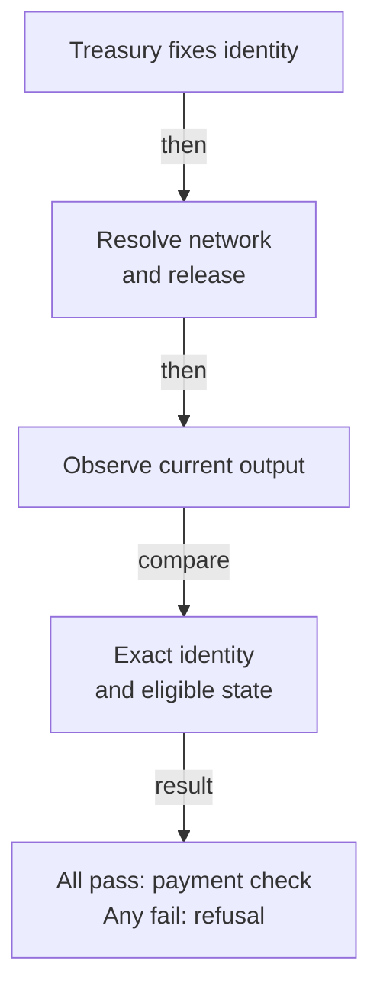

# Trust model

A relying application wants to know which checkpoint it can trust, what the
chain verifies, and what its own integration must establish. cardano-keri
projects public KERI events into a Cardano checkpoint. KERI is
Key Event Receipt Infrastructure; a KERI **AID** (Autonomic Identifier) has a
signed **KEL** (Key Event Log). The chain does not discover KEL events by
itself. It verifies the event evidence supplied in a transaction.

!!! abstract "Where this page stands"
    Two sections describe **what ships on `main` today**: what the current
    validators guarantee, and the residuals that follow from it. The rest
    describes the **accepted design** — the Lean machine of
    `lean/CardanoKeri/Checkpoint.lean` — and each such section says so. For
    settled transaction IDs and dates, see the
    [story ladder](../story-ladder.md).

## The projection law

One rule sits above everything else on this page: **the chain projects the
KEL and never originates identity state.** Every arrow points one way. The
design is built only against what a controller and its witnesses already
publish; the chain never asks KERI for anything, and never pronounces a
verdict KERI itself would not. Where KERI says a verdict is formed is
[validator roles and event locality](https://trustoverip.github.io/kswg-keri-specification/#validator-roles-and-event-locality).

Two consequences that shape the whole trust boundary:

- **Possession of the next keys is control** ([pre-rotation](https://trustoverip.github.io/kswg-keri-specification/#pre-rotation)). If a thief holds them, her
  witnessed rotation is legitimate under KERI's own rule and the chain follows
  it. Nothing the chain does may outlive that rotation.
- **Proven [duplicity](https://trustoverip.github.io/kswg-keri-specification/#duplicity) cannot be unseen**: two receipted
  rotations at one sequence are a fact of the record for ever, and KERI has no
  event that un-duplicates an identifier. What KERI leaves to each validator is
  the trust decision, which it may take either way (the
  [review's reading of the specification's own text](watcher-conformance.md#the-specification-has-a-trust-text-tension)).
  **This project's selected policy is that conviction is terminal**: the
  convicted (terminal after a duplicity proof) leaf never reopens and the
  conviction bond, the stake posted against that proof, is seized. The reasons
  are ours, not KERI's: a bond that could be recovered would not deter, and
  inventing a recovery event KERI lacks would be the chain originating identity
  state.

## What the current validators guarantee — shipped today

### Inception bytes bind to the AID

Registration first runs the project's Aiken BLAKE3 implementation in a
premint transaction. The resulting proof token has a deterministic name bound
to the inception bytes and claimed AID.

The Register transaction consumes and burns that token. Its registration
observer then verifies:

- the event fields project to the checkpoint datum;
- indexed controller signatures satisfy the event's weighted threshold;
- indexed witness receipts satisfy `toad`, the event's witness threshold; and
- the thin checkpoint creates exactly one correctly named token in one output
  with the required escrow.

The registrant cannot copy a victim's public inception and substitute attacker
keys. The event, signatures, receipts, AID, and projected checkpoint must
agree.

### Rotation cannot choose an arbitrary successor

Advance verifies one genuine KERI rotation against the exact checkpoint input:

- the event continues from the recorded prior KERI event;
- revealed controller keys match the stored next-key commitments;
- the event's own controller threshold passes;
- the previously committed next threshold also passes;
- witness receipts cover the exact event bytes and satisfy the incoming
  witness threshold; and
- the output is the unique sequence-plus-one successor with the same token and
  complete value.

A relayer may submit the public event but cannot alter its result. A stolen set
of current keys is insufficient to replace the pre-committed successor. A
controller-signed event without the required witness receipts is also
insufficient.

`ixn`, `dip` and `drt` events are rejected, not merely unrepresentable:
advance requires the type span to read `rot` and registration requires `icp`.

### The sequence never moves backward

The successor must satisfy `new.seq == spent.seq + 1` and
`new.native_sn > spent.native_sn`. No superseding recovery exists on chain, and
the accepted design does not add one. KERI's superseding rule applies
to a rotation over an interaction, and interactions never reach the chain, so
every recovery the checkpoint can express is a forward advance. The one
scenario that would need a rollback is a thief who declined the winning move;
it is an accepted, stated limit.

### Close cannot redirect the refund

Close requires the current controller threshold today. Its signed evidence
binds the network, checkpoint policy, exact input reference, AID, sequence, and
refund address. The transaction burns the checkpoint token and refunds the
complete checkpoint value only to that address.

!!! warning "Close is removed in the accepted design"
    In the accepted model there is no owner exit: no close, no parking and
    no revival; a checkpoint is alive until it is convicted. That is what
    stops a thief holding only the current keys from erasing the owner's
    Cardano presence. See
    [Compromise of the current keys](key-compromise.md).

## Residuals of what ships today

### Duplicate live registration

There is no shared global AID registry or absence proof. Independent
transactions may create more than one candidate for the same AID.

A consumer must fail closed unless it resolves exactly one accepted
checkpoint — and it cannot prove that no other candidate exists, which is why
this is a residual rather than an inconvenience. A holder of some past epoch's
keys can mint a second checkpoint and advance it exactly to their epoch.

The registry of the accepted design removes this: one leaf per AID, an absence proof
required to insert, and the token mint-once by construction.

### Current-key theft

Pre-rotation stops an attacker holding only the current keys from taking the
identity **forward**: they cannot rotate, so they cannot advance the checkpoint
or replace the committed successor.

It does not stop them from using the identity **now**. Until a rotation
settles, the stolen keys are the current authority, and no validator can tell
them from the owner. Worse, on `main` today `Close` is a current-controller
operation, so a thief can burn the checkpoint and send the escrow to an address
the signed message names.

The accepted design closes both halves of that, and
[Compromise of the current keys](key-compromise.md) works the case through in
full.

### Next-key theft

Theft of the committed successor private keys, or total loss of all current and
reserve keys, is not solved here and cannot be. Those are KERI key-management and
[recovery](https://trustoverip.github.io/kswg-keri-specification/#superseding-recovery-and-reconciliation) problems, and by the projection law the chain follows KERI's
verdict rather than overruling it.

### Discovery lag

Cardano cannot react to a KERI event nobody has submitted. Between KERI
publication and a settled advance, an application may still see the old
checkpoint. High-value applications must state how they monitor KERI and how
fresh a checkpoint must be. The accepted design turns that from advice into two
mechanisms: the pool of advance funds that pays a hunter (anyone paid to land rotations, or to freeze a checkpoint that cannot pay for one) to be prompt, and the
juvenility window (the age a checkpoint must reach before a consumer trusts it)
`W` that a consumer enforces.

### Scale

The two-key fixture fits production protocol limits. The real three-of-seven
GLEIF shape has not completed the vertical ladder and is expected to exceed
current mainnet execution limits in later operations. Epic
[#321](https://github.com/lambdasistemi/cardano-keri/issues/321) measures that
gap; it is not assumed away.

---

## What the accepted design guarantees

Each item below is a theorem in `lean/CardanoKeri/Checkpoint.lean`, playable in
the checkpoint simulator, and unbuilt on chain.

| Guarantee | Why it holds |
|---|---|
| The keys move only by a rotation; the poison (the owner's own lock on the checkpoint) never moves them | a poison touches the poison bit and nothing else |
| The poison is epoch-local | any witnessed rotation clears it, and only a poison sets it |
| Poisoned checkpoints cannot authorize a consumer | the consumer rejects poison; a rotation clears it |
| No present state is absorbing | the next-key holder can always rotate, with any bond option |
| One incarnation per AID in the chosen registry | registration requires an unknown key; a retired key cannot register again |
| Only conviction is terminal | there is no owner exit: no close, no parking, no revival |
| `D_reg` is never a fee source | it leaves only at a conviction |
| The pool never gates a transition | an unpaid rotation is still a valid rotation |
| A relayer cannot age the owner or move her refund address | every intent other than `keep` is signed by the new epoch's keys |
| The refund address moves only by the owner's signature | at register, and at a rotation the new keys authorized |

### The consumer's predicate

A treasury fixes its intended network, published release, registry seed and
AID independently of a candidate. The reviewed holding predicate requires
matching validated network/release, the release's application credential,
exactly one complete expected representative asset, and a decoded application
datum for that AID. Its unchanged lifecycle condition then requires a present,
unfrozen, unpoisoned state at least the juvenility window old.

The output cannot select the context against which it is authenticated.
[Exact consumer identity](consumer-identity.md) binds the actual pinned
Singular State/Active declarations, finite naming premises, registration
bridge and model evidence. The [consumer checklist](../user/consumer-checklist.md)
explains the complete integration rule.

Pending conviction retains custody but refuses consumption; there is no
parking and no revival. Permanent retirement requires
the matching actual terminal fold. Another registry may register the same AID;
its holding still fails the original treasury's context.

The model's present/unfrozen state represents full bonds. A real decoder and
observer must establish that those fields correspond to the same output's
physical value. The holding predicate and `realizesState` do not validate
current unspentness. Network/release discovery, byte encodings and faithful
observation remain explicit implementation obligations. The payment's own
threshold check is separate, and no checkpoint expiry field is modeled.

The consumer implementation remains unaccepted until both real implementation
properties and a connected ledger-boundary journey execute. Lean proofs and
simulator replay count as neither production layer. A consumer still cannot
know from this state alone whether an unseen KERI rotation has occurred.

## Trust and responsibility boundaries

### KERI witnesses

For an identity with `toad > 0`, the system assumes the configured KERI
witness threshold provides meaningful public acceptance. The validator checks
the receipts; it cannot make a colluding witness quorum honest. The
threshold's assumptions are KERI's
[witness agreement algorithm](https://trustoverip.github.io/kswg-keri-specification/#keris-algorithm-for-witness-agreement-kawa)
and [witnessing policy](https://trustoverip.github.io/kswg-keri-specification/#witnessing-policy).

An identity may choose `toad = 0`. That weaker mode carries no witness
receipts at all, so the checkpoint accepts signature-only advances for it. It
is served at the consumer's risk: `toad` is on the consumer surface precisely
so an application requiring public KERI acceptance can reject such identities
by policy.

A colluding quorum at or above `toad` can do one thing worse than lying about
liveness: it can receipt two rotations at one sequence. That is exactly the
duplicity a conviction proves, and it is why the conviction's exposure is
bounded by `D_reg` and by the witness set the controller chose.

### Relayers and hunters

Relayers and hunters are untrusted submitters. They may censor their own
service, delay submission, or pay fees strategically. They cannot fabricate
valid signatures, receipts, preimages, or conflicts, and they cannot choose a
different valid successor. See [the hunter](super-watcher.md).

Permissionless submission gives other parties the ability to relay the same
public truth. It does not guarantee inclusion against block-level censorship.

Permissionlessness has one price, and it is stated rather than hidden: because
the chain cannot tell the controller from a relayer, the **first** registration
of an AID, or a resurrection using a public rotation whose keys have leaked,
can be made by a stale-key holder who advances only to their own epoch. The
window is bounded by juvenility, closed by any advance to the tip, and the
attacker's bonds are then the controller's — a stale registration is a
donation. Removing the residual would mean removing the relayer.

### Indexers

In the redesigned consumer, an indexer locates candidates for the independently
chosen complete registry and AID context. It does not choose the expected
asset or release. The consuming transaction revalidates the token, script, datum,
AID, sequence, and state against the ledger.

A stale reference points to a spent output and rejects. A false reference does
not match. An unavailable indexer affects liveness only.

### The registry

Registration and terminal completion use actual registry folds. Rotations,
poison, freezing, top-ups and conviction are local Checkpoint
transitions. Pending custody remains until its recorded request is consumed
by a matching fold. The consumer authenticates the holding against its fixed
registry identity; it need not spend the registry state.

### Full KEL history

The checkpoint stores current state, not the complete KEL. Off-chain software
discovers and preserves the history, detects conflicts, and constructs
evidence. The on-chain observer validates the specific event and proof used by
the transition.

### Cardano settlement

The poison and the conviction are prospective containment. They cannot reverse
a Cardano transaction that already settled under an older key state. This is
why witness receipts are checked during advance before new keys become active,
and why each application still needs a freshness policy for unseen off-chain
events.

## Threat summary

The **Result** column marks whether the response ships today or is designed.

| Attempt | Response | State |
|---|---|---|
| Register a public inception with attacker keys | Reject: projected keys and signed event disagree | shipped |
| Activate a Cardano-first rotation without witness acceptance | Reject: incoming witness receipts insufficient | shipped |
| Rotate with stolen current keys only | Reject: committed successor keys and dual thresholds do not match | shipped |
| Anchor a forged credential in an interaction (`ixn`) event | Not projected: establishment events only. The harm is off-chain | shipped |
| Roll the checkpoint back to an earlier sequence | Reject: the sequence is strictly increasing | shipped |
| Authorize a value operation with stolen current keys | **No rejection is available** — those keys are the current authority | shipped |
| Close the checkpoint with stolen current keys | **No rejection is available today** — close is a current-controller operation | shipped |
| Same, under the accepted design | Reject: close is a rotation and needs the next keys | designed |
| Register a second checkpoint for one AID | **No rejection is available today** | shipped |
| Same, under the accepted design | Reject: the registry insert needs an absence proof | designed |
| A relayer ages the owner or moves her refund address using her public rotation | Reject: the intent is unsigned by the new keys | designed |
| One stolen member key of a multisig poisons the identity | Reject: the poison is evaluated at the current threshold | designed |
| Authorize a payment from a poisoned checkpoint | Reject: the consumer requires an unpoisoned state | designed |
| Take `D_reg` without a duplicity proof | Reject: `D_reg` is never a fee source | designed |
| Freeze an identity whose pool pays | Reject: the freeze requires `pool < P` | designed |
| Convict without two witnessed rotations at one sequence | Reject: the proof needs the tip's own keys and `toad` receipts on both | designed |
| A next-key thief with `toad` colluding witnesses convicts and takes `D_reg` | **No rejection is available** — exposure bounded by `D_reg` and by the chosen witness set | designed |
