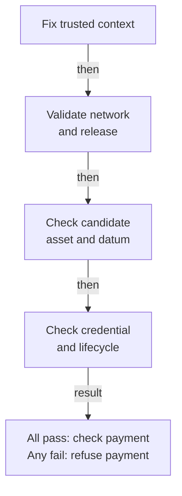

# Consumer checklist

A treasury wants to pay Alice using the key state from its chosen registry.
It must reject a convincing checkpoint from another registry, another AID or
another network, as well as a checkpoint that is frozen, poisoned, too young,
parked or awaiting termination.

!!! note "Model rule; production conformance remains open"
    The reviewed consumer model and its executable simulator express this
    rule. They do not establish a deployed consumer, a Cardano datum decoder
    or a current-output observer. The existing V1 reader is a separate
    implementation; its naming rule is not the redesigned registry rule.
    This code is not for mainnet.

## Fix the intended identity first

The treasury fixes its network, published KERI release, registry creation
seed and intended AID independently of the output it is checking. A trusted
integration supplies the actual network and resolves the complete release.
An unknown release or a network mismatch is an error or refusal, never
permission to adopt the candidate's values.

The candidate supplies evidence to compare with the fixed context. It does
not choose the context. The payment's own authorization remains a separate
check after holding eligibility succeeds.

## Check the complete holding

The model's `consumableHolding` proposition and `consumableHoldingB`
executable predicate require all of the following:

1. The observed network equals the intended network, and the resolved release
   equals the complete intended descriptor: application policy, application
   credential, state program and state policy.
2. The output uses the release's application credential.
3. The complete expected representative asset has aggregate quantity exactly
   one in that output. Both its policy and name matter; two duplicate entries
   of quantity one count as two and fail.
4. The same output has an application datum that the selected release decoder
   accepts for the intended AID.
5. Its decoded state is present, unfrozen and unpoisoned, and the current slot
   is at least its birth slot plus the juvenility window. Equality at that
   boundary is sufficient. A zero window permits consumption at birth.

The representative name is derived from the complete registry identity and
encoded AID key through the imported Singular `activeAsset`. The registry
identity is derived from the release and creation seed through `stateAsset`.
It is not the raw AID, a human registry label or the allocated registration
serial. See [Exact consumer identity](../design/consumer-identity.md) for the
selected declarations and explicit encoding assumptions.

A present model state holds the conviction bond; an unfrozen one holds the
freeze bond. Establishing that a real output's datum and lovelace represent
those model values is an additional implementation obligation. A Boolean
flag alone is not evidence of physical value.

## Follow the lifecycle story

Registration does not grant immediate consumption: juvenility still applies.
Authorized rotations retain the same representative asset. Parking retains
the output, token and key state but makes it ineligible. Revival is a local
transition with fresh bonds and a new juvenility window. Conviction retains
ineligible pending custody until the matching recorded request is consumed
by the actual terminal fold. Only that completion establishes retirement.

After retirement, the same key cannot register or revive in that registry.
Another registry can legitimately register the same AID; its token still
fails this treasury's original context. This is not global AID uniqueness.

[Play the treasury story](../simulator/index.html?story=11): inspect the exact
holding, change an identity field, then follow creation, registration,
rotations, parking, revival and the matching terminal completion. The
simulator labels its finite naming and datum interpretations.

## Complete the integration before relying on it

The transaction must validate its current reference input, scripts, complete
value and datum, then check the payment's own signatures against the current
threshold. Neither immutable registration metadata nor the model's
`realizesState` premise establishes that an output reference is still unspent.

Reject zero or several eligible candidates. Missing tokens alone do not prove
that an identity was never registered or is terminal. Unknown releases,
network errors and provider failures must not become “identity absent”.
The model has no checkpoint expiry field; booking intervals do not define
consumer expiry or renewal.

Production acceptance remains held until both implementation layers execute:
properties over the real decoder, value map, scripts and trusted context;
and a connected boundary journey through genuine creation, registration,
updates, parking, revival and terminal burn. Lean proofs and JavaScript replay
are model evidence, not either production layer. See the
[trust boundaries](../design/trust-model.md#the-consumers-predicate).
