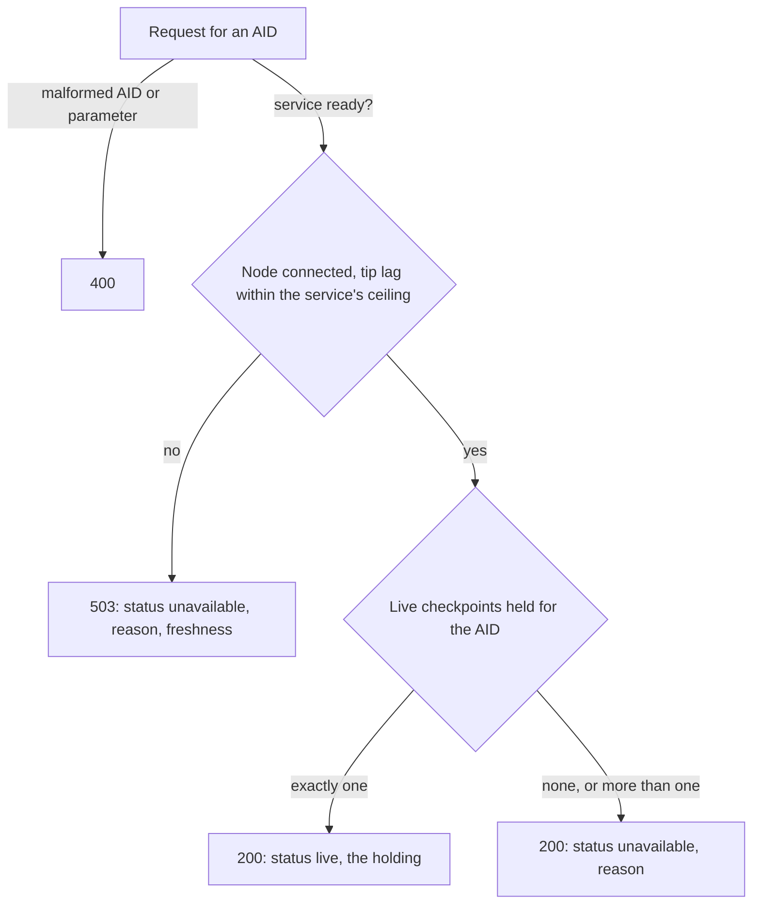

# The query endpoint — checkpoint answers without a node

!!! note "What ships, and the accepted design"
    Unless a paragraph below is marked as preprod or `main` today, it
    describes the accepted design (D-036 to D-040). In that design an
    identity is **active** until it is convicted: there is no owner exit, no
    parking and no revival. A duplicity proof enters pending custody; its
    associated Registry fold makes it **convicted** (terminal); there is no
    withdraw; a `deposit` rotation is the
    unfreeze; and the **poison**, the owner's own lock on the checkpoint,
    lasts one epoch and is cleared by rotation. Play the
    [checkpoint simulation](../simulator/index.html).
    What ships today is the V1 checkpoint with role addresses.


`ckeri-query` is a read-only HTTP service that answers checkpoint, board, and
watchability questions about M1 identities directly from the indexed chain
state. A person with only `curl` — no Cardano node on the asking side, no local
RocksDB store, no Koios key — can ask a running `ckeri-query` whether an AID's
checkpoint is current and get back an answer that says exactly which indexed
chain slot it came from and how stale that slot is.

No hosted service of the earlier design is available. A reader runs
`ckeri-query` themselves; see [Configuration](#configuration). The examples
below assume the default port:

```text
http://localhost:8080
```

## Routes

| Method | Path | Always 200? | Description |
| --- | --- | --- | --- |
| `GET` | `/ready` | yes | Service and freshness status |
| `GET` | `/checkpoint/{aid}` | no (503 when not ready) | Current authenticated checkpoint for an AID |
| `GET` | `/board` | no (503 when not ready) | Complete authenticated endpoint-board catalog |
| `GET` | `/board/{witness_key}` | no (503 when not ready) | Authenticated endpoint-board record for a witness key |
| `GET` | `/watchability/{aid}` | no (503 when not ready) | Whether a checkpoint's declared witnesses are all listed on the board |
| `GET` | `/identity/{aid}` | no (503 when not ready) | The checked live holding of an AID in the registry, or `unavailable` with the reason; served by the registry service only |
| `GET` | `/swagger.json` | yes | Machine-readable OpenAPI document |
| `GET` | `/swagger-ui` | yes | Interactive Swagger UI over `/swagger.json` |

`{aid}` is a self-addressing CESR E-code identifier. `{witness_key}` is a
non-transferable Ed25519 CESR B-code key. Both are the qualified-base64
(qb64) form ckeri itself prints — the same strings you already see from
`ckeri status` or a registration transcript.

## `GET /ready`

Always returns HTTP 200 with this exact shape:

```json
{
  "ready": true,
  "as_of_slot": 129921673,
  "tip_lag_slots": 0,
  "upstream": "connected",
  "reason": null
}
```

```console
$ curl -s http://localhost:8080/ready | jq
```

`ready` is `true` only when all of the following hold at once: the store has
a transactional watermark, the upstream node connection is up, a chain tip is
known, and `tip_lag_slots <= 60`. `reason` explains why the service is not
ready when it isn't (for example `"upstream disconnected"` or `"tip lag
exceeds the 60-slot freshness threshold"`); it is `null` when ready.

A service started from a release identity answers by the ceiling it was started with,
not by that threshold, and `/ready` then also carries that ceiling as
`max_tip_lag_slots`; see [the registry service's ceiling](#the-registry-services-ceiling).

## `GET /checkpoint/{aid}`

```console
$ curl -s http://localhost:8080/checkpoint/E... | jq
```

```json
{
  "aid": "E...",
  "as_of_slot": 129921673,
  "tip_lag_slots": 0,
  "checkpoint": {
    "tx_id": "ccf10efe3b90833374cf712fdbe2b246f88aadf34c170c9074d16754cdf5c6f2",
    "output_index": 0,
    "sequence": 1,
    "native_sequence": 1,
    "current_keys": ["D...", "D...", "D...", "D...", "D..."],
    "current_threshold": { "type": "unweighted", "value": 2 },
    "next_key_digests": ["E...", "E...", "E..."],
    "next_threshold": { "type": "unweighted", "value": 2 },
    "witnesses": ["B...", "B...", "B..."],
    "witness_threshold": 2
  }
}
```

Substitute the AID you want to look up for `E...`. An unknown but
well-formed AID returns HTTP 200 with `"checkpoint": null` — a `null`
payload is a real answer ("no current checkpoint exists for this identity"),
not an error. A malformed CESR identifier (wrong code, wrong length, invalid
base64) returns HTTP 400:

```json
{ "error": "malformed_identifier" }
```

`tx_id` and `owner_key_hash` (board only) render as lowercase hex; every
other CESR value renders in canonical qualified-base64 form. A threshold
preserves its actual weighted or unweighted shape: an unweighted threshold is
`{"type":"unweighted","value":N}`; a weighted threshold is
`{"type":"weighted","clauses":[[{"numerator":1,"denominator":2}, ...]]}`.

## `GET /board/{witness_key}`

```console
$ curl -s http://localhost:8080/board/B... | jq
```

```json
{
  "witness_key": "B...",
  "as_of_slot": 129921673,
  "tip_lag_slots": 0,
  "board": {
    "aid": "E...",
    "scheme": "https",
    "url": "https://witness.example/",
    "tx_id": "5c98bb45cc3e0879a63aa5807dff7f3809ae934ccbcac54f547c189bb4e8701c",
    "output_index": 0,
    "lovelace": 5000000,
    "owner_key_hash": "3d18237dc14be14284d775a5766016c7c4c432dedce287011701c6c7"
  }
}
```

An unknown witness key returns HTTP 200 with `"board": null`. The board
record is only served after the endpoint independently validates the frozen
board marker, datum, KERI event, and signature — a forged or malformed
output fails the entire lookup closed rather than returning a partial or
untrusted catalog. Koios is not part of this serving path.

## `GET /board`

```console
$ curl -s http://localhost:8080/board | jq
```

```json
{
  "as_of_slot": 129921673,
  "tip_lag_slots": 0,
  "board": [
    {
      "witness_key": "B...",
      "aid": "E...",
      "scheme": "https",
      "url": "https://witness.example/",
      "tx_id": "5c98bb45cc3e0879a63aa5807dff7f3809ae934ccbcac54f547c189bb4e8701c",
      "output_index": 0,
      "lovelace": 5000000,
      "owner_key_hash": "3d18237dc14be14284d775a5766016c7c4c432dedce287011701c6c7"
    }
  ]
}
```

The array contains every current authenticated record in deterministic
output-reference order; an empty catalog is `"board": []`. The complete
catalog and `as_of_slot` come from one store transaction. As with the
single-record route, one forged or malformed output fails the whole response
closed with HTTP 500 rather than returning a partial catalog.

## `GET /watchability/{aid}`

```console
$ curl -s http://localhost:8080/watchability/E... | jq
```

```json
{
  "aid": "E...",
  "as_of_slot": 129921673,
  "tip_lag_slots": 0,
  "watchability": {
    "checkpoint_present": true,
    "witnesses_declared": 3,
    "witnesses_listed": 3,
    "missing_witnesses": []
  }
}
```

This compares the checkpoint's declared witness set against the current
authenticated endpoint board and reports how many declared witnesses are
actually discoverable. Unlike `/checkpoint` and `/board`, `watchability` is
never `null`: with no current checkpoint it reports
`"checkpoint_present": false`, zero counts, and an empty
`missing_witnesses` list rather than omitting the field.

## `GET /identity/{aid}`: the registry service's live holding

A relying party that pays an identity wants one answer: is this AID's holding
in the registry live right now, and may I consume it? The registry service
answers that question, and only that question. It gives either the AID's
**checked live holding** at a stated chain point, or `unavailable` with the
reason. It claims nothing else: it never answers that an identity is
terminated, was never registered, or is awaiting termination.

This route belongs to the registry service, the instance started from a
release identity file instead of a deployment manifest. The registry service
is a separate process. It has its own endpoint, and its own store directory
that starts empty and is distinct from the store of the version 1 service. A
store that the other mode created is refused when the service opens it, naming
the mismatch. A service started from a deployment manifest does not serve this
route and answers HTTP 404 with an error that names its manifest mode.



A live answer carries the holding's facts and amounts, the identity of the
registry and of the release, the output reference, the chain point the holding
was read at and the freshness. The holding, its amounts and the chain point come
from one store transaction; the tip lag is measured against the tip sampled after
it, as for the other data routes:

The numbers in the examples below show the shape of an answer, not a real holding.

```console
$ curl -s 'https://registry.example/identity/E...?window_ms=300000&now_ms=1700000300000' | jq
```

```json
{
  "status": "live",
  "aid": "E...",
  "as_of_slot": 129921673,
  "tip_lag_slots": 0,
  "max_tip_lag_slots": 25,
  "block_hash": "9a1c...",
  "registry": {
    "state_policy": "64...",
    "state_token_name": "5c...",
    "seed": { "tx_id": "65...", "output_index": 3 }
  },
  "release": {
    "application_policy": "61...",
    "application_credential": "62...",
    "state_program": "63...",
    "state_policy": "64..."
  },
  "holding": {
    "tx_id": "ccf1...",
    "output_index": 0,
    "sn": 5,
    "epoch": 2,
    "poisoned": false,
    "frozen": false,
    "topped_up": true,
    "born_at": 1700000000000,
    "refund_address": "70...",
    "deposit": 8000000,
    "freeze_bond": 2000000,
    "pool": 3,
    "lovelace": 12000003,
    "key_state": {
      "current_keys": ["D...", "D..."],
      "current_threshold": { "type": "unweighted", "value": 1 },
      "next_key_digests": ["E..."],
      "next_threshold": { "type": "unweighted", "value": 1 },
      "witnesses": [],
      "witness_threshold": 0
    }
  },
  "consumer": { "evaluated": true, "consumable": true, "failed_clauses": [] }
}
```

The consumer result is reported beside the holding and never changes
`status`. It is the verdict of the published consumer predicate over the same
holding, for the release's context and the AID, at the maturity window and the
time the caller supplies in `window_ms` and `now_ms`, both in milliseconds, the
unit of `born_at`. `consumable` is true when the holding passes every clause,
and `failed_clauses` names each clause it fails, such as `CheckpointFrozen`,
`CheckpointPoisoned` or `CheckpointJuvenile`. A holding that is frozen still
has `status: "live"`; whether to consume it is the consumer result's answer.
Without both parameters the answer says it was not evaluated and why:

```json
{ "evaluated": false, "reason": "the consumer result is evaluated only when both window_ms and now_ms are given" }
```

Every other case of a ready service answers HTTP 200 with `status:
"unavailable"` and a reason, never a 404 and never an empty success. The
service holds either no live checkpoint of the registry for the AID, or more
than one. The body names the registry and the release the service follows and the
chain point the store was read at, so a reader can tell whose answer it is:

```json
{
  "status": "unavailable",
  "aid": "E...",
  "as_of_slot": 129921673,
  "tip_lag_slots": 0,
  "max_tip_lag_slots": 25,
  "block_hash": "9a1c...",
  "registry": { "state_policy": "64...", "state_token_name": "5c...", "seed": { "tx_id": "65...", "output_index": 3 } },
  "release": { "application_policy": "61...", "application_credential": "62...", "state_program": "63...", "state_policy": "64..." },
  "reason": "the store holds no live checkpoint of this registry for this AID"
}
```

A service that is not ready answers HTTP 503, as the other data routes do,
and the body says it is unavailable besides carrying the readiness fields, the reason
of [fail-closed semantics](#fail-closed-semantics), and the registry and the release
the service follows:

```json
{
  "status": "unavailable",
  "ready": false,
  "as_of_slot": 129921603,
  "tip_lag_slots": 26,
  "max_tip_lag_slots": 25,
  "upstream": "connected",
  "reason": "tip lag 26 exceeds the ceiling 25",
  "error": "service_unavailable",
  "registry": { "state_policy": "64...", "state_token_name": "5c...", "seed": { "tx_id": "65...", "output_index": 3 } },
  "release": { "application_policy": "61...", "application_credential": "62...", "state_program": "63...", "state_policy": "64..." }
}
```

Readiness and the identity answer are two separate questions. The limit is the
[ceiling of the registry service](#the-registry-services-ceiling): a service whose node
is connected, whose tip and store point are known and whose tip lag is at most its
ceiling is ready, and one more slot makes it not ready, and it answers HTTP 503. A ready service answers `live` only when exactly one classified live
checkpoint of the registry is held for the AID; with none, or with two, it answers
HTTP 200 with `status: "unavailable"`. A malformed AID, or a `window_ms` or `now_ms`
that is not a non-negative integer, is HTTP 400.

## The registry service's ceiling

The registry service is started with the largest tip lag, in slots, that it answers
within. The setting has no default: it is `--max-tip-lag-slots`, or the variable
`CKERI_MAX_TIP_LAG_SLOTS`, a non-negative whole number, and the service refuses to
start without it, or with anything else, before it opens its store. It is a setting
of the deployment because the lag that is acceptable depends on the network: how long
a slot lasts and how often blocks arrive decide how far behind the tip a healthy
store is. The project fixes no number.

The ceiling governs every route this service answers from its store: `/ready`,
`/checkpoint/{aid}`, `/watchability/{aid}`, both `/board` forms and
`/identity/{aid}`. A lag up to and including the ceiling is answered. A larger lag,
a node that is not connected, no observed tip and a store that has recorded nothing
are each the not-ready answer of that route: HTTP 503 with the readiness fields for
the data routes, and `ready: false` for `/ready`. The reason for a lag names the lag
and the ceiling.

The service says which ceiling it applied. `/ready` carries `max_tip_lag_slots`,
and so do the live body, the unavailable body and the 503 body of the identity route,
beside `as_of_slot` and `tip_lag_slots`. The 400 error body carries neither, and the
other routes keep their shapes. The numbers in the example
below show the shape of an answer, not a recommended ceiling:

```json
{
  "ready": false,
  "as_of_slot": 129921603,
  "tip_lag_slots": 26,
  "max_tip_lag_slots": 25,
  "upstream": "connected",
  "reason": "tip lag 26 exceeds the ceiling 25"
}
```

A relying party that needs a fresher answer than the deployment gives reads the
`tip_lag_slots` of each answer and applies its own tolerance to it. A service has one
ceiling, and the ceiling of the party that reads it is its own. The service started
from a deployment manifest keeps its fixed threshold, described above, and does not
read this setting.

## Freshness and provenance — what `as_of_slot` actually promises

Every data response carries `as_of_slot` and `tip_lag_slots` beside its
payload, and `/ready` carries the same pair at top level. This is not
decoration — it is a provenance claim about the chain state behind the
answer, and it means something specific:

`as_of_slot` is the latest rollback-log slot observed **inside the same
store transaction** that read the checkpoint, board, or watchability data.
It is deliberately not the follower's internally tracked "last processed
slot": that counter advances after each commit and is retained across a
disconnect, so it can read as fresher than the store actually is right after
a rollback. Sourcing freshness from the transactional watermark instead means
a rollback invalidates the freshness claim by the same mechanism that
invalidates the data — there is no window where a stale answer carries an
optimistic slot number.

`tip_lag_slots` is computed by sampling the observed chain tip **after** that
transaction commits, purely to measure lag; it never gates which data was
read. When the store watermark is momentarily ahead of the sampled tip, or no
tip has been observed yet, or the upstream node is disconnected, or the lag
exceeds 60 slots, the service reports itself not ready rather than publish a
freshness number it cannot stand behind.

What the follower observes, from which node, and what its 60-slot limit and a
not-ready answer mean are declared in
[What the follower observes, and when a read is unavailable](follower.md#what-the-follower-observes-and-when-a-read-is-unavailable).

## Fail-closed semantics

When `/ready` would report `ready: false`, every data route (`/checkpoint`,
both `/board` forms, `/watchability`) fails closed with **HTTP 503** and the same
readiness fields, plus an explicit error tag — never a stale or partial
payload:

```console
$ curl -si http://localhost:8080/checkpoint/E... 
HTTP/1.1 503 Service Unavailable
content-type: application/json
```

```json
{
  "ready": false,
  "as_of_slot": 129921603,
  "tip_lag_slots": null,
  "upstream": "disconnected",
  "reason": "upstream disconnected",
  "error": "service_unavailable"
}
```

The 503 body never includes `checkpoint`, `board`, or `watchability` — not
even as `null` — so a client cannot mistake a service-unavailable envelope
for a data response with an empty payload. An unexpected internal failure
(never an expected fail-closed condition) returns HTTP 500 with
`{"error":"internal_error"}` and no other detail.

## Configuration

`ckeri-query` is an `opt-env-conf` binary: every setting has a command-line
flag and a `CKERI_*` environment variable.

| Flag | Env | Default | Notes |
| --- | --- | --- | --- |
| `--node-socket` | `CKERI_NODE_SOCKET` | — | Cardano node socket path |
| `--network-magic` | `CKERI_NETWORK_MAGIC` | — | Cardano network magic |
| `--byron-epoch-slots` | `CKERI_BYRON_EPOCH_SLOTS` | — | Byron epoch size for the node-to-client codec |
| `--security-param-k` | `CKERI_SECURITY_PARAM_K` | — | Rollback-window security parameter |
| `--start-slot` / `--start-block-hash` | `CKERI_START_SLOT` / `CKERI_START_BLOCK_HASH` | origin | Follower start point |
| `--store-path` | `CKERI_STORE_PATH` | — | RocksDB indexer directory |
| `--manifest-path` | `CKERI_MANIFEST_PATH` | — | Deployment manifest JSON path |
| `--release-identity-path` | `CKERI_RELEASE_IDENTITY_PATH` | — | Release identity JSON path; the registry service, given in place of the manifest |
| `--max-tip-lag-slots` | `CKERI_MAX_TIP_LAG_SLOTS` | none | Registry service only, and required there: the [ceiling](#the-registry-services-ceiling); not read in manifest mode |
| `--board-address` | `CKERI_BOARD_ADDRESS` | — | Endpoint-board address; **mandatory for `ckeri-query`** |
| `--port` | `CKERI_PORT` | `8080` | HTTP listen port |

`--board-address`/`CKERI_BOARD_ADDRESS` is optional in the general follower
configuration, but `ckeri-query` refuses to start without it: `/board` and
`/watchability` have nothing to authenticate against otherwise, and the
binary fails fast with a concise message rather than silently serving an
endpoint that can never answer those routes.

## One process, no derived state

`ckeri-query` is a single OS process. It opens exactly one RocksDB store
through `withRocksDBIndexerRunner`, hands the resulting handle and
transaction runner to both `withChainSyncFollower` (the chain-sync consumer)
and the HTTP application, and links the follower's async before it starts
serving — a follower failure takes the whole process down rather than
leaving a server answering from a store nothing is updating any more. There
is no second follower, no separate query database, and no replication lag
between "what was indexed" and "what the endpoint can see".

The HTTP layer itself owns no cache: no memo table, no secondary index, no
`IORef`, `MVar`, or `TVar` holding decoded data. Every response is a pure
decode of a fresh read inside one `kv-transactions` transaction — for
`/checkpoint` and `/board` that is one transaction; for `/watchability` the
same transaction reads both the checkpoint and the board catalog. There is
no rollback-invalidation logic to get wrong, because there is no derived
state to invalidate: a rollback simply changes what the next transaction
reads.

## What this endpoint does not do

`ckeri status --aid E... --endpoint http://localhost:8080` now
consumes this contract through the production CLI, delivered by
[#177](https://github.com/lambdasistemi/cardano-keri/issues/177). It validates
the checkpoint and watchability responses, including their echoed identity
and shared freshness envelope, and fails closed without falling back to a
local store or Koios.
