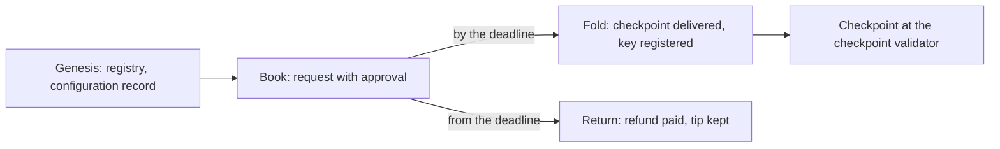

# Register an identity in a registry, and terminate it when convicted

This page describes registration on a local test chain, where a registry of
KERI's application is created and an identity registers in it in three steps,
and the termination of an identity whose checkpoint was convicted, in two more.
The `ckeri register` command still builds the single-transaction registration
of the deployed preprod generation until the preprod deployment of the new
contracts ([#356](https://github.com/lambdasistemi/cardano-keri/issues/356));
this page is about the registry generation.

!!! warning "Not for mainnet"
    This code is not for mainnet.

## Stories

**Alice registers.** Alice books her registration: she pays one request that
holds her deposit, the registration cost and a tip, and commits the initial
state of her checkpoint. A different party, Bob, folds the request into the
registry before its deadline. A checkpoint appears at the checkpoint
validator's address holding exactly Alice's deposit and one active token of her
identifier in this registry.

**A late fold is refused.** Once a request's deadline has passed, a fold of
that request is refused by the application, even when everything else about the
transaction is as it was.

**An unfolded request comes back.** After the deadline anyone may return a
request. Its refund address is paid everything but the tip, and a return that
pays another address is refused.

**A second registration of a registered AID cannot be folded.** Dana books her
registration twice. The first request is folded and her checkpoint appears; it
carries the state her booking committed, although the fold came later, because
the age of a checkpoint is fixed at booking and a delayed fold keeps it. The
second request is refused whoever folds it. A fold built against the registry
before the first landed is refused by the ledger, because the registry state it
spends is already consumed. A fold built afterwards is refused by the builder,
which does not build a fold for a key the registry already holds. Neither
refusal changes a checkpoint or the registry's root, and a fold of a new key
folds. That the registry holds each key once is the rule of the public
[Singular registry](https://github.com/lambdasistemi/singular/issues/742), at
commit `d69ab005c3b710aeebf033d3c5cd08c56feb5643`.

**A convicted identity is terminated.** A conviction leaves the identity's
pending output at the checkpoint validator's address, holding the registry's
minimum ADA and the identity's active token. Carol, who is neither the identity's
owner nor the convictor, books its termination with her own fee and no signature
of theirs: the pending output is released into a termination request at the
application address, which holds the registry's termination carrier and the
tip, the active token and a termination approval. Bob, another party, folds the
request. The registry marks the identifier terminal, the active token and the
approval are burned, the treasury is given the request less the tip, and Bob
keeps the tip. The journey reads these back from the chain and not from the
builders' values: the registry's root is the tree with the identifier's
terminal leaf, no unspent output holds the active token or the approval, and
Bob's wallet gained exactly the tip less the fee.

**Each clause of a termination is refused by the scripts that judge it.** A
release of the pending output with no approval minted is refused by the
checkpoint validator alone. A booking that mints the approval of another key is
refused by the checkpoint validator and by the application, both. A burn of the
approval that spends the request without the terminating fold is refused by the
application's spend of the request alone. A second booking of the same pending
output, built before the first landed, is refused by the ledger because the
output is consumed, and by nothing else; built afterwards, the builder refuses
it by name. Each refusal leaves the registry's root and what sits at the
validators as it was.

**A terminated identifier cannot register again.** Its owner can book a
registration of it, because a booking reads no registry. The fold of that
request is refused by the builder, which names the key and computes nothing for
it; the registry's own rule is the one that holds the key terminal for good, at
the public [Singular registry](https://github.com/lambdasistemi/singular/issues/743).
The request is returned after its deadline to its refund address, everything
but the tip. A second termination booking of the key is refused by the builder:
no pending output holds its token.

## The three steps

| Step | Who | What the transaction does |
|---|---|---|
| Genesis | the registry's creator | spends a seed output; mints the registry's state token into an empty state and the configuration record, which holds the request parameters and names the checkpoint validator's credential |
| Book | the identity's owner | mints the approval of the request and pays the request to the application address, reading the configuration record; the booking interval is no wider than the registry's booking width, and the deadline is its upper bound plus the processing time |
| Fold | any party | spends the request and the registry state; the registration observer attests the inception evidence; the state script inserts the identifier and mints its active token; the holding is delivered to the checkpoint address with the initial datum; the approval is burned and the treasury is given the registration cost |
| Return | any party | after the deadline, spends the request, burns its approval and pays the refund address everything but the tip |
| Book termination | any party | spends the convicted checkpoint's pending output, which the checkpoint validator releases only because exactly one termination approval of its registry and key is minted in the same transaction; the application mints that approval and places the request, reading the configuration record; no signature but the fee payer's |
| Fold termination | any party | spends the request and the registry state; the state script marks the key terminal and the active token is burned with the approval; the treasury is given the request less the tip; there is no deadline |

The checkpoint validator recognises a checkpoint by the registry's active
asset of its identifier, the representative asset of the
[exact consumer identity](../design/consumer-identity.md). It applies to one
registry, so each registry has its own checkpoint validator; the same
amounts (deposit, freeze bond, premium, network) are applied to it and to the
application from one set of terms, and nothing on chain binds the two.

## What the local test chain checks

The end-to-end journey of the repository's test suite runs genesis, a booking, a
fold by another party, a late fold (refused), a return paying another address
(refused) and the return to the refund address, and asserts the checkpoint, the
registry state and the refund from chain state. It then books one new identity
twice and shows both refusals of the second registration and the fold of the
new key that lands, reading both checkpoints and the registry's root back from
chain after each refusal. The other checkpoint journeys
(advance, conviction, freeze, deposit rotation, top-up) start from a checkpoint
a fold delivered. The termination journey starts from the conviction journey's
checkpoint and runs the booking, the controls and the fold described above,
reading back the registry's root, the validators' outputs and the folder's
wallet; what the treasury received is derived from the wallet change and the
declared fee, because the treasury cannot be read before an epoch ends.

The revisions, script hashes and sizes of this generation, and how the devnet
registry's own identity and transaction identifiers are derived and printed, are
on the page [the identities of this generation](../architecture/registry-identities.md).

## Limits

- One request is folded per transaction. The validators allow a transaction that folds a registration and a termination together and add up what it owes the treasury; the builders build one change per transaction.
- Booking does not check the premium.
- A registration of a terminal key is booked and returned after its deadline; the booking reads no registry, so it cannot be refused there. The builder refuses the fold of such a request from a list of terminated keys its caller supplies; the registry's insertion is what refuses it on the ledger.
- Nothing on chain binds the application's minimum ADA to the checkpoint validator's; the terms set both from one value and the derivation refuses terms where they differ.
- The foreign-registry rows of the Lean are refused here at the lookup of the configuration record, which exists only for a registry whose state policy was checked at its genesis; the Lean refuses them at its explicit policy clause. The verdicts are the same.
- Premises the Lean states and does not prove: the termination approval's preimage collides with nothing else, and the checkpoint validator realizes the checkpoint model.
- Checkpoint migration, introduced for the deployed generation, is not part of the registry generation; a new contract generation means new registrations.
- `ckeri register`, `advance`, `freeze` and `top-up` stay on the deployed preprod generation until [#356](https://github.com/lambdasistemi/cardano-keri/issues/356).
