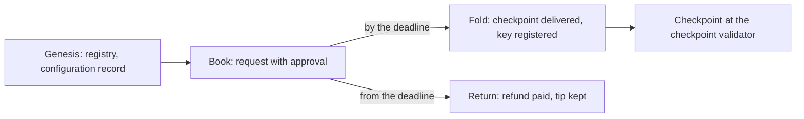

# Register an identity in a registry: book, fold, return

This page describes registration on a local test chain, where a registry of
KERI's application is created and an identity registers in it in three steps.
The `ckeri register` command still builds the single-transaction registration
of the deployed preprod generation until the preprod deployment of the new
contracts ([#356](https://github.com/lambdasistemi/cardano-keri/issues/356));
this page is about the registry generation.

!!! warning "Not for mainnet"
    This code is not for mainnet.

## Stories

**Alice registers.** Alice books her registration: she pays one request that
holds her deposit, the registration cost and a tip, and commits the initial
state of her checkpoint. A different party, Bob, folds the request into the
registry before its deadline. A checkpoint appears at the checkpoint
validator's address holding exactly Alice's deposit and one active token of her
identifier in this registry.

**A late fold is refused.** Once a request's deadline has passed, a fold of
that request is refused by the application, even when everything else about the
transaction is as it was.

**An unfolded request comes back.** After the deadline anyone may return a
request. Its refund address is paid everything but the tip, and a return that
pays another address is refused.

## The three steps

| Step | Who | What the transaction does |
|---|---|---|
| Genesis | the registry's creator | spends a seed output; mints the registry's state token into an empty state and the configuration record, which holds the request parameters and names the checkpoint validator's credential |
| Book | the identity's owner | mints the approval of the request and pays the request to the application address, reading the configuration record; the booking interval is as wide as the registry's booking width, and the deadline is its upper bound plus the processing time |
| Fold | any party | spends the request and the registry state; the registration observer attests the inception evidence; the state script inserts the identifier and mints its active token; the holding is delivered to the checkpoint address with the initial datum; the approval is burned and the treasury is given the registration cost |
| Return | any party | after the deadline, spends the request, burns its approval and pays the refund address everything but the tip |

The checkpoint validator recognises a checkpoint by the registry's active
asset of its identifier, the representative asset of the
[exact consumer identity](../design/consumer-identity.md). It applies to one
registry, so each registry has its own checkpoint validator; the same
amounts (deposit, freeze bond, premium, network) are applied to it and to the
application from one set of terms, and nothing on chain binds the two.

## What the local test chain checks

The end-to-end journey of the repository's test suite runs genesis, a booking, a
fold by another party, a late fold (refused), a return paying another address
(refused) and the return to the refund address, and asserts the checkpoint, the
registry state and the refund from chain state. The other checkpoint journeys
(advance, conviction, freeze, deposit rotation, top-up) start from a checkpoint
a fold delivered.

## Limits

- One request is folded per transaction.
- Booking does not check the premium.
- No termination approval is minted yet ([#350](https://github.com/lambdasistemi/cardano-keri/issues/350)), so a convicted checkpoint's pending output waits for termination.
- Checkpoint migration, introduced for the deployed generation, is not part of the registry generation; a new contract generation means new registrations.
- `ckeri register`, `advance`, `freeze` and `top-up` stay on the deployed preprod generation until [#356](https://github.com/lambdasistemi/cardano-keri/issues/356).
