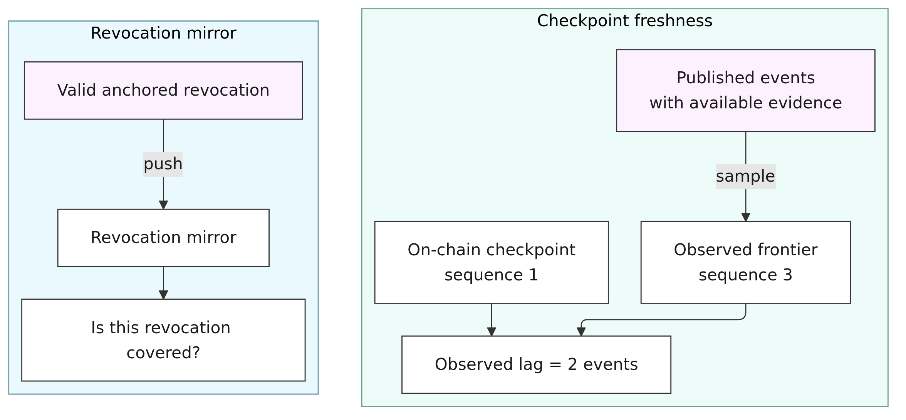
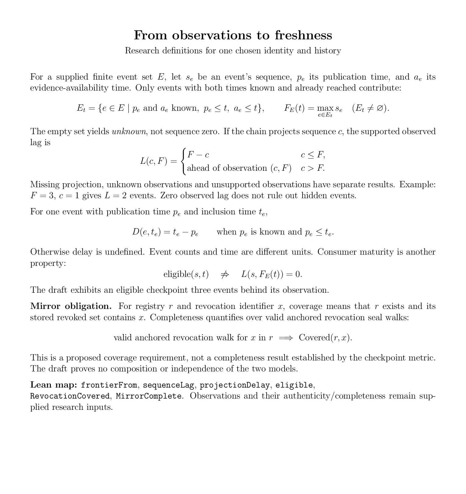
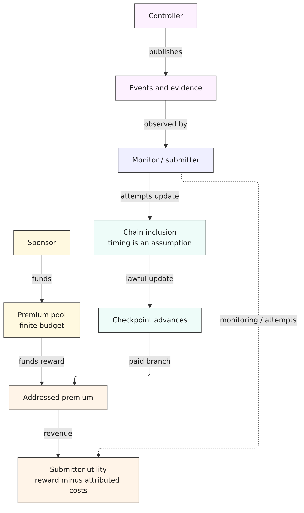
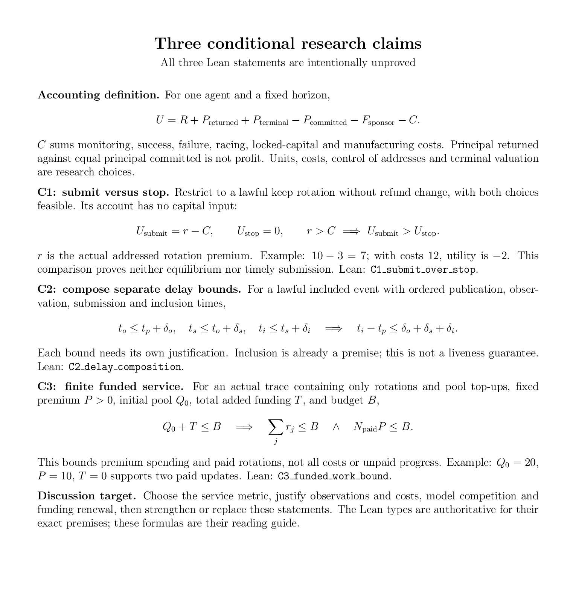

<!-- gist: a83bce7685f174ff1244b656f3277317 -->
# Freshness incentives: a Lean research starting point

**Meeting draft · 29 October 2026.** Introduce two freshness obligations; focus the economic study on checkpoints. The Lean examples compile. Three proposed research claims deliberately remain unproved. This is not an accepted protocol amendment or a calibrated economic result.

The question for the scientist is: **what measurable freshness service is purchased, and under which information, cost, competition and funding assumptions will someone supply it?**

## 1. Two obligations, one study to begin

Checkpoint freshness compares a projected key-event sequence with supported observations, and measures an event's publication-to-inclusion delay. Revocation-mirror freshness asks whether valid anchored revocations have been pushed into the mirror.

<!-- diagram: freshness | Checkpoint sequence lag and revocation-mirror coverage are separate freshness obligations -->

A fresh checkpoint alone does not establish complete revocation coverage. Both depend on publication, evidence availability, observation and inclusion; their composition and independence are not proved here. Empty or unavailable observations remain unknown, rather than receiving a reassuring zero-lag score.

<!-- math: metrics -->

## 2. Who funds and supplies fresh projections?

The imported Checkpoint model already supplies lawful updates and addressed pool premiums. The research layer supplies actor control, costs, strategies and assumptions about observation and inclusion.

<!-- diagram: incentives | Sponsor funding, controller publication, submitter activity, chain inclusion and net utility -->

The pool can run out: lawful unpaid progress remains possible. A profitable update can also arrive late. Rewarding a lawful update does not by itself prove prompt service or exclude reward-seeking production of otherwise valid events.

## 3. Conditional claims in LaTeX and Lean

The formulas below summarize the actual proposed Lean types. **C1, C2 and C3 each use `sorry`**. Their assumptions must be reviewed before proof work; none is a guarantee of real-world freshness.

<!-- math: claims -->

The downloadable [LaTeX source](freshness-math.tex) and [two-page PDF](freshness-math.pdf) accompany these rendered pages. The Lean files retain their original pre-meeting research labels and exact verified bytes.

| Start here | Content |
|---|---|
| [Presenter brief](presenter-brief.md) | One-minute opening, examples, three desired decisions and a 45-minute agenda |
| [Discussion and debrief](discussion-debrief.md) | Detailed assumptions, calibration questions and a blank outcomes template |
| [Lean concepts](Freshness/Concepts.lean) | Observations, lag, delay, utility, lawful executions, choices, game and funding traces |
| [Lean examples](Freshness/Examples.lean) | Data-to-number, profit/loss, race, funding exhaustion/renewal, delayed inclusion and Mirror coverage |
| [Lean claims](Freshness/Claims.lean) | C1 submission versus stopping, C2 delay composition, C3 funded-work bound |

## 4. What to decide together

1. **Metric and evidence:** sequence lag, publication delay or a conditional service target? What data can be observed, and what may remain hidden?
2. **Economics:** who monitors, submits and funds; which strategies are feasible; what do attempts, races and capital cost; what happens when the pool empties?
3. **Next formal claim:** revise one conditional statement, identify its measurements, and provide a positive example plus a counterexample when a key assumption is removed.

No equilibrium, calibrated probability, guaranteed promptness, anti-farming result or physical-ledger correspondence is claimed. Compiled-validator verification can subsequently connect implementation behavior to the model; it does not supply economic or observation assumptions.

## 5. Reproduce the Lean examples

See the [research README](README.md) for the exact run command, source bindings and admission inventory.

Diagram sources: [freshness](freshness.mmd) and [incentives](incentives.mmd). Rendered assets and LaTeX are preserved byte-for-byte from the reviewed meeting package.
