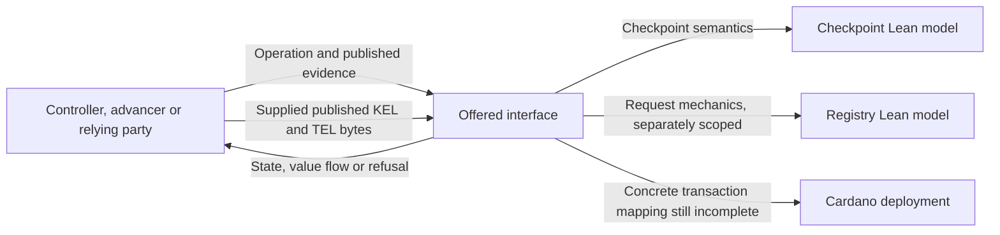
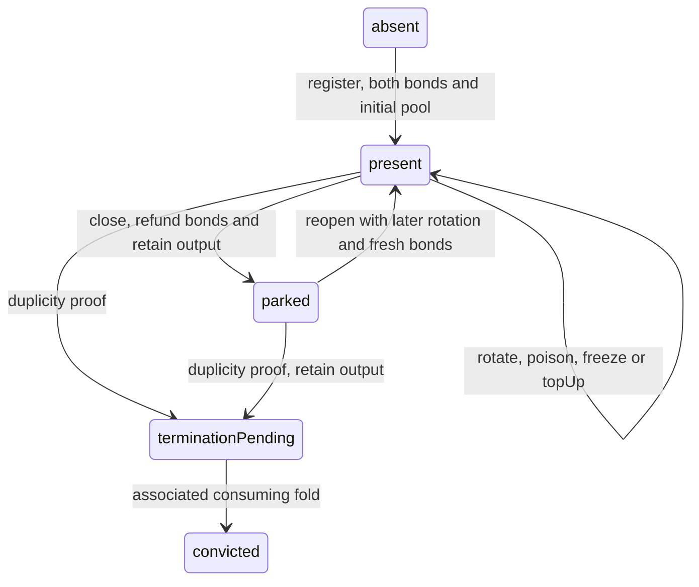
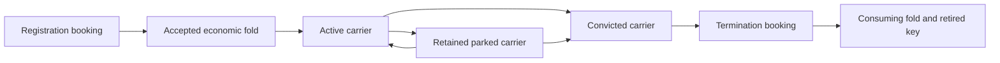
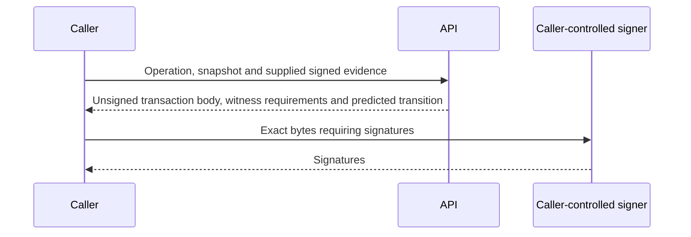

# An API derived from the Lean models

## Stories this specification serves

As an AID controller, I want to register, rotate, poison, close and reopen my
checkpoint with the authorization and refunds the model requires. As an
advancer, I want to land public evidence and know whether I receive a premium.
As a relying party, I want a verdict that distinguishes an unusable checkpoint
from evidence I could not obtain. As a registry operator, I want to contribute,
fold and retract requests under the model's admission and timing rules.

This is a **specification candidate**, following the operator's instruction to take
the API from the Lean specifications. It does not yet define a complete SDK
contract. The checkpoint source revision and every extracted source hash are bound in
[model provenance](model-provenance.json). The separate
[credential, TEL and delegation profile](statements.md) uses the named
statement branch at `4906cfaed34e43405b04d3cc8746bd6388fc8452`.
The issue supplies coverage
requirements; existing library code supplies implementation evidence. Neither
silently adds operations or guards to the Lean model.

The [HTML presentation contract](presentation.md) explains how the reference
is generated from these sources, including operation examples and schema downloads.

## Model boundary

[Checkpoint.lean](../../lean/CardanoKeri/Checkpoint.lean) defines the lifecycle:
`Action`, `Env`, `Step`, `stepFn`, `SysStep` and `consumableStateB` are the
source of the extraction below. Its eight actions have thirteen transition
constructors because payment and state cases are outcomes of an action.
[Registry.lean](../../lean/CardanoKeri/Registry.lean) imports the public Singular
economic booking and fold judgments. Its local carrier adapter and Checkpoint
share the retained-output boundary: parking preserves the output, representative
token and active registry key. Revival rotates that output locally. Conviction
first leaves a termination-pending carrier; only an accepted consuming fold
burns the token and retires the key.

Checkpoint `SysStep` retains the actual registration origin and the exact pending
termination entry. A completion must replay an accepted fold under that stored
context and consume that request. A valid fold for another request cannot complete
this identity. [The certificate adapter](../../lean/CardanoKeri/CheckpointCertificate.lean)
executes that judgment; the separate local action grid does not establish it.

[Samaritan.lean](../../lean/CardanoKeri/Samaritan.lean) states conditional booking
and fold economics. It does not add another caller operation or a guaranteed
refund of the request minimum ADA.

| Choice | Alternative | Reason |
| --- | --- | --- |
| Derive operations from executable Lean definitions | Infer them from CLI names | Lean governs semantics. |
| Keep local transitions and associated system completion distinct | Treat local conviction as final retirement | The actual consuming fold owns retirement. |
| CDDL maps for named fields | Require positional tuples throughout | Native evidence encodings remain a separate boundary. |
| Leave evidence representation open where Lean abstracts it | Accept caller-provided booleans as proof | Predicates stand for verification. |

## Checkpoint operations

Every operation is scoped to an AID, deployment parameters and observed state
at a chain slot. Lean's AIDs, addresses and key epochs are natural-number
abstractions. They are not a wire format for KERI prefixes, Cardano addresses
or public keys. `D` and `B` are positive bonds, `P` is the pool premium and
`W` the juvenility window. Neither `P` nor `W` is required to be positive.

An accepted model step returns **both the next state and addressed value
flow**. The caller API prepares unsigned artifacts from that transition;
it does not treat the model result as a submitted transaction or finality.
The operator selected **unsigned preparation and caller-supplied evidence**.
The API knows nothing about the KERI network: no KERI transport, discovery,
network client, resolver callback or evidence-fetching adapter belongs to it.

Present checkpoints carry independent poison and freeze flags. An action's
evidence obligations below describe what must be validated. Callers supply
the evidence and obtain signatures outside the API. Poison, bond, pool and reap are project
terms rather than KERI event types.

| Caller goal / action | Caller supplies beyond common context | What the caller obtains | Refusal conditions in the model |
| --- | --- | --- | --- |
| Sponsor an AID: `register` | Refund address, initial pool; funding for `D + B + pool0` | Present checkpoint at sequence and epoch zero, born now; funds locked | State is not absent; at `SysStep`, no matching accepted registration origin is supplied |
| Land a rotation: `rotate` | Later establishment sequence, `keep` or `deposit`, premium payee, optional replacement refund address; witnessed rotation and required intent authorization | Next epoch/sequence; poison cleared; refund address updated if supplied. If pool covers `P`, pay `P`; otherwise accept without payment. `deposit` clears freeze and brings missing `B`; `keep` preserves freeze | No present checkpoint; invalid rotation evidence; sequence not later; required intent unauthorized |
| Declare current keys unsafe: `poison` | Current-key quorum declaration | Poison flag set, no value movement | No present checkpoint; quorum absent; already poisoned |
| Report stale keys: `freeze` | Later witnessed rotation, hunter payee | Existing `B` paid to hunter; freeze flag set; old epoch and sequence retained | No present checkpoint; invalid evidence; sequence not later; pool covers `P`; already frozen; poisoned |
| Fund future advances: `topUp` | Pool increment | Pool increased, including a permitted zero increment; no authorization guard | No present checkpoint |
| Prove duplicity: `convict` | Duplicity evidence against recorded epoch/sequence; convictor payee | Termination pending, retaining token and key state. Present: `D` to convictor, held `B` and pool to refund address. Parked: no bond or pool movement | State neither present nor parked; duplicity evidence invalid |
| Leave: `close` (the checkpoint model's reap) | Later witnessed rotation, payee, optional new refund address; new-key intent binds close payee and refund option | Parked output retaining token, minimum ADA and resulting epoch/sequence. Pay `P` only when covered; refund remaining bonds and pool | No present checkpoint; invalid rotation; sequence not later; close intent unauthorized |
| Return: `reopen` | Rotation from exactly the parked key state to a later sequence; fresh `D`, `B`, initial pool and sponsor-selected refund address | Clean, fully bonded present checkpoint, born now, next epoch | State not parked; invalid rotation path; sequence not later; pending termination or retired state |

`keep` with no replacement refund address requires no additional intent
signature. Every deposit, every close and every replacement refund address
requires the corresponding new-key intent. A close binds its premium payee;
a copied close with that payee changed must fail authorization. Insufficient
pool is **not** a refusal for rotate or close. Deposit preserves `bornAt`
and brings zero bond value when the freeze bond is already full. Close can
consume a poisoned or frozen checkpoint; top-up can fund either.

Local parking, revival and conviction leave the registry key active. Registration
installs the active key through an accepted fold; associated termination completion
retires it permanently. A pending state has no local action exit and is not
consumable. The local register function is a state transition fixture; it does
not validate inception cryptography or certify an accepted Registry origin.

## Registry request mechanics

As a contributor or folder, I want the complete request, transaction inputs,
outputs, assets and validity interval to determine the result. A refused action
leaves the input state unchanged; an accepted action returns the complete state
and application flow. The Registry wire profile is an executable model adapter,
not a deployed transaction codec.

| Action | Required context | Result and limits |
| --- | --- | --- |
| `bookRegistration` | Complete generic booking, carrier ADA `Mc + D`, declared tip | Validated pending registration; no active carrier yet. |
| `fold` | Expected generation and plugin, complete UTxO and economic transaction, KERI inception for registrations | Actual imported fold, installed carriers/bindings, consumed pending entries, generation advanced. |
| `park` | Live carrier and coarse close authorization to recipient | Bond `D` returned, key counter advanced, token/output/`Mc` retained. |
| `revive` | Parked carrier and rotation from its retained key | Fresh `D`, live carrier with next key counter, same token/output/`Mc`. |
| `convictCkpt` | Live or parked carrier and coarse duplicity evidence | Pending carrier; key remains active until fold. |
| `bookTermination` | Exact pending carrier and complete generic termination booking | Whole pending entry retains token/key/original holding metadata; request holds `Mr + tip`; booker receives `Mc - Mr - tip` and pays its fee separately. |
| `genericRetraction`, `genericRejection` | Full imported recovery transaction and registration request | Exact generic recovery result; these wrappers do not settle all application recovery requirements. |

Registry's coarse evidence predicates do not establish equivalence to Checkpoint's
concrete duplicity and signed intent checks. The associated Checkpoint system
requires both its local evidence and the actual stored Registry receipt. Recovery
deadlines and payment conditions come from the imported judgments; there is no
user-posted revival request, dormant leaf or timestamp shortcut.

## Reads and missing models

As a relying party, I want to distinguish a negative verdict from incomplete
evidence. `consumableStateB` returns true exactly for a present checkpoint
that is neither frozen nor poisoned and satisfies `bornAt + W <= now`.
It does not check the consumer transaction's signatures, validity interval
or concrete registry proof. Returning that Boolean as complete transaction
authorization would overstate the model.

The pinned statement branch now supplies historical seal walks, `vcp`/`iss`/`rev`
projection, credential-chain admission and delegated approval certificates.
[Its model profile](statements.md) preserves those executable definitions
and their limits, including unproved theorem statements and an unresolved
composition with the funded Checkpoint lifecycle. Complete key-state queries,
chain-point subscriptions and concrete key lookup remain missing models.
Epoch counters cannot return concrete current keys, next-key digests,
thresholds or witnesses.

The ticket requires credential verdicts to distinguish issued, revoked and
unknown. Missing TEL/KEL evidence must never imply validity. No operation may
require external KERI parties to publish, sign or maintain additional material
for this projection. The new profile separates the model's final/provisional
historical verdict from an API `unknown` assessment for incomplete supplied
evidence. It does not prove live KERI revocation freshness.

## Unsigned preparation and supplied evidence

As a controller or relayer, I supply an operation, a Cardano state snapshot,
deployment parameters and already-published KERI evidence. The API checks
the evidence and models the transition. When a concrete deployment supports
that transition, preparation returns the unsigned Cardano transaction body,
its required witness roles, and the expected state and value flow. If the
deployment cannot express the transition, it returns
`deployment-operation-unsupported`; it must not construct an older operation
with the same name but different semantics.

Existing KERI event signatures and witness receipts are evidence inputs,
not signatures generated by this API. Bridge intent authorization remains
separate from Cardano payment witnesses: a Cardano witness cannot stand in
for a missing new-key intent. The API accepts no secret keys or signer
callback. It does not acquire missing evidence. A concrete preparation may
identify missing evidence or authorization material, but must not advertise
a transaction as ready to witness when its transition evidence is incomplete.

Unsigned means an artifact the caller can inspect and sign externally; it
does not mean that the API may skip validation of signatures already present
in its evidence. The concrete transaction-body, intent-preimage and witness
encodings must be bound to a deployment profile before that operation can
be marked supported. Preparation alone does not establish transaction
acceptance, inclusion or an unchanged chain snapshot.

## Refusals, shapes and conformance

Lean returns `none` for refusal; it does not define stable refusal names or
diagnostic precedence. [The refusal registry](refusals.json) assigns stable
names to checkpoint guards as an explicit interface addition. When the
state has no constructor for the action, return only
`checkpoint-state-mismatch`. Otherwise return every failed applicable guard,
without duplicates, sorted by the ASCII spelling of its stable name. Do not
evaluate guards requiring a state variant that is absent. This avoids a
hidden implementation-specific choice of the first failed check. Refusal
leaves the input state unchanged. Guard names describe verified model
predicates; callers cannot supply trusted Boolean evidence to a production API.

[The CDDL draft](checkpoint-model.cddl) describes named maps for the abstract
checkpoint action and state profile. It is not an encoding of signed KERI
events. Original event bytes must be retained for cryptographic verification;
map membership does not prescribe their serialization order. Concrete KERI
and Cardano encodings still need their own profile. Model naturals use CDDL
`unsigned`, including positive CBOR bignums, so the abstract profile does not
truncate Lean values to a machine word. [The encoding contract](encoding.md)
defines deterministic maps, exact integers and preservation of signed bytes.

Existing Lean trace drivers supply accepted/refused transition observations.
The current local Checkpoint grid contains 1,472 complete cells; Registry's
local grid has 56 cells alongside connected traces, stories and economic boundary
cases. The associated Checkpoint system has a separate connected 34-cell corpus.
[The model corpus](checkpoint-conformance.json) retains the Checkpoint grid in
the named-map profile. [The provenance record](model-provenance.json) binds source
hashes, the public Singular dependency and complete trace hashes.
The toolchain comes from this repository's `lean-toolchain` through
[model-toolchain.nix](model-toolchain.nix). Extraction is finite execution evidence;
its counts do not establish universal correctness or production correspondence.

The driver encoding and proposed CDDL profile are distinct. CDDL uses a
discriminator named `action`, renames the action's `sn'` to `sn`, `op` to
`bond`, `refund'` to `refund`, and top-up's `x` to `amount`. It flattens the
present-state wrapper and the parked and pending key-state wrappers into named maps.
The [conformance generator](extract-checkpoint.mjs) applies this representation
mapping to the existing Lean trace output and annotates the failed guards.
It preserves accepted states and value flows from Lean, and checks that a
nonempty refusal set agrees with Lean's `none` for every grid cell.
[The model corpus](checkpoint-conformance.json) contains 119 accepted and
1,353 refused cells, covers all eight actions and all ten `stepFn` refusal
names, and passes CDDL validation. Its finite oracle tables are test inputs,
not cryptographic evidence accepted by the production API.
These are normative candidate vectors for the abstract transition profile.
System leaf-proof checks and concrete preparation refusals are separate
layers and are not claimed covered by this grid. Every concrete offered
operation still needs cryptographic positive/negative vectors, including
malformed evidence. A schema parser accepting this file alone cannot
establish that concrete contract.

## Scope of remaining implementation work

The operator resolved signing as unsigned and excluded all KERI networking
from the API. The instruction to derive the API from Lean selects Checkpoint's
current freeze semantics: take existing `B` under its guards, retain old
keys, and permit unpaid rotation. The historical alternative requiring a
new hunter bond is excluded.

Concrete Registry deployment mapping, cryptographic evidence profiles and missing
query models remain implementation/model work recorded in
[the gap inventory](gaps.md). Delegation, TEL and credential shapes and
source-executed examples are now specified in [their refinement](statements.md);
concrete implementation and lifecycle composition remain follow-up work.
This document specifies a caller boundary; it does not claim
that every modeled operation is already deployed.
